# v4.2 기획서: 촌장의 하루 (대표님 시험 플레이 의견 → v4.2)

> "1. 촌장이 마을 사람과 비슷해서 잘 모를 때가 있네. 촌장만의 버프? 광채? … 물건 있는 쪽으로 가면 무조건 물건 잡던데
> 설정에 온/오프 … 어떤 물건 잡으면 어디로 가야 하는지 네비게이션.
> 2. 마을 물건 재고들이 넘쳐나는 곳들이 있어 … 남는 것들은 거대 물류창고에 … 이것도 체크.
> 3. 기차는 승객용 열차 칸이 없고 화물칸도 없네 … 들어오고 나갈 때 뒤로 나가던데 앞으로 나가게.
> 4. 촌장 사무실 하나 만들어 줘. 사무직 2명, 수행비서 한 명, 세금이나 코인 나 대신 가지고 와서 은행에 입금해 주는 직원
> 한 명 … 재고 확인, 뉴스, 시민들의 편지 … 안이 보이게, 일하는 모습도.
> 5. 내가 촌장 컨트롤 안 하면 촌장이 자유롭게 돌아다니며 일과 업무, 수다 … 관망 모드 넣자."

자세한 설계(개발용): `docs/v42_plan.md` · 그림 주문서: `docs/CONTRACT_V42.md`. 숫자는 모두 `src/data/balance.js` 의
`v42` 칸에서 대표님이 직접 바꿀 수 있어요 (한국어 설명이 붙어 있어요).

---

## 한눈에 보기

| # | 대표님 요청 | 이렇게 바뀌어요 | 언제 보여요 |
|---|---|---|---|
| 1 | 촌장이 안 보여요 → 버프·광채 | 촌장님 발밑에 **오로라 빛 고리(후광)** + 몸 뒤로 은은한 **광채**. 멀리 보면 머리 위에 **별 표시**. 가공소에서 일할 때는 고리가 **금빛으로 반짝** (촌장님은 원래 기술자보다 1.25배 빨리 일해요 — 이게 눈에 보이는 "촌장 버프"). 마을이 다 갖춰진 뒤에는 일꾼 곁에 가만히 서 있으면 **촌장 응원** (일꾼이 1.1배 빨리 일해요, 음표가 떠요) | 처음부터 |
| 1 | 지나가기만 해도 물건을 잡아요 → 온/오프 | 설정 › **놀이** › **자동 줍기: 켬 / 멈추면 / 끔**. "멈추면" = 발판 위에 잠깐(0.35초) 멈춰야 집어요. "끔" = 화면에 **줍기 손 버튼**이 생겨요 (한 번 누르면 한 번, 꾹 누르면 계속) | 첫 판매가 끝난 뒤 (처음 배우는 동안은 "켬") |
| 1 | 어디로 가야 하는지 → 네비게이션 | 물건을 들면 **길 안내**: 발밑 화살표 + 걸어갈 길을 따라 점선 + 도착지에 빛나는 고리와 물건 그림 + 화면 밖이면 가장자리 표시 + 아래에 `구운 생선 8 → 광장 판매대 · 12m` | 첫 판매가 끝난 뒤 |
| 2 | 재고가 넘쳐요 → 체크 + 물류창고 | 재 봤어요: **회전율 문제가 맞아요** (아래 2장). 짐꾼 규칙을 고치고, **짐꾼 2**·**가공소 2단**을 새로 살 수 있고, 남는 물건은 **기차 화물칸에 실어 수출**, 그래도 남는 건 **서리 물류창고**(안이 보이는 큰 창고)로 가요 | 짐꾼·가공소: 30~40분 / 물류창고: 읍이 된 뒤 |
| 3 | 객차·화물칸이 없어요, 뒤로 나가요 | 새 **객차 "솔방울호"**(창문에 손님이 보여요), **화물칸**(문이 스르륵 열려요), **무개화차**(상자가 실려요). 역 끝에 **고리 선로**를 깔아서 기차가 **늘 기관차를 앞세우고** 들어오고 나가요 | 역을 고친 첫 기차부터 |
| 4 | 촌장 사무실 + 직원 4명 + 은행 | 광장 서쪽 바닷가 길에 **촌장 사무실** (가까이 가면 지붕이 투명해져서 안이 보여요). 직원 **셈이·소복이·총총이·딸랑이**. 옆에 **서리 은행**. 사무실 책상에서 **재고 · 소식(신문) · 편지 · 직원 · 통장** | 마을회관을 지은 뒤 |
| 5 | 관망 모드 | 오른쪽 **망원경 버튼**, 또는 **1분 동안 안 만지면** 저절로. 촌장님이 혼자 일하고, 점심 먹고, 주민과 수다 떨고, 사무실에서 신문 보고, 기차 구경하고, 밤엔 난롯가에서 졸아요. **화면을 만지면 바로 다시 조종**. 돈은 절대 안 써요 | 마을이 다 갖춰진 뒤 (약 20분) |

> **10-26 추가**: 큰 식당 · 짐꾼 손질은 **13장**, 대표님 폰에서 찾은 문제 3개(잡화점이 안 팔아요 · 선착장 생선이 그대로예요 ·
> 마을회관에 통조림이 안 들어가요)와 **마을회관 레벨 · 승격식** 설명은 **14장**에 있어요.

---

## 1. 촌장님

### 1.1 후광과 광채

| 무엇 | 어떻게 보여요 | 왜 이렇게 |
|---|---|---|
| **후광 고리** | 발밑 눈밭에 얇은 오로라 색(민트 → 하늘 → 보라) 고리. 안쪽은 비어 있어서 발판·그림자가 그대로 보여요. 화면을 줄여도 늘려도 **폰 화면에서 늘 같은 크기**(손가락 한 마디쯤) | 발밑이라 다른 사람을 가리지 않고, 머리 위 짐 탑과도 안 부딪혀요 |
| **광채** | 몸 뒤로 은은한 금빛 빛무리. 밤에는 조금 더 밝아요 (등불처럼) | "광채" 요청 그대로 |
| **금빛 고리** | 가공소 일하는 자리에 서면 고리가 금색으로 바뀌고, 한 번 구울 때마다 반짝. 처음 세 번은 `×1.25` 글자가 떠요 | 촌장님은 원래 1.25배 빨리 일해요 → 그게 "버프"라는 걸 보여 줘요 |
| **별 표시** | 화면을 많이 줄였을 때(0.8배 아래), 사람이 4명 넘게 몰려 있을 때, 관망 모드일 때만 머리(짐 탑) 위에 작은 금별 배지 | 광장 인파 속에서도 1초 안에 찾게 |
| **읍 고리** | 읍이 되면 고리 바깥에 가는 금테가 하나 더 | 등급이 눈에 보여요 |
| **촌장 응원** | 마을이 다 갖춰진 뒤, 일꾼 근처(약 4m)에 2초 이상 가만히 서 있으면 그 일꾼들이 1.1배 빨리 일해요. 음표가 퐁퐁 | 진짜 버프. 처음 20분에는 안 켜져요 |

- 설정 › 놀이 › **촌장 후광 켬/끔** 으로 고리·광채·별을 한꺼번에 끌 수 있어요.
- 안 고른 것: 왕관(짐 탑 위로 너무 높이 떠요), 하늘에서 내리는 빛기둥(유치해 보여요), 새 옷(다시 그려도 눈밭에서 하얘요),
  윤곽선 빛(폰 화면에서는 너무 가늘어요).

### 1.2 자동 줍기 (설정 › 놀이)

| 고르기 | 발판(가공소 출구·모아두는 곳·배 창고) | 나무·바위·밀·그물·동물 | 내려놓기 |
|---|---|---|---|
| **켬** (처음 값, 지금과 똑같아요) | 밟자마자 집어요 | 잠깐(0.08초) 서면 캐요 | 지금처럼 |
| **멈추면** | 발판 위에서 **0.35초** 멈춰야 집어요. 지나가기만 하면 안 집어요 | 0.35초 서야 캐요 | 지금처럼 |
| **끔** | 저절로 안 집어요. 오른쪽 아래에 **줍기 버튼**이 나와요 (물건 그림 + 개수). 톡 누르면 = 가방이 찰 때까지 한 번, 꾹 누르면 = 누르는 동안만 (손을 떼면 멈춰요) | 줍기 버튼을 누르고 있는 동안만 | 지금처럼 |

- 촌장님은 1초에 255픽셀을 걸어서, 발판 하나를 0.27초 만에 지나가요 → "멈추면"이면 지나갈 때 절대 안 집어요.
- 처음 튜토리얼(어부를 고용할 때까지)은 늘 "켬"이에요.
- "켬"일 때 처음으로 지나가다 집으면 한 번만 알려 줘요: `지나가다 주웠어요 · 설정 › 놀이 › 자동 줍기에서 바꿀 수 있어요`.

### 1.3 길 안내 (네비게이션)

| 무엇 | 모양 |
|---|---|
| 발밑 화살표 | 촌장님 발 앞에 땅에 붙은 청록 화살표. 다음 길모퉁이를 가리켜요 (울타리를 뚫고 가리키지 않아요) |
| 점선 | 실제로 걸어갈 길을 따라 둥근 점 (가장 가까운 점 몇 개는 숨겨요), 도착지 쪽으로 빛이 흘러가요 |
| 도착지 | 바닥에 퍼지는 빛 고리 + 그 위에 물건 그림 배지와 이름 (`광장 판매대`) |
| 화면 밖 | 화면 가장자리에 물건 그림 + 남은 거리 (`28m`) |
| 아래 쪽지 | `구운 생선 8 → 광장 판매대 · 12m` (다른 물건이 다른 곳에 가면 `+1곳`, 누르면 다음 곳). 꾹 누르면 이번 짐만 안내를 숨겨요 |

- **어디로 안내하나요?** 튜토리얼 화살표와 짐꾼이 쓰는 것과 **똑같은 규칙**이에요 (공사장 → 광부 식량 → 가공소 재료 → 빈 판매대 →
  식당 식재료 → 판매대 → 주문 → 창고). 그래서 화살표·네비·짐꾼이 서로 다른 곳을 가리키는 일이 없어요.
- 여러 물건을 들고 있으면 **가장 많이 받아 주는 곳**으로. 화살표와 같은 곳이면 화살표만 보여요.
- **한 번 정한 곳은 흔들리지 않아요**: 그곳이 이 짐을 아직 받아 주는 한 그대로예요 (짐꾼들이 식량 상자를 채우는 동안
  광장 판매대 ↔ 식량 상자를 왔다 갔다 하던 것을 고쳤어요). 다른 곳이 2개 넘게 더 받아 주는 상태가 4초 넘게 이어질 때만 바꿔요.
  아래 쪽지의 숫자는 그곳이 받아 주는 개수예요.
- **받아 줄 곳이 없으면** 쪽지가 `광장 판매대 가득 · 잠시 기다리거나 버려요`라고 말해 주고 모닥불(버리는 곳)이 살짝 반짝여요.
- (코드 2 리뷰 뒤) **안내한 곳의 자리를 촌장님 몫으로 맡아 둬요**: 걸어가는 동안 짐꾼이 그 자리를 채우지 않아요 (제재소 입구가
  1초 만에 차서 35m 떨어진 짐 싣는 곳으로 바뀌던 것). 8초 넘게 가만히 서 있으면 자리를 짐꾼에게 돌려줘요.
- 더 많이 받아 주는 곳이 나와도 **훨씬 먼 곳이나 짐 싣는 곳(수출)으로는 바꾸지 않아요** (빵 10개를 들고 식량 상자 → 판매대 →
  식량 상자 → 짐 싣는 곳으로 7,485px(약 117m)를 걷던 것).
- 원료(생선·통나무·밀·광석·고기)는 가공소 입구가 가득하고 갈 곳이 수출뿐일 때, 짐 싣는 곳이 25m(1,600px)보다 멀면 안내하지 않고
  `○○ 입구 가득 · 잠시 기다리거나 버려요`라고 말해요 (원료 수출은 하나에 0.5~1.5코인이에요). `balance.js` `v42.nav.rawDockPx`.
- 길 안내가 짐을 데려가는 동안에는 지나가는 길의 **다른 물건 발판에서 저절로 줍지 않아요** (주괴를 나르다 판자를 줍던 것). 서서 멈추면 주워요.
- 마을이 다 갖춰진 뒤에는 아무 데서도 안 받는 남는 물건을 **역 짐 싣는 곳**(수출)으로 안내해요. 촌장님이 거기 내려놓으면 기차·물류창고로 가요.
- 설정 › 놀이 › **길 안내 켬/끔**.

---

## 2. 물건이 넘치는 문제 — 재 봤어요

봇이 45분 마을을 30분 넘게 돌리면서 10초마다 모든 창고·더미·판매대를 셌어요.

| 본 것 | 숫자 |
|---|---|
| 모아두는 곳(생선 통·통나무·밀·광석·고기)이 가득 | 시간의 **78~100%** |
| 교역소 판매대에 판자·주괴가 **없음** | 90~96% (그 사이 제재소·제련소 출구는 가득!) |
| 광장 판매대에 빵·훈제 고기가 없음 | 37~57% |
| 창고(300칸)에 들어 있는 물건 | 평균 **1~6개** (거의 비어 있음) |
| 역 짐 싣는 곳에 쌓인 상자 | 255 → **1,540개** (버그) |
| 돈 발판에 쌓이는 코인 | 1분에 1,510코인 — 봇은 시간의 **33%** 를 코인 주우러 다녀요 |

**왜?** (대표님 말씀처럼 회전율 문제예요)
1. 잡는 사람이 굽는 곳보다 많아요: 생선 87 vs 굽기 75, 광석 82 vs 제련 50, 고기 65 vs 훈제 50 (1분에).
2. 완성품이 가공소 문 앞에서 멈춰요: 상품 짐꾼이 한 줄에 한 명인데, 먼 대장간·통조림 공장이 늘 1순위라 교역소를 못 채워요.
3. 창고가 "보관"이 아니라 "돌아가는 길"이에요: 넣었다가 바로 다시 꺼내 가요.
4. 버그 2개: 역이 화면에 보일 때만 상자를 기차에 실었어요 / 배 창고 생선이 한도를 넘어 저장됐어요.
5. 음식은 만드는 양(1분 140)이 손님이 사는 양(1분 98)보다 많아요.

**고친 것**

| # | 바뀌는 것 | 대표님이 보는 것 | 값 |
|---|---|---|---|
| 버그 | 화면 어디에 있어도 역에서 상자를 실어요 · 배 창고 한도 지킴 | 역 짐 더미가 줄어요 | — |
| F1 | **빈 판매대가 먼저** | 빵·훈제 고기가 판매대에서 안 사라져요 | — |
| F2 | 대장간·통조림 재료는 **거의 비었을 때만 급해요**, 먼 곳은 조금 덜 급해요 | 교역소에 판자·주괴가 다시 쌓여요 | — |
| F3 | 창고 짐꾼이 **판매대로 바로** | 창고 숫자가 오르내려요 (진짜 보관) | — |
| F4 | **짐꾼 2** (한 줄에 짐꾼 하나 더) — 그 줄 출구가 오래 가득 차면 발판이 생겨요 | `판자가 쌓여요 → 판자 짐꾼 2를 부를 수 있어요` | 500~900 |
| F5 | **가공소 2단** (1.5배 빨리) — 그 줄 일꾼 3명째 뒤 | 가공소가 빨리 움직이고 ×1.5 배지 | 900~1,600 |
| F6 | **딸랑이** (수금원, 4장) | 돈 발판이 1분마다 비워져요 | 900 |
| F7 | **기차 수출**: 화물칸·무개화차에 주문 상자를 먼저, 남는 자리에 **남은 물건**을 실어 보내요 (값의 절반) | 화물칸 문이 열리고 상자가 쏙쏙 | 한 번에 56개 (화물칸 크게 2,000 → 88개) |
| F8 | **서리 물류창고** (아래) | 큰 창고 선반에 진짜 재고 | 6,000 |

**리뷰 뒤에 더 고친 것** (60분 넘게 놀았을 때 남던 문제 · 모두 마을이 다 갖춰진 뒤에만 켜져서 처음 20분은 그대로예요)

| 바뀌는 것 | 대표님이 보는 것 |
|---|---|
| 가공소 출구가 70% 넘게 차면 짐꾼이 **마을이 지금 원하는 만큼 한 번에** 들고 나가서 여러 곳에 차례로 내려놓아요 (전에는 첫 곳이 원하는 2~3개만 들고 갔어요) | 훈제장·화덕 출구가 덜 막혀요 |
| 아무 데서도 안 받는 남는 물건은 그 줄 짐꾼이 직접 **역 짐 싣는 곳**(수출)으로, 재료 짐꾼도 재료가 가득 차면 짐 싣는 곳으로 | 광석·고기 더미가 줄고 기차로 더 많이 나가요 |
| 창고는 **70%까지만** 채워요 (그 위로는 바로 원하는 곳이 있을 때만). 통나무·밀·광석·날고기는 창고가 안 받으니 거기로 안 가요 | 창고가 꽉 차서 300/300이 되던 일이 없어요 |
| 교역소 상인은 종류마다 **2개씩 진열용**으로 남겨 둬요 (점원을 부르지도 않아요) | 교역소 선반이 늘 비어 보이던 것이 사라져요 |
| 광부 식량 상자는 반 넘게 차 있을 때 **빵부터** 채워요 (훈제 고기는 빈 판매대가 먼저) | 광장 훈제 고기 판매대가 덜 비어요 |

### 2.1 서리 물류창고 ("거대 물류창고")

| 항목 | 내용 |
|---|---|
| 그림 | 이미 완성된 **솔방울 물류센터** (11 × 8 m). 누르거나 가까이 가면 지붕이 투명해지고 선반에 물건이 진짜 재고만큼 쌓여 있어요. 지게차가 삐삐 |
| 자리 | 서리역 남쪽 끝, 은행길 아래 (지도 안에서 이만한 빈자리는 여기 하나) |
| 열리는 때 | 읍이 된 뒤 + 창고(v3)가 있을 때 + 동남쪽 언덕 땅이 열려 있을 때 |
| 비용 | 6,000코인 + 판자 40 + 주괴 20, 20초 (화물 썰매·직원 3명·지게차가 같이 와요) |
| 흐름 | ① 역 짐꾼이 남는 물건을 **짐 싣는 곳**으로 → ② 기차가 실을 수 있는 만큼 먼저 수출 → ③ 남은 건 **조랑말 화물 썰매**(한 번에 60개)가 물류창고로 → ④ 지게차가 선반에 → ⑤ **솔방울 마을 상인**이 걸어와서 사 가요 (값의 60%, 코인은 물류 금고로 → 딸랑이가 가져가요. 딸랑이를 아직 안 뽑았으면 15초마다 저절로 화면 코인으로 와요. 저장해도 금고 코인은 그대로) |
| 더 사기 | 역 짐꾼 3·4 (1,000·1,500) · 화물칸 크게 (2,000) · 썰매 한 대 더 (2,500) — 필요해 보일 때만 나와요 |
| 나중(v8) | 이 창고를 v8 물류센터가 그대로 이어받아요 (선반의 물건도 그대로) |

**목표** (봇으로 확인해요): 빵·훈제 고기·구운 생선 판매대가 빈 시간 10% 이하 · 교역소 판자·주괴 40% 이하 · 모아두는 곳이 가득한
시간 절반 이하 · 창고 평균 40개 이상 · 수입 +15~30% · 읍까지 걸리는 시간은 그대로(+5% 이내).

### 2.2 고친 뒤에 다시 재 봤어요 (CODE-1, 같은 봇·같은 저장)

v4.1 의 46분·45분 저장을 각각 20분씩 돌리며 10초마다 셌어요 (왼쪽 v4.1 → 오른쪽 v4.2). 봇은 읍 돈을 먼저 모으고,
남는 돈으로 짐꾼 2·가공소 2단 같은 새 발판을 사요.

| 본 것 | 46분 저장 | 45분 저장 | 목표 |
|---|---|---|---|
| 광장 판매대 빈 시간: 빵 / 훈제 고기 / 구운 생선 | 24 / 61 / 8% → **0 / 31 / 0%** | 15 / 63 / 8% → **6 / 39 / 0%** | 10% 이하 — 고기는 아직 |
| 교역소 판자 / 주괴 없음 | 90 / 98% → 78 / 76% | 96 / 98% → 79 / 75% | 40% 이하 — 아직 (아래) |
| 제련소 / 제재소 출구 가득 | 68 / 44% → 38 / **8%** | 68 / 69% → 36 / **8%** | 30% 이하 — 제재소 OK |
| 모아두는 곳 가득 (생선·밀·광석·고기) | 97·100·100·100% → **63·44·98·80%** | 93·100·100·100% → **68·57·96·91%** | 하나라도 가득한 시간 절반 이하 — 아직 (광석·고기) |
| 창고 평균 | 4개 → **87개** | 7개 → **48개** | 40개 이상 ✓ |
| 역 짐 싣는 곳 상자 | 1,417개 → 최대 113, 끝 67 | 745개 → 최대 112, 끝 28 | 기차 한 번 분량 |
| 수입 (1분) | 1,838 → **2,170 (+18%)** | 1,809 → **2,298 (+27%)** | +15~30% ✓ |
| 기차로 수출한 남은 물건 | 0 → 54개 | 0 → 69개 | — |

- **교역소가 비는 건 이제 "막힘"이 아니라 "다 팔림"이에요.** 제재소·제련소가 만든 판자의 87%, 주괴의 75%가 교역소로
  가고 (나머지는 대장간·통조림·건물 터), 상인이 0.28초마다 하나씩 사 가요 (1분에 214개까지 · 만드는 건 1분에 약 85개).
  출구가 가득 찬 채 판매대가 비던 v4.1 모습은 사라졌어요. 판매대에 늘 물건이 보이게 하고 싶으시면 `trade.buyInterval`
  (상인이 사는 간격)을 0.6초쯤으로 늘리면 돼요 — 대신 처음 20분 수입도 바뀌어서 이번에는 손대지 않았어요.
- **광석·고기 더미가 계속 가득한 건** 잡는 사람이 가공소보다 빨라서예요 (광석 1분 82~94 vs 제련 76). 이제 가득 찬 더미는
  창고 짐꾼과 원료 짐꾼이 창고로 옮기고, 창고가 70% 넘게 차면 역 짐꾼이 기차·물류창고로 보내요. 그래도 더미가 금방 다시
  차요. 더 줄이려면 `surplus.pileAt`(0.9)·`pileKeep`(16)을 낮추거나, 광석·고기 일꾼 수를 줄이는 방법이 있어요.
- 봇이 새 발판을 한꺼번에 다 사면 (처음 4분에 가공소 2단 5개 + 짐꾼 2 5명): 고기 빈 시간 23/29%, 제련소 33/39%, 창고 144/90개,
  수입 +25/+30%.

**리뷰 뒤에 고치고 다시 재 봤어요** (46분 저장, 이번에는 60분 동안 · 같은 봇. 왼쪽부터 v4.1 → 리뷰 받은 CODE-1 → 고친 뒤)

리뷰에서 "60분 넘게 돌리면 아직 넘친다, 이번엔 창고가 넘친다"는 지적이 있었어요. 그래서 마을이 다 갖춰진 뒤의 규칙을
더했어요 (처음 20분은 그대로예요).
- 가공소 출구가 70% 넘게 차면 짐꾼이 마을 여러 곳이 원하는 만큼 한 번에 싣고 차례로 내려놔요.
- 아무 데서도 안 받는 물건은 그 짐꾼이 수출 짐 싣는 곳으로 가져가요.
- 창고는 70%까지만 받아요. 넘친 원료는 창고가 받는 것(날생선)만 창고로, 나머지는 수출로 가요.
- 교역소 상인은 종류마다 2개를 진열용으로 남겨 둬요.
- 광부 식량 상자는 빵부터 채워요 (훈제 고기는 광장 판매대 먼저).

| 본 것 | v4.1 | 리뷰 때 | 고친 뒤 | 목표 |
|---|---|---|---|---|
| 광장 판매대 빈 시간: 빵 / 훈제 고기 / 구운 생선 | 21 / 55 / 5% | 8 / 27 / 1% | **0 / 10 / 0%** | 10% 이하 ✓ (새 게임에서는 고기가 아직 33%) |
| 교역소 판자 / 주괴 없음 | 92 / 97% | 71 / 76% | **0 / 0%** (2개 진열 · 2개만 남은 시간 75%) | 40% 이하 ✓ |
| 제련소 / 제재소 출구 가득 | 65 / 59% | 26 / 3% | **15 / 2%** | 30% 이하 ✓ |
| 모아두는 곳 하나라도 가득 | 100% | 97% | 97% (광석 73 · 고기 86) | 절반 이하 — 아직 |
| 창고 평균 | 4개 | 174개 | 168개 (70%에서 멈춰요) | 40개 이상 ✓ |
| 역 짐 싣는 곳 상자 | 끝에 3,385개 (계속 늘어요) | 최대 138 | 최대 268, 끝 88 (물류창고 자리만큼만 쌓여요) | 기차 한 번 분량 — 넘지만 더는 안 늘어요 |
| 수입 (1분) | 1,851 | 2,380 (+29%) | **2,530 (+37%)** (다른 판: +32%) | +15~30% — 조금 넘어요 |

- **수입이 목표보다 조금 높아요.** 늘어난 돈은 판매대·교역소에서 팔린 돈이에요. 예전에는 같은 물건이 출구에 가득 찬 채
  쌓여만 있었어요. 기획서에 적힌 줄이는 순서는 수출 값 → 물류창고 판매 값 → 가공소 2단이에요. 그런데 재 보니 수출은 1분에
  20~30코인(1%)이고 물류창고 판매도 34코인(1.4%)이라, 앞의 두 개를 낮춰도 1~2%밖에 안 줄어요. 가공소 2단을 약하게 하면
  다시 출구가 가득 차요. 그래서 이번에는 숫자를 바꾸지 않았어요. 대표님이 정해 주세요: 이대로 둘까요, 가공소 2단을 조금
  줄일까요?
- **모아두는 곳은 아직 가득해요** (광석·고기). 잡는 사람이 가공소보다 빨라서예요 — 위 2.2의 설명과 같아요.

**짐꾼 가방을 키우면?** (대표님 질문 — 처음부터 40분, 새 게임, 모아두는 곳 하나라도 90% 넘은 시간)

| 경우 | 하나라도 가득 | 생선 · 통나무 · 밀 · 광석 · 고기 |
|---|---|---|
| v4.1 | 57% | 13 · 2 · 46 · 91 · 76% |
| v4.2 (가방 그대로: 원료 8 · 상품 14) | 56% | 15 · 1 · 34 · 85 · 68% |
| 가방 키움 (원료 12 · 상품 18) | 56% | 11 · 0 · 42 · 88 · 50% |
| 가방 키움 + F1~F3·남는 물건 규칙을 처음부터 | 57% | 11 · 0 · 43 · 90 · 56% (그 사이 남는 물건 69개 수출) |

결론: 가방을 키워도, 고친 규칙을 처음부터 켜도 처음 40분의 "가득 찬 더미"는 거의 그대로예요 (고기만 68→50~56%). 더미가 차는 이유가 짐꾼이 아니라
가공소 입구가 가득 찬 것(제련소 1분 50개)이라, 원료를 더 들고 가도 넣을 곳이 없어요. 그래서 **'짐꾼 큰 가방' 업그레이드는
만들지 않았어요** — 같은 돈이면 가공소 2단(1.5배)이 훨씬 잘 들어요. 상품 18~20개는 짐이 두 줄 탑이 되어 머리 위로 높이
솟아요 (14개까지가 깔끔해요). 처음 20분 흐름은 그대로예요.

**속도 (새 게임, 봇, 게임 분)** — v4.1 → v4.2: 마을 완성 19.8 → 19.7 · 역 수리 22.1 → 21.6 · 가게 5개 38.7 → 39.5 (+2%) ·
**읍 48.2 → 47.0** · 가장 긴 기다림 5.2 → 1.4분 (똑똑한 봇, 읍 돈을 먼저 모아요, 마지막 빌드). 화살표만 따라가는 봇: 가게 5개 39.7 · 읍 47.8
(v4.1 기록 40.8 · 50.3). 모든 봇: 멈춤 0, 오류 0. 리뷰 뒤 고친 빌드: 마을 완성 19.3 · 역 수리 22.1 · 가게 5개 37.0 · **읍 44.8** · 가장 긴 기다림 3.0분 (멈춤 0, 실수로 돈 쓰기 0, 오류 0).

### 2.3 코드 2: 남는 원료도 남는 물건과 같은 길로 (대표님 기본안)

대표님이 정해 주신 기본안대로 만들었어요. **마을이 다 갖춰진 뒤에만** 켜져요 (처음 20분은 그대로예요).
- 모아두는 곳(생선·통나무·밀·광석·고기)이 **90% 넘게 10초** 차 있으면, **8개**만 남기고 나머지를 "남는 원료"로 봐요
  (코드 1은 20초 · 16개).
- **창고 짐꾼**이 남는 원료를 역 **짐 싣는 곳**으로 날라요 (한 번에 6개 이상, 가장 오래 가득 찬 곳부터, 오래 찬 곳은
  자기 넘침 일보다 먼저). **역 짐꾼**도 날라요 — 급한 정도 33: 정기 납품(30)보다 먼저, 가게 채우기(35)·주문 카드(38)보다는 나중.
- 짐 싣는 곳의 원료는 **기차 화물칸으로 수출**(원료는 아주 싸요: 원료 값 × 수출 비율 = 하나에 0.5~1.5코인)되거나, **썰매로
  서리 물류창고**에 가요. 물류창고는 칸마다 선반의 **절반까지만** 원료를 받아요 (나머지 절반은 물건 자리). 원료 손님이
  1분에 40개를 사 가요 (물건 손님은 물건부터 사요).
- **잡는 사람은 느리게 하지 않았어요.** 짐꾼 가방도 그대로예요 (아래 "짐꾼 가방을 키우면?"의 결정 그대로).
- 숫자는 모두 `balance.js` 의 `v42.surplus` (`pileForS`, `pileKeep`, `pilePrio`, `whRaw`, `rawMinLoad`) 와 `v42.depot`
  (`rawRack`, `sell.rawPerMin`, `rawPrice`) 에 한국어 설명과 함께 있어요.

**재 봤어요** (v4.1 의 46분 저장 → 60분, 같은 봇, 10초마다 · 왼쪽부터 v4.1 → 코드 1 → 코드 2)

| 본 것 | v4.1 | 코드 1 | **코드 2** | 목표 |
|---|---|---|---|---|
| 모아두는 곳 하나라도 가득 (60분) | 100% | 97% | **95%** | 절반 이하 — 아직 |
| 　생선 · 통나무 · 밀 · 광석 · 고기 | 95 · 77 · 99 · 100 · 100% | 57 · 4 · 16 · 73 · 86% | **60 · 7 · 27 · 66 · 79%** | |
| 　20분 뒤부터 (물류창고·남는 원료 길이 다 돌 때) | — | — | 93% (60 · 0 · 0 · 51 · 69%) | |
| 수입 (1분) | 1,851 | 2,530 (+37%) | **2,459 (+33%)** | +15~30% — 조금 넘어요 |
| 기차로 수출한 남은 물건 | 0 | 625개 | **733개** | — |
| 광장 판매대 빈 시간: 빵 / 훈제 고기 / 구운 생선 | 21 / 55 / 5% | 0 / 10 / 0% | 8 / 12 / 0% | 10% 이하 — 고기·빵 조금 넘어요 |
| 교역소 판자 / 주괴 없음 | 92 / 97% | 0 / 0% | 0 / 0% | 40% 이하 ✓ |
| 제련소 / 제재소 출구 가득 | 65 / 59% | 15 / 2% | 18 / 2% | 30% 이하 ✓ |
| 창고 평균 | 4개 | 168개 | 161개 | 40개 이상 ✓ |
| 역 짐 싣는 곳 상자 (최대 / 끝) | 끝에 3,385개 | 268 / 88 | 222 / 90 | 더는 안 늘어요 |
| 오류 | 0 | 0 | 0 | |

- **왜 아직 가득해요?** 더미를 비워 봤더니 (더미를 20개 이하로 계속 비우는 시험), 잡는 사람이 가공소보다 1분에 **약 110개**를
  더 가져와요 (생선 +25 · 광석 +49 · 고기 +34). 남는 원료 길로 빠지는 건 1분에 **약 30개**예요 (원료 짐꾼 14 · 창고 짐꾼 12 ·
  역 짐꾼 3). 짐꾼은 걸어서 나르니까 한 번에 8개씩, 길이 멀어요. 그래서 더미는 비워져도 2~3분이면 다시 차요. 생선·광석·고기
  더미가 "절반 이하"가 되려면 1분에 80개쯤을 더 빼야 해요. 방법은 셋이에요 (대표님이 골라 주세요):
  ① 광석·고기 일꾼 수를 하나씩 줄이기 (가장 확실, 대신 "일꾼을 고용했는데 없어진" 느낌), ② 남는 원료를 가져가는
  **원료 수레**(새 짐꾼 업그레이드, 한 번에 30개), ③ "가득 찬 더미"를 실패로 보지 않기 (더미가 가득 차면 잡는 사람이 잠깐 기다려요 —
  지금도 그래요. 원료는 아주 싸서, 못 판 원료로 잃는 돈은 1분에 몇 코인이에요).
- **수입**은 +33%로 목표보다 3%p 높아요 (코드 1 +37% 보다는 내려왔어요). 기차 수출은 물건·원료 다 합쳐 1분에 약 23코인(1%)뿐이라
  수출 값을 내려도 거의 안 바뀌어요. 늘어난 돈은 대부분 판매대·교역소에서 팔린 물건이에요 (코드 1 설명과 같아요).
- 같은 봇으로 급한 정도 30 · 남기는 수 12 로도 재 봤어요 (49분): 하나라도 가득 93%, 광석 63 · 고기 78%, 수입 +32%.
  차이는 봇 판마다의 오차 안이라, 정기 납품보다 먼저 나르는 33 · 8 을 기본으로 두었어요.

**처음 20분은 그대로예요** (새 게임, 같은 봇, 25분): 마을 완성 **19.5분** (코드 1: 20.0 · 19.5), 처음 20분 수입 1분에
572 (코드 1: 544 · 577), 처음 20분 판매대 빈 시간 · 광석 더미 가득 시간도 같아요 (빵 55 · 고기 100 · 생선 28% / 광석 14%).

---

## 3. 기차

### 3.1 새 열차 칸

| 칸 | 길이 | 모양 | 하는 일 |
|---|---|---|---|
| 기관차 (지금 그대로) | 2.6 m | 빨강·검정·금띠, 연기 | 늘 맨 앞 |
| **객차 "솔방울호"** | 3.0 m | 하늘색 몸 + 크림색 창문 띠 + **청록 지붕**(기관차 빨강과 안 이어지게), 큰 창문 4개에 **손님들이 앉아 있어요**, 양 끝 승강대와 등불 | 손님이 이 문으로 타고 내려요 |
| **화물칸** | 2.6 m | 밤색 나무판 + 크림색 X자 문, 초록 지붕, 양쪽 **미닫이문** | 역에 서면 문이 스르륵, 상자가 쏙 |
| **무개화차** | 2.4 m | 낮은 나무 바닥 + 말뚝, 끝에 방수포 | 상자가 진짜 실은 만큼 쌓여요 |

| 단계 | 언제 | 열차 | 좌석 |
|---|---|---|---|
| 마을 | 첫 기차부터 | 기관차 + 객차 + 화물칸 + 무개화차 (10.6 m) | 16 |
| 읍 | 승격식 선물 | 기관차 + **객차 2량** + 화물칸 + 무개화차 (13.6 m) | 32 |

- 처음 세 번은 도착할 때 칸마다 이름표가 잠깐 떠요 (`객차 · 손님 14명`, `화물칸 · 상자 6개`).
- 기차를 누르면 **열차 카드**: 칸 그림, 탄 손님, 실은 상자, 다음 역과 시간.

### 3.2 앞으로 달리기: 고리 선로

- 서리역 끝(지금 차막이 자리)과 솔방울역 끝에 **바닷가 쪽으로 동그란 고리 선로**를 깔아요.
- **서리역에서**: 기관차를 앞세우고 들어와서 → 손님이 내리고 타고 상자를 싣고 (12초) → 역무원이 깃발 → **앞으로** 고리를 따라
  바다 옆을 한 바퀴 빙글 → 다시 승강장 옆을 **기관차가 앞으로** 지나 솔방울 마을로. 창문의 손님들이 손을 흔들어요.
- **솔방울역에서**: 똑같이 고리를 한 바퀴 돌아 기관차가 앞으로 돌아와요.
- 건널목은 지금처럼 열려 있어요 (기차가 서 있을 때 꼬리가 건널목 2.5 m 앞에서 멈춰요). 화물칸은 짐 싣는 곳 바로 앞에 서요.
- 고리를 도느라 한 바퀴가 59초 → **약 86초** 로 길어져요. 대신 한 번에 손님을 1.44배 태워 와서 1분에 오는 손님 수는 같아요 (봇으로 재 보니 v4.1 1분에 3.6명 → v4.2 3.4명, 95%).
- 안 고른 것: 기관차를 앞뒤에 하나씩 다는 방법 (그림이 필요 없지만 꼬리 쪽 기관차가 여전히 뒤로 가 보여요).

---

## 4. 촌장 사무실 · 직원 · 서리 은행

### 4.1 어디에, 언제, 얼마

| 순서 | 무엇 | 나타나는 때 | 비용 |
|---|---|---|---|
| 1 | **촌장 사무실 터** (광장 서쪽, 바닷가 길 옆) | 마을회관을 지으면 | 1,800 + 판자 20 + 주괴 6 |
| 2 | **셈이** (장부 담당) | 사무실이 서면 | 500 |
| 3 | **딸랑이** (수금원) | 셈이 다음 | 900 |
| 4 | **소복이** (소식·편지 담당) | 딸랑이 다음 | 700 |
| 5 | **서리 은행 터** (사무실 서쪽 옆, 같은 길) | 읍 + 사무실 | 3,000 + 판자 24 + 주괴 12 (창구 직원 2명 + 은행장 같이 와요) |
| 6 | **총총이** (수행비서) | 소복이 + 읍 | 900 |

직원은 사무실 문 앞 **직원 뽑기 발판**에서 한 명씩 뽑아요. 뽑으면 광장 쪽에서 소품(장부·돈 자루·우편 가방·수첩)을 들고 걸어와서
꾸벅 인사하고 자리에 앉아요.

### 4.2 사무실 안 (가까이 가면 지붕·앞벽이 투명해져요)

| 자리 | 있는 것 | 누가 |
|---|---|---|
| 뒤쪽 가운데, 동그란 깔개 위 | **촌장 책상** (이름패, 도장, 편지 더미, 작은 지구본, 스탠드) | 촌장님 (관망 모드에서 앉아서 신문 봐요) |
| 뒷벽 | **재고판(칠판)** — 게임이 5줄 막대를 실시간으로 그려요 · 마을 지도와 핀 | 셈이가 가서 가리켜요 |
| 왼쪽 | **책상 2개** (주판·장부·타자기·전화·스탠드) | 셈이, 소복이 |
| 문 옆 | **비서 책상** (약속 수첩·종·꽃병) | 총총이 |
| 오른쪽 안 구석 | **금고**·돈 자루·열쇠판·동전 세는 탁자 | 딸랑이 |
| 왼쪽 벽 | 편지 칸 선반, 서류장, 외투걸이, 난로와 주전자, 화분 | — |
| 밖 | 빨간 **우체통** (편지 오면 깃발이 쏙), 문 등불, 작은 깃발 | 집배원이 편지를 넣어요 |

### 4.3 직원이 하는 일

| 이름 | 하는 일 | 화면에서 보이는 것 |
|---|---|---|
| **셈이** | 장부 | 책상에서 쓰다가 도장 쾅, 30초마다 재고판에 가서 가리키며 막대를 고쳐요. 판매대가 30초 넘게 비면 스탠드가 빨개지고 `훈제 고기가 바닥이에요!` |
| **소복이** | 소식·편지 | 아침 6시 신문 꾸러미를 받아 타자를 쳐요. 편지가 오면 우체통에서 꺼내 편지 칸에 꽂고 `편지 왔어요~`. 가끔 전화 |
| **총총이** | 수행비서 | 촌장님 뒤를 2m쯤 떨어져 따라다녀요 (길을 막지 않아요). 촌장님이 수다 떨면 수첩에 적고, 새 편지·신문이 오면 걸어와서 알려 줘요. 화면 어디서든 **업무 쪽지**를 누르면 사무실 화면이 열려요. 그리고 촌장님을 찾는 두 번째 표시예요 |
| **딸랑이** | 수금원 | 1분마다(돈이 1,000 넘게 쌓이면 바로) 판매대·교역소·잡화점·큰 식당·마을회관 세금 상자를 돌며 등에 진 **돈 자루**에 코인을 쓸어 담아요 (딸랑딸랑). 은행 창구에서 직원이 세고 도장 쾅, 5,000 넘으면 **금고 문이 빙글**, 코인이 `+6,240` 하고 통장 그림과 함께 화면 위 코인으로 날아와요 |

- 자루 속 코인은 저장돼요 (껐다 켜도 안 사라져요). 촌장님이 먼저 발판을 밟으면 지금처럼 촌장님이 가져가요.
- 딸랑이는 **물류창고 금고**도 돌아요 (읍이 된 뒤에도). 역 금고는 읍부터 15초마다 저절로 와요.
- 직원 뽑기 발판에 반쯤 낸 돈도 저장돼요 (껐다 켜도 그대로).
- 은행·물류창고·사무실 **안에 들어간 사람은 안에 보여요**: 촌장님·딸랑이는 바닥 위에, 창구 직원은 카운터 뒤에.
  지붕이 닫혀 있으면 안에 있는 사람은 지붕에 가려요 (전에는 딸랑이가 닫힌 은행 벽 위에 그려지고, 촌장님은 안에서 사라졌어요).
- 다시 켰을 때도 직원은 저마다의 옷을 입고 나와요 (전에는 껐다 켜면 모두 같은 마을 사람 옷이었어요).
- 은행이 생기기 전에는 딸랑이가 사무실 금고에 넣고, 코인은 바로 화면 코인으로 와요.
- **v4.2 은행**: 입금하면 바로 쓸 수 있는 코인이 되고 **통장에 한 줄**이 적혀요. 저금(이자)·대출은 v5에서 같은 통장에 생겨요.

### 4.4 사무실 화면 (책상 앞 발판에 잠깐 서기 · 사무실을 탭 · 총총이의 업무 쪽지)

| 탭 | 내용 | 예 |
|---|---|---|
| **재고** | 줄마다: 모아두는 곳 · 가공소 입구/출구 · 판매대 · 창고 · 흐름(1분에 잡기→굽기→팔기) · **상태** 부족(빨강) / 길 막힘(주황) / 남음(파랑) / 적당(초록) + 바로가기 버튼 | `판자 · 길 막힘 → 판자 짐꾼 2 (600)` 누르면 카메라가 제재소로, 화살표가 발판을 가리켜요 |
| **소식** | 매일 아침 6시 **서리 소식** 신문: 머리기사 3~5개, 어제의 숫자, 날씨, 광고, 어제 가장 큰 일의 사진 | `기차가 빙글! 서리역에 '도는 선로' 생겨` · `어제 손님 214명 · 구운 생선 612개` |
| **편지** | 주민·이웃 마을 사람의 편지 (6통까지), 답장 버튼 1~2개, 답장하면 행복 +1 | 아래 표 |
| **직원** | 누가 지금 뭘 하는지 | `딸랑이 · 교역소에서 수금 중 (1,240코인)` |
| **통장** | 최근 입금 8줄 + 오늘 수입이 어디서 왔는지 막대 (판매대·교역소·잡화점·식당·세금·역 금고·수출·물류창고) | `12일 09:20 · 수금 입금 · +6,240` |

| 편지 보낸 사람 | 언제 와요 | 답장 버튼 |
|---|---|---|
| 빵집 아주머니 "빵 짐꾼이 혼자라 빵이 오븐 앞에 산더미예요" | 빵 길 막힘 | `빵 짐꾼 2 부르기 · 700` / `조금 더 볼게요` |
| 솔방울 마을 민지(9살) "새 객차 창가에서 바다를 봤어요, 기차가 빙글 돌 때 제일 신나요" | 새 기차 첫 운행 뒤 | `답장 보내기` (민지가 단골 ★에 한 걸음) |
| 광부 영감 "광석은 산더미인데 제련소가 못 따라오네" | 광석이 오래 남음 | `제련소 2단 보기` / `나중에` |
| 큰 식당 요리사 "훈제 고기가 자꾸 떨어져서 마음이 아파요" | 식당 훈제 고기 자주 바닥 | `재고 보기` |
| 이주민 가족 "아이 둘과 강아지 한 마리, 받아 주실 수 있을까요?" | 빈 부지가 있을 때 | `어서 오세요!` / `다음에요` |
| 솔방울역 역무원 "화물칸이 꽉 차서 상자를 다 못 실어요" | 수출 상자가 오래 기다림 | `화물칸 크게 · 2,000` / `알겠어요` |
| 솔방울 카페 사장 "물류창고가 생기면 거기서 바로 받아 올 텐데요!" | 읍 + 물류창고 없음 | `물류창고 터 보기` / `고마워요` |
| 장난꾸러기 "눈사람 대회 열어 주세요!!" | 한 번 | `좋아, 열자! · 120` (아이들이 광장에서 2분 동안 눈사람, 행복 +2) / `다음에` |
| 할머니 "발밑에 반짝이는 빛 덕분에 멀리서도 금방 알아본다오" | 둘째 날부터 | `답장 보내기` |
| 서리 은행장 "곧 저금과 대출 창구도 열 예정이에요" | 은행 + 3일 | `고마워요` |

---

## 5. 관망 모드

| 항목 | 내용 |
|---|---|
| 켜기 | 오른쪽 **망원경 버튼**, 또는 **1분 동안 안 만지면** 저절로 (3초 세고 시작, 그 사이 만지면 취소). 설정에서 끔 / 30초 / 1분 / 2분 |
| 끄기 | **마을 화면을 만지면 바로** 다시 조종 (`다시 조종해요`; 손가락을 움직이면 그 순간, 가만히 대기만 해도 0.1초 뒤). 두 손가락으로 **확대·축소**하는 건 관망을 끄지 않아요. 확대·지도·설정·업무 버튼은 눌러도 관망이 계속돼요 (그 버튼을 누르는 동안은 1분 자동 시작도 다시 세요). 지도를 펼쳐 둔 동안에는 저절로 시작하지 않아요 |
| 화면 | 위에 `관망 중 · 촌장님은 지금: 광장 판매대에 생선을 채우는 중`(급한 일도 `계산대에서 손님 돈을 받는 중`처럼 무슨 일인지 말해요), 화살표·안내는 숨겨요, 별 표시가 늘 떠 있고 고리는 조금 옅게, 반짝이는 천천히 돌아요 |
| 돈 | **절대 안 써요** (사기·고용·업그레이드 발판이 관망 중인 촌장님을 무시해요). 설정 `관망 중 돈 쓰기: 안 써요 / 고용만` — `고용만`이면 돈이 충분할 때 직원·짐꾼 고용 발판으로 **직접 걸어가서** 뽑아요 (건물·업그레이드·배는 절대 안 사요) |
| 카메라 | 촌장님을 부드럽게 따라가다가, 가끔(45~90초에 한 번까지) 근처의 볼거리로 6~8초 다녀와요: 기차 도착, 개업 테이프, 이사, 은행 금고 빙글, 우체통 편지, 썰매 싣기 (설정 `관망 볼거리 켬/끔`) |

**촌장님이 하는 일** (그때그때 가장 하고 싶은 걸 골라요, 매번 조금씩 달라요)

| 하는 일 | 언제 | 보이는 것 |
|---|---|---|
| 급한 일 | 계산대에 손님이 기다리는데 점원이 없을 때, 테이프 자르기, 가공소에 재료가 쌓였는데 기술자가 없을 때 | 뛰어가서 일해요 (금빛 고리) |
| 점심 | 12:00~13:00, 큰 식당이 있으면 | 바깥 식탁에 앉아 정식을 먹어요 (들고 있던 짐은 먼저 갖다 놓고) |
| 업무 | 짐을 들 수 있을 때 | 나르고, 팔고, 식재료 칸을 채워요 (자기 길 안내를 따라가요) |
| 수금 | 딸랑이가 아직 없고, 판매대·교역소·식당 등에 코인이 200개 넘게 쌓였을 때 | 코인이 많고 가까운 곳부터 주우러 가요 (딸랑이를 뽑으면 딸랑이 몫) |
| 기차 구경 | 기차가 곧 들어올 때 (하루에 한 번은 일보다 먼저, 조금 멀어도) | 승강장에 가서 손 흔들기, 고리 도는 기차. 기차가 서 있는 동안 계속 보고, 떠나면 끝 |
| 수다 | 근처에 쉬고 있는 주민이 있을 때 (쉬어 가는 20초에는 조금 먼 곳까지 찾아가요) | 마주 보고 말풍선 2~4개, 눈꽃말 목소리, 하트. 총총이가 받아 적어요 |
| 사무실 | 아침 신문이 나왔을 때, 편지가 2통 넘게 왔을 때 | 들어가서(지붕이 투명) 책상에 앉아 신문 읽기, 편지에 도장 쾅 |
| 쉬기 · 콩이 | 할 일이 없을 때 (콩이와 10분 넘게 안 놀았으면 콩이가 먼저) | 벤치, 모닥불에 손 녹이기, 바다 보기, 콩이 쓰다듬기·공 던지기 |
| 저녁 · 밤 | 20시부터, **21시~6시는 밤이라 일보다 먼저** (급한 일만 깨워요) | 사무실 등불 아래, 22시부터 책상에서 꾸벅꾸벅 (zzz) |

- 짐을 들고 있으면 점심·저녁·수다·쉬기·사무실·콩이·기차 구경 전에 **짐부터 갖다 놓아요** (생선 다섯 개를 머리에 이고 점심을
  먹던 것을 고쳤어요). 앉는 자세 그림은 관망 중에 늘 준비해 두고, 아직 안 왔으면 의자 앞에 서 있어요 (책상 속에 서 있지 않아요).

**봇으로 30분 지켜본 결과** (46분 저장, 아무것도 안 만짐): 멈춤 0 · 오류 0 · 쓴 돈 0 · 10분마다 25~32번 할 일을 바꿔요 (8가지: 업무 37 · 수금 29 · 급한 일 8 · 수다 5 · 점심 3 · 쉬기 3 · 저녁 2 · 기차 구경 1) · 버는 돈은 화살표만 따라가는 봇의 **87%** (같은 10분) · 화면을 만지면 그 순간 바로 돌아와요.
코드 2 리뷰 뒤 다시 30분 (사무실·직원 넷, 아침 7시부터 사흘 밤): 밤 9시~아침 6시에 10초마다 본 69번 중 **66번은 쉬고**
(전에는 56번이 짐 나르기), 기차 구경 2번, 콩이와 놀기 1번, 점심 사흘 모두 · 멈춤 0 · 쓴 돈 0 · 버는 돈은 화살표 봇의 **85%**.

---

## 6. 설정 화면

설정에 탭이 두 개 생겨요: **소리·화면** (지금 있는 7줄) / **놀이** (새로):

| 줄 | 고르기 | 처음 값 |
|---|---|---|
| 자동 줍기 | 켬 / 멈추면 / 끔 | 켬 |
| 길 안내 | 켬 / 끔 | 켬 |
| 촌장 후광 | 켬 / 끔 | 켬 |
| 관망 자동 | 끔 / 30초 / 1분 / 2분 | 1분 |
| 관망 볼거리 | 켬 / 끔 | 켬 |
| 관망 중 돈 쓰기 | 안 써요 / 고용만 | 안 써요 |

---

## 7. 지금 저장(읍, 코인 넉넉)으로 들어가면

1. 처음 한 번 **"새로워진 것"** 카드: `촌장님 발밑의 반짝이는 후광` · `물건을 들면 갈 곳을 알려 줘요` · `가만히 두면 촌장님이 알아서 지내요 (관망 모드)` · `기차가 이제 앞으로 달려요`.
2. 광장의 촌장님 발밑에 민트빛 고리. 화면을 줄이면 머리 위에 별.
3. 화덕 출구를 밟으면 생선이 날아오고, 발밑 화살표와 점선이 광장 판매대로. 쪽지 `구운 생선 8 → 광장 판매대 · 12m`.
4. 배너 `촌장 사무실을 지을 수 있어요` — 화살표가 바닷가 길을 가리켜요. 지으면 테이프 커팅, 가까이 가면 텅 빈 사무실(난로·지도·책상 4개).
5. 셈이 → 딸랑이 → 소복이 → 은행 → 총총이 순서로 (돈이 있으면 몇 분 안에 다).
6. 기차가 오면: 기관차 + 하늘색 객차 2량 + 화물칸 + 무개화차, 칸마다 이름표. 서고, 내리고, 깃발, **바다 쪽 고리를 빙글 돌아 앞으로** 솔방울 마을로.
7. 물류창고 터가 은행길 아래에. 지으면 조랑말 썰매가 상자 12개를 싣고 오가요.
8. 폰을 내려놓으면 1분 뒤 관망 모드. 촌장님이 사무실에서 신문 읽고, 할머니와 수다, 화덕이 바쁘면 굽고, 기차 구경.

---

## 8. 숫자 표 (`balance.js` 의 `v42` 칸)

| 무엇 | 값 | 키 |
|---|---|---|
| 촌장 사무실 | 1,800 + 판자 20 + 주괴 6, 10초 | `office.site` |
| 셈이 / 딸랑이 / 소복이 / 총총이 | 500 / 900 / 700 / 900 | `office.hire` |
| 서리 은행 | 3,000 + 판자 24 + 주괴 12, 12초 | `bank.site` |
| 서리 물류창고 | 6,000 + 판자 40 + 주괴 20, 20초 | `depot.site` |
| 짐꾼 2 (화덕·제재소·빵·제련·훈제) | 500 · 600 · 700 · 800 · 900 | `porter2.costs` |
| 가공소 2단 (같은 순서) | 900 · 1,000 · 1,100 · 1,400 · 1,600 (1.5배 빨리) | `station2` |
| 역 짐꾼 3 / 4 | 1,000 / 1,500 | `stationPorter34` |
| 화물칸 크게 / 썰매 한 대 더 | 2,000 / 2,500 | `freight.bigCost`, `depot.sleigh.secondCost` |
| 썰매 한 대 더가 나오는 때 | 썰매 한 번 분량(60개)이 역에서 모두 합쳐 120초 기다리고 물류창고에 자리가 있을 때 · 두 대는 번갈아 실어요 | `depot.sleigh.offerS` |
| 수출 값 / 물류창고 판매 값 | 판매 가격의 50% / 60% | `freight.exportRate`, `depot.sell.rate` |
| 기차 한 번에 싣는 상자 | 56개 (크게: 88) | `freight.perTrain` |
| 딸랑이 도는 간격 | 60초 (1,000코인 넘으면 바로) | `courier.every`, `rushAt` |
| 금고가 빙글 도는 입금 | 5,000 이상 | `courier.vaultAt` |
| 기차 속도 / 고리에서 / 서 있는 시간 | 3.4 m/초 / 2.2 m/초 / 서리역 12초 · 솔방울역 8초 | `train` |
| 자동 줍기 "멈추면" 시간 | 0.35초 | `pickup.stillS` |
| 촌장 응원 | 1.1배, 2초 서 있기, 반경 200 | `cheer` |
| 관망 자동 시작 | 60초 (설정에서 바꿔요) | 설정 |
| 남는 물건 (가공소 출구) | 70% 넘게 20초 + 1,500px 안에 원하는 곳 없음 → 30%만 남기고 수출 | `surplus.outAt`, `outForS`, `localPx` |
| 남는 원료 (모아두는 곳) | (코드 2) 90% 넘게 10초 → 8개만 남기고 수출·물류창고로 (마을 완성 + 가공소 2단이 나온 뒤) | `surplus.pileAt`, `pileForS`, `pileKeep` |
| (코드 2) 창고 짐꾼도 남는 원료를 날라요 | 한 번에 6개 이상, 오래 가득 찬 곳부터 | `surplus.whRaw`, `rawMinLoad` |
| (코드 2) 물류창고의 원료 | 칸마다 선반의 50%까지 · 원료 손님 1분에 40개 · 기차 수출 값 = 원료 값 × 수출 비율 | `depot.rawRack`, `depot.sell.rawPerMin`, `depot.rawPrice` |
| 창고 = 마을 버퍼 | 모아두는 곳이 85% 넘으면 창고 짐꾼·원료 짐꾼이 창고로 · 창고가 70% 넘으면 반까지 수출 | `surplus.pileToWh`, `whAt`, `whKeep` |
| 역 짐꾼이 남는 원료를 나르는 급한 정도 | (코드 2) 33 — 정기 납품 30보다 먼저, 가게 채우기 35 · 주문 38보다 나중 | `surplus.pilePrio` |
| (리뷰 뒤) 짐꾼이 가방을 가득 채워 나가는 때 | 가공소 출구가 70% 넘게 차 있으면, 마을 여러 곳이 원하는 만큼 한 번에 싣고 차례로 내려놔요 (마을 완성 뒤) | `porters.fullLoadAt` |
| (리뷰 뒤) 교역소 진열 | 상인이 종류마다 2개는 판매대에 남겨 둬요 (마을 완성 뒤) | `trade.displayKeep` |
| 관망 쉬어 가기 | 급한 일·업무·수금을 150초 하면 20초 동안 수다·사무실·쉬기·콩이 | `pilot.breakAfter`, `breakFor` |

---

## 9. 정한 것 (두 기획안 중에서)

| 질문 | 정한 것 | 이유 |
|---|---|---|
| 촌장 표시 | 발밑 고리 + 광채 + 멀리서 별 | 폰 화면에서 늘 같은 크기, 아무도 안 가려요 |
| 기차를 앞으로 | **고리 선로** (기관차 하나) | 꼬리에 기관차를 하나 더 달면 그 기관차는 여전히 뒤로 가요. 고리는 보기에도 즐거워요 |
| 물류창고 자리 | 지금 지도 안 (은행길 아래) | v8 자리는 지도를 아래로 크게 늘려야 해요 (큰 공사) |
| 은행 자리 | **사무실 옆** (원래 v5 계획은 은행길) | 딸랑이가 돈을 넣는 모습을 한 곳에서 다 볼 수 있어요. v5는 위치만 받아서 그대로 써요 (그래서 "은행길"이라는 이름은 v5에서 바뀔 수 있어요) |
| 은행 기능 | v4.2는 입금 + 통장 기록만 | 저금·대출은 v5 은행이 같은 통장에 더해요 |
| 관망 시작 | 1분 (8초는 너무 짧아요: 그냥 구경만 해도 켜져요) | 설정에서 바꿀 수 있어요 |
| 저장 | 저장 버전 6 → 7 (지금 저장 그대로 이어져요) | v5~v8 번호는 하나씩 밀려요 |

**대표님이 골라 주실 것** (지금 값으로 만들고, 말씀하시면 숫자만 바꿔요)
- 촌장 응원(1.1배)을 켤까요? (`cheer.mult` 1.0 이면 꺼져요)
- 관망 모드 자동 시작 1분이 괜찮을까요?
- 은행을 사무실 옆에 두는 것 (v5 계획의 은행길 대신) 괜찮을까요?

---

## 10. 만드는 순서

| 단계 | 하는 일 | 대표님이 보는 때 |
|---|---|---|
| **코드 1** (새 그림 없이) | 버그 고치기, 파일 수 줄이기(효과음 묶기), 후광(임시 고리), 자동 줍기, 길 안내, 고리 선로(임시로 지금 객차를 늘려서), 짐꾼·가공소·수출, 사무실(임시 건물)·직원(지금 주민 옷)·은행(완성 그림)·딸랑이, 물류창고(완성 그림)·썰매, 관망 모드, 저장 7, 시험 | 안 보내요 (내부용) |
| **그림** (동시에) | 후광·별·길 안내 그림, 새 아이콘, 촌장 앉기·신문 읽기·손 흔들기 동작, **촌장 사무실 건물**(안이 보이는), 직원 동작(타자·도장·전화·편지 읽기·서류 꽂기·인사·돈 담기), **새 객차·화물칸·무개화차**와 **고리 선로**, 사무실 소리 | 그림 미리보기를 먼저 보여 드려요 |
| **코드 2** ✓ | 임시 그림을 새 그림으로 바꾸고, 모든 시험·봇·사진, 보고서, 게임 링크 올리기 — 끝났어요 (아래 11장) | v4.2 링크 (올리기는 리드가) |

시간이 모자라면 **물류창고만 v4.3으로** 미뤄요 (나머지는 그것 없이도 다 돼요: 넘치는 물건은 기차 화물칸으로 수출).

---

## 11. 코드 2: 새 그림이 다 들어갔어요 (사진)

사진은 모두 `docs/previews/screens_v42/` 에 있어요 (폰 390×844 한국어 전부, 360×640 · 영어 일부). v4.1 의 46분 저장으로
찍었어요.

| 사진 | 보이는 것 |
|---|---|
| 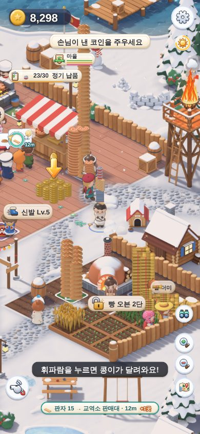 | **촌장님 후광** — 발밑의 오로라 고리, 몸 뒤 광채, 반짝이. 멀리 보면 머리 위에 별 핀 (`02b`, 줌 0.6) |
| 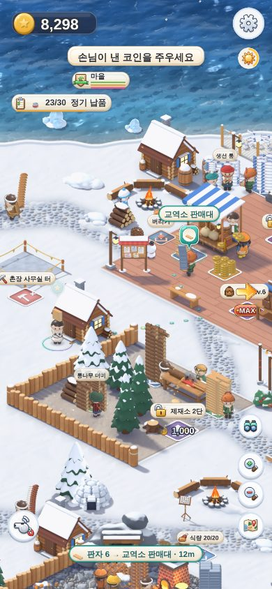 | **길 안내** — 판자를 들면 발밑 화살표, 걸어갈 점선, 아래 칩 `판자 6 → 교역소 판매대 · 12m` |
| 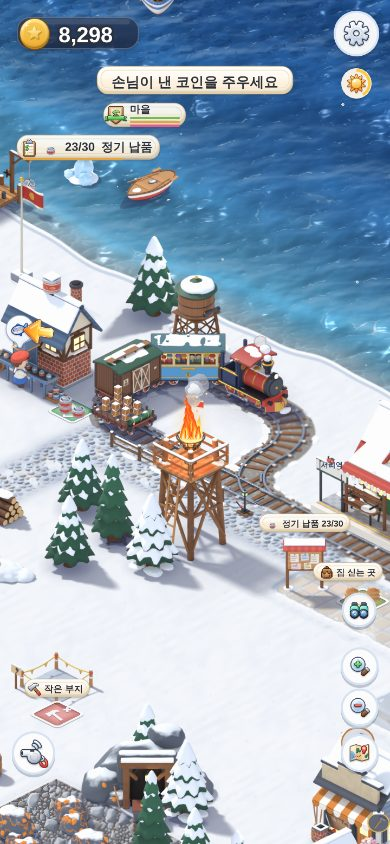 | **고리 선로** — 기관차가 앞장서서 바닷가 고리를 돌아요. 물탱크가 물을 붓고, 바퀴가 끼익 |
| 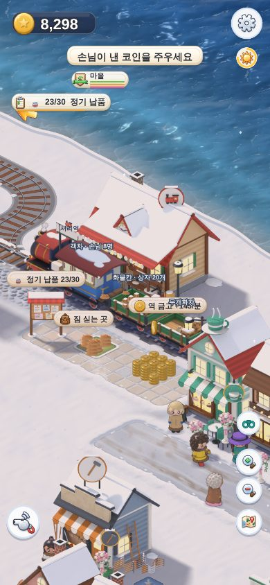 | **새 열차** — 기관차 + 객차 "솔방울호" + 화물칸(문이 열려요) + 무개화차(실은 상자가 보여요) |
| 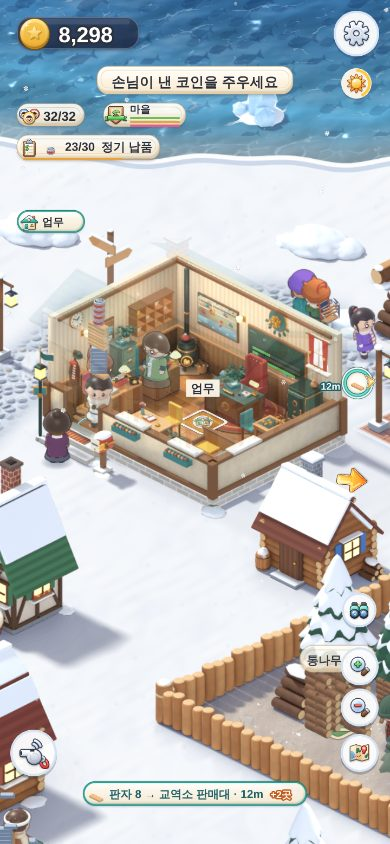 | **촌장 사무실 안** — 가까이 가면 지붕이 투명해져요. 셈이·소복이가 책상에서 쓰고 타자를 쳐요 (타자기 소리) |
| 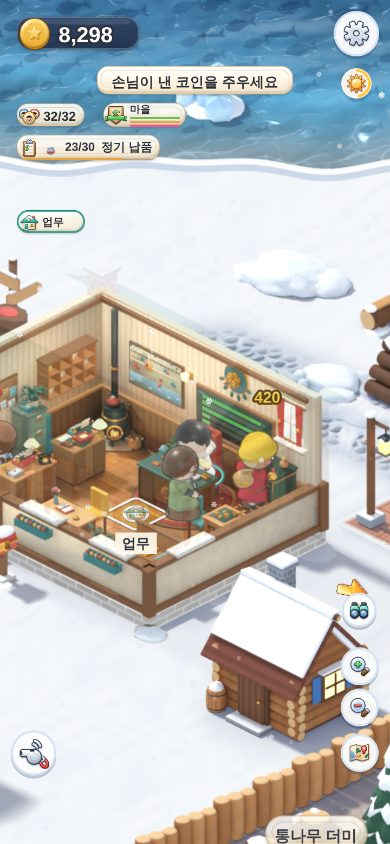 | **관망 모드의 촌장님** — 자기 책상에 앉아 쓰고 읽어요 (밤엔 졸아요) |
| 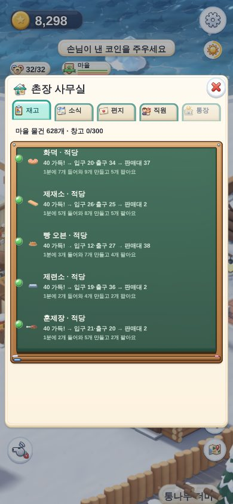 | **사무실 화면 · 재고** — 셈이의 칠판에 줄마다 상태 점과 흐름 |
| 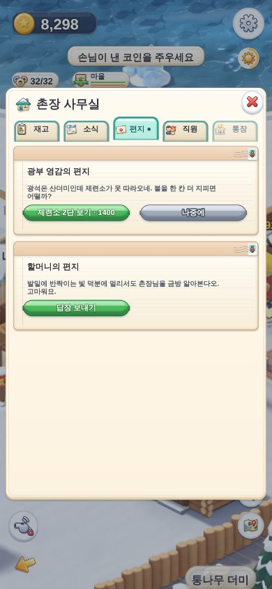 | **편지** — 편지지 그림, 답장 버튼 |
| 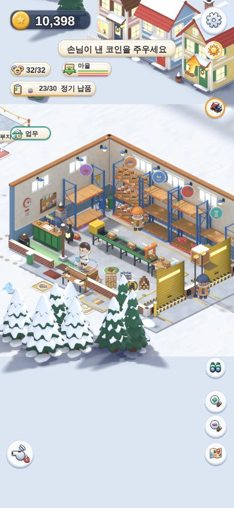 | **서리 물류창고** — 선반 칸마다 물건 (코드 2부터는 남는 원료도 칸의 절반까지) |
| 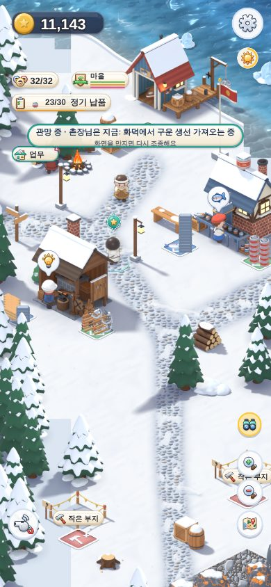 | **관망 모드** — 위에 "관망 중 · 촌장님은 지금: …" |

그 밖에: `01` 새로워진 것 카드, `04` 설정 › 놀이, `05b` 솔방울역 고리, `07` 화물 싣기, `08` 읍의 객차 2량, `09` 열차 카드,
`12` 소식, `14` 직원, `15` 통장, `16` 은행 금고, `18` 썰매.

**코드 2에서 찍은 사진을 보고 고친 것**
- 사무실 안 책상의 직원이 **건물 밑에 그려져서 안 보였어요** → 이제 의자 위에 보여요.
- 책상에 앉은 직원의 **머리가 비어 있었어요** (앉은 자세의 머리 그림을 안 불러왔어요) → 사무실 가까이 가면 함께 불러와요.
- 재고 칠판의 첫 줄이 **칠판 테두리에 가려졌어요** → 한 칸 내렸어요.

**아직 남은 것** (자세한 건 `docs/build_reports/v42_code2.md` §7)
- 솔방울역 쪽 고리를 도는 칸 끝이 지도 동쪽 끝(6144)을 32px 넘어가요. 화면은 6144에서 멈추니까 실제 게임에서는
  화면 가장자리에서 잘려 보여요. 고리를 한 칸 서쪽으로 옮기려면 선로 데칼을 다시 그려야 해요 (그림 쪽 일).
- 모아두는 곳 가득 (2.3장), 수입 +33% — 대표님이 골라 주실 것 (2.3장).
- 화면 메모리: 광장 +13 MiB · 역 +15 MiB (계획 +8 · +14). 모든 곳에서 한계(455 MiB) 아래예요 (가장 높은 곳 439, 리뷰 뒤 고친 판은 452 — 전에 못 불러오던 직원 머리·사무실 화면 그림을 이제 불러와요).

---

## 12. 코드 2 리뷰 뒤 고친 것 (2026-10-17)

리뷰 세 개(놀이 · 보이는 것 · 튼튼함)에서 나온 것을 먼저 그대로 재현해 보고 고쳤어요. 대표님 눈에 보이는 것만 적어요
(자세한 건 `docs/build_reports/v42_code2.md` §8).

**촌장님이 잘 보여요**
- 밤에 촌장님이 **하얗게 바래 보이던 것** → 촌장님 불빛을 발밑의 둥근 빛 웅덩이로 바꿨어요. 얼굴·옷 색이 그대로예요.
- 서리역에 선 **화물칸 뒤에 촌장님이 가려지면** 화물칸 위에 촌장님 모습이 옅게 비치고 별 표시가 떠요.
- 관망 중에 의자·책상에 앉을 때 **서 있는 그림으로 책상 속에 서 있던 것** → 앉는 그림을 늘 준비해 두고, 아직 안 왔으면 의자
  앞에 서 있어요.

**사무실 · 은행**
- 사무실·은행 **벽을 뚫고 들어가던 것** → 벽이 이제 빈틈없이 막아요. 문으로만 들어가요 (물류창고도 같아요).
- 재고 칠판 막대가 **칠판 아래로 내려가 있던 것** → 칠판 위에 바로 그려요.
- 은행 창구 직원 얼굴이 **유리 뒤에 가려 얼굴 없는 동그라미**로 보이던 것 → 얼굴은 유리 앞에, 몸은 창구 뒤에.
- 사무실에 다가가면 **안이 비어 있는 투명한 집**이 잠깐 보이던 것 → 안쪽 그림과 직원 그림이 다 오면 그때 지붕이 투명해져요.
- 직원 머리가 **비어 보이던 것**(메모리가 꽉 찼을 때) → 멀리 있는 동네 그림을 먼저 치우고 직원 그림을 불러와요.
- 처음부터 다시 시작했는데 **사무실 소리가 계속 나던 것** → 새 게임은 조용히 시작해요.
- 업무 발판 글씨가 **직원 머리 위에 떠 있던 것** → 발판 아래로.
- 딸랑이는 **아침 7시부터 밤 9시까지만** 돌아요 (새벽 2시에 입금하던 것). `balance.js` `v42.courier.from / to`.

**관망 모드** (5장 표도 고쳤어요)
- 밤 9시부터 아침 6시까지는 **밤이라 쉬어요** (새벽 3~4시에 주괴를 나르던 것). 급한 일만 깨워요.
- 하루에 한 번은 **기차 구경**, 10분 넘게 안 놀았으면 **콩이와 놀기**가 먼저예요.
- **짐을 들고 점심·저녁**을 하지 않아요 (먼저 갖다 놓아요).
- 두 손가락으로 **확대·축소해도 관망이 안 꺼져요**. 지도를 펼쳐 둔 동안엔 저절로 시작하지 않아요.

**길 안내** (1.3장에 자세히)
- 안내한 곳 자리를 **촌장님 몫으로 맡아 둬요** (걸어가는 동안 짐꾼이 채우지 않아요). 한 번 꽉 차서 떠난 곳으로는 15초 동안
  다시 안 가요. 멀리 있는 곳이나 짐 싣는 곳으로는 바꾸지 않아요.
- 원료를 25m 넘게 떨어진 짐 싣는 곳(수출)으로 보내지 않아요.
- 짐을 안내받아 나르는 동안 **지나가는 길의 다른 물건은 줍지 않아요** (멈추면 주워요).

**기차**
- 고리를 나오는 굽은 길에서 객차가 **기관차와 직각으로 보이던 것** → 붙은 칸끼리는 한 방향(45°)까지만 달라요.
- 망루 모닥불이 **지나가는 기차 위에 그려져** 기차에 불이 난 것처럼 보이던 것 → 망루와 함께 투명해져요.
- 주문 상자가 밀려 있어도 **남는 물건이 기차 한 번에 4분의 1(14칸)** 은 타요 (30분 동안 수출이 0이던 것). `v42.freight.surplusShare`.
- 승객이 **한 문으로만 타던 것** → 네 문으로 나눠 타고, 문 앞까지 걸어가서 사라져요.
- 열차 카드의 기관차가 **빨간 글씨 칸**이던 것 → 기관차 그림.

**화면**
- 영어 화면에서 탭 글씨가 그림과 겹치던 것, 편지 버튼 양 끝의 네모, 처음 연 사무실 화면이 크림색에서 칠판으로 바뀌던 것, 길 안내
  이름표가 멀리 볼 때 너무 크고 화면 끝에서 잘리던 것, 다시 불러올 때 위쪽 칩에 자물쇠가 잠깐 보이던 것 → 고쳤어요.
- 편지 버튼 숫자에 쉼표: `· 2,000`.

**그대로 둔 것 (대표님이 정하실 것)**
- **모아두는 곳이 자주 가득** (60분 중 93 %, 목표 50 % 이하): 원료가 쓰는 것보다 1분에 약 110개 더 들어오고, 짐꾼은
  1분에 30개쯤 날라요. 2.3장의 세 가지 중에서 골라 주세요 — 광석·고기 채집꾼 한 명씩 줄이기 / 원료 수레 업그레이드 /
  가득 찬 더미를 "채집꾼이 쉬는 것"으로 받아들이기. 짐꾼 가방 키우기는 정하신 대로 그대로예요.
- **수입 +33 %** (목표 +15~30 %): 수출·물류창고 값을 내려도 2점쯤밖에 안 바뀌어요. 값은 하나도 안 바꿨어요.
- **훈제 고기 판매대가 빈 시간 11 %** (목표 10 % 이하, 고치기 전 12 %): 처음 3분(저장할 때부터 비어 있음)을 빼면 8.5 %.
  훈제장에는 고기가 20개 넘게 쌓여 있고, 짐꾼이 27m를 걸어오는 동안 비어요. 다음 숫자 손볼 때 다시 봐요.
- 기차 수출은 733 → **830개**로 늘었어요 (주문 상자가 밀려 있어도 기차의 4분의 1은 남는 물건 몫).
- 관망 중 밤(21~6시)에는 쉬니까 30분 동안 버는 코인이 조금 줄었어요 (64,580 → 56,627). 그래도 화살표만 따라가는 봇의
  85 % (기준 80 % 이상)예요. 밤에도 일하게 하고 싶으시면 `balance.js`가 아니라 `agenda.js`의 저녁 점수(60)를 낮추면 돼요.
- **솔방울역 고리가 가게 줄 뒤로 지나가는 것**, 고리 끝이 지도 끝을 32px 넘는 것: 선로를 옮기려면 지도와 선로 그림을
  함께 바꿔야 해요 (그림 쪽 일, 11장).
- 사무실 그림 다듬기(다른 작업)가 끝나면 벽 위치와 책상 자리를 다시 맞춰요 (벽이 이제 실제로 막으니까 꼭 다시 봐야 해요).
- 화면 메모리: 사진 찍는 길에서 가장 높은 곳이 452 MiB예요 (물류창고 앞, 한계 455 아래, 여유가 3 MiB뿐). 기차 칸 그림을 선로 근처에서만 불러오게 하면 약 17 MiB
  줄일 수 있어요 (7장).

---

## 13. 손질: 큰 식당 자리 늘리기 · 서빙 고침 · 짐꾼 더 (2026-10-18, 마무리 2026-10-25)

대표님 말씀: "원자재가 빨리 안 줄어든다는 건 사갈 곳이 모자라거나, **나를 사람(짐꾼)이 모자라** 밀리는 것. 창고는 일찍
있어야 하고, 창고 직원은 **만드는 양에 맞춰** 늘어야 한다." 이번 손질은 그중 **나르는 쪽**과 **큰 식당**만 했어요.
사갈 곳(공장 · 가게 · 공사 현장 · 자재창고 늘리기)은 다음 판에서 따로 해요 (그 기획은 `docs/기획서_물류수요개편.md`).
자세한 숫자는 `docs/build_reports/v42_touch.md` 에 있어요.

> **10-25 마무리에서 더 고친 것** (지난주 작업이 사용 한도로 중간에 멈춰서, 마지막 코드로 처음부터 다시 쟀어요)
> - **진짜 큰 원인을 하나 더 찾았어요.** 게임을 **다시 불러오면**, 다 지은 건물 둘레에 **공사 때의 보이지 않는 벽**이 다시
>   생겼어요. 큰 식당은 땅이 커서 이 벽이 **테라스 절반**을 덮었어요. 서빙 직원은 그 벽에 막혀 7초씩 헤매다 포기하고,
>   손님은 자리까지 25초나 걸렸어요. 대표님 폰은 게임을 껐다 켤 때마다 이 상태였어요. → 다 지은 건물에는 이 벽이 다시
>   안 생겨요 (모든 건물이 같아요). 이제 서빙 직원은 **모든 자리**에 2초 안에 가고, 손님도 2~8초면 앉아요.
> - **테이블 늘리기 발판이 뜨는 때**: 서빙을 고치고 나니 자리가 모자라는 일이 거의 없어서, 예전 조건(줄이 자리를 1분 기다림)만으로는
>   발판을 보기 어려웠어요. 이제 **손님을 모두 150명 받으면**(2단계는 450명) 발판이 떠요. 배너도 "큰 식당에 손님이 많아요!" 로 바꿨어요.
> - 발판 자리를 새 식탁 자리 **조금 뒤**로 옮겼어요 (가로등이 가격 글씨를 가렸어요).
> - 창고 직원이 연달아 올 때 **큰 배너는 5분에 한 번**, 그 사이에 오는 직원은 작은 알림("창고 직원이 N명이 되었어요")만 떠요.
> - **줄 순서**: 줄에 먼저 도착한 손님이, 아직 걸어오는 중인 손님보다 앞에 서요. 계산대가 안 온 손님을 기다리지 않아서,
>   점심이 몰릴 때 1분에 받는 손님이 22명 → 31명으로 늘었어요.
> - **서빙 직원 2** 는 다시 재 보니 보통 때는 필요 없어요 (벽 때문에 막혔던 거였어요). 발판은 정말 막힐 때만 떠요 (13.4).
> - 창고 직원 일에서 드물게 나던 오류를 막았어요 (60분 시험에서 한 번 보였어요; 그 순간 마을 움직임이 한 번 건너뛰어졌어요).

### 13.1 먼저 재 봤어요 — 큰 식당이 왜 막혔나

대표님 사진처럼 테라스에 손님이 가득 앉아 음식만 기다리는 모습을 그대로 만들어 봤어요 (`30_restaurant_busy_before.jpg`).
v4.1 의 46분 저장, 촌장님은 식당에 없고, 식재료 칸은 꽉 채운 채 5분씩 쟀어요.

| 상태 | 1분에 먹은 손님 | 1분에 코인 | 그냥 간 손님 (1분) | 자리에서 음식 기다린 시간 |
|---|---|---|---|---|
| 직원 없음, 촌장님이 계산대 + 주방 | 13.2 | 326 | 0 | 1.3초 |
| 계산 점원 + 요리사, 촌장님 없음 | 0 | 0 | 6.0 | 70초 (모두 그냥 감) |
| **직원 셋 다, 촌장님 없음 (대표님 사진)** | **3.8** | **96** | **2.0** | **60초** |

- 직원이 셋 다 있는데도 1분에 4명도 못 먹었어요. 요리사는 17 % 만 일하고, 서빙 직원은 100 % 바빴어요.
- 원인: **음식이 식탁까지 못 갔어요.** 서빙 직원이 5번 중 3번은 식탁에 못 닿고 12초 헤매다 포기했어요. 자리가 모자란 게
  아니었어요. 지난주에는 식탁 4개가 딱 붙어서 길이 없는 줄 알았는데, 마무리에서 **진짜 큰 원인**을 찾았어요: 게임을
  **다시 불러오면** 다 지은 건물 둘레에 **공사 때의 보이지 않는 벽**(둥근 벽)이 다시 생겼어요. 큰 식당은 땅이 커서 이 벽이
  **테라스 절반**(자리 2 · 3 · 7번과 뒤뜰로 가는 길)을 덮었어요. 새로 시작한 게임에서는 이 벽이 안 생겨서 시험에서는 못
  봤어요. 대표님 폰은 게임을 켤 때마다 불러오니까 늘 이 상태였어요.
- 서빙 직원이 없을 때는 주문을 받아 놓고 음식이 영영 안 와서, 앉은 손님이 70초 뒤에 다 그냥 갔어요.

### 13.2 고친 것 — 서빙

- **보이지 않는 벽을 없앴어요.** 다 지은 건물에는 공사 때의 벽이 다시 안 생겨요 (큰 식당만이 아니라 모든 건물이 같아요;
  건물마다 자기 벽은 따로 있어요). 이제 서빙 직원은 16자리 **모두** 2초 안에 닿고, 손님도 2~8초면 앉아요 (전엔 7번 자리 26초).
- 서빙 직원이 **식탁 옆 빈 자리**를 찾아서 걸어가요 (식탁을 뚫고 가려다 막히지 않아요). 뒤뜰 식탁엔 테라스를 돌아서 가요.
- 한 번에 **두 접시**까지 들고 가요 (같은 쪽 식탁 두 곳). `serverCarry: 2`
- **주방에 아무도 없으면** (요리사·서빙 직원이 없고 촌장님도 주방 발판에 없으면) 주문이 3개 밀린 뒤에는 계산대가 새 주문을
  잠깐 안 받아요. 손님은 식탁이 아니라 **줄에서** 기다려요 (돈 안 내고 가는 손님이 줄어요). 주방 발판에
  `주문 3개 · 여기 서세요` 가 떠요. `holdTickets: 3`

결과 (같은 조건, 마지막 코드):

| 상태 | 1분에 먹은 손님 | 1분에 코인 | 그냥 간 손님 (1분) | 자리에서 음식 기다린 시간 | 서빙 직원이 바쁜 시간 |
|---|---|---|---|---|---|
| **직원 셋 다, 촌장님 없음 (대표님 사진)** | 3.8 → **12.0** | 96 → **281** | 2.0 → **0** | 60초 → **2.6초** | 100 % → 66 % |
| 직원 없음, 촌장님이 계산대 + 주방 (주방 발판 글씨대로) | 13.2 → 12.0 | 326 → 274 | 0 → 0 | 1.3초 → 1.0초 | – |
| 계산 점원, 촌장님 주방 | 12.0 → 12.4 | 322 → 291 | 0 → 0 | 0.9초 → 0.8초 | – |
| 계산 점원 + 요리사, 촌장님 없음 (서빙 직원 아직 없음) | 0 → 0 | 0 | 6.0 → **2.4** | 70초 | – |

- 줄이 꽉 찬 시간도 65 % → **0 %**. 이제 손님이 오는 만큼 다 먹고 가요 (8자리에 1분에 약 12명).
  (줄 순서까지 고친 마지막 코드로 한 번 더 재니: 1분에 12.0명, 자리에서 기다린 시간 1.7초, 그냥 간 손님 0. 코인은 그때그때
  정식을 시키는 손님 수에 따라 1분에 243 ~ 281이에요.)
- 서빙 직원이 없고 촌장님도 없으면 여전히 음식이 안 나가요 — 이건 그대로예요. 그래도 손님이 식탁 대신 **줄에서**
  기다려서 돈 안 내고 가는 손님이 6.0 → 2.4명으로 줄었어요. 촌장님이 주방 발판에 서면 바로 요리가 나가요.
- 줄 맨 앞 손님이 아직 걸어오는 중이면, 먼저 도착한 손님이 앞으로 와서 주문해요 (계산대가 안 온 손님을 기다리지 않게).

### 13.3 테이블 늘리기

- **언제** (둘 중 먼저 오는 때): ① 주방은 잘 도는데 **빈자리가 없어서** 줄 맨 앞 손님이 기다린 시간이 모두 **1분**이 될 때,
  ② 큰 식당이 손님을 **모두 150명** 받았을 때 (2단계는 **450명**, 처음부터 센 수). 그러면 식당 **뒤뜰**(화면 위쪽, 테라스 뒤)에
  「테이블 늘리기」 발판이 생겨요. 배너: "큰 식당에 손님이 많아요! — 식당 뒤뜰에 테이블을 늘릴 수 있어요".
  (46분 저장은 손님을 벌써 181명 받아서 들어가자마자 1단계 발판이 떠요.)
- **1단계 1,200 코인**: 식탁 2개(자리 4개) → 자리 12개. **2단계 2,000 코인** → 자리 16개. 그 위는 없어요.
- 발판은 새 식탁이 놓일 자리 바로 뒤에 생겨요 (가로등이 가격을 가리지 않게). 다 내면 식탁이 톡 튀어나오고, 등불 줄이 하나 더 걸려요. 원래 등 하나는 옆으로 비켜요.
  있던 그림(피크닉 식탁 · 등불 줄 · 가로등)만 써요.
- 손님은 테라스를 **돌아서** 뒤뜰 자리로 걸어가요 (순간이동 안 해요). 빈자리 **아무 데나** 앉아요. 다만 음식이 계산대 옆에서
  서빙 직원 수보다 많이 기다리면 새 손님은 테라스에 앉아요 (뒤뜰은 서빙 직원이 멀리 돌아가야 해서요 — 15.2).
- **솔직히 말씀드리면**: 서빙을 고친 뒤로는 보통 때 자리가 거의 안 모자라요. 평균으로 8자리 중 3.3개, 12자리 중 4.3개,
  16자리 중 4.7개만 차 있어요. 테이블을 늘리면 매출이 오르는 건 **자리가 늘면 손님이 더 많이 오기 때문**(아래 `seatsPull`)이에요.
  "식당이 커지면 손님이 늘어난다"로 두실지, 다른 효과(예: 정식 손님이 늘기)를 더할지 정해 주세요.
- 자리가 늘면 손님도 조금 더 와요: 16자리면 8자리일 때의 약 1.4배. `seatsPull: 0.5`
- 코인을 **조금만 내고** 떠나도, 다시 불러와도 낸 만큼 남아 있어요. 기다린 시간도 저장돼요.
- 관망 중의 촌장님은 이 발판에 돈을 안 써요 (원래 규칙: 관망은 돈을 안 써요).

### 13.4 서빙 직원 2 (다시 재 보니 보통 때는 필요 없어요)

- 지난주에는 16자리에 서빙 직원 1명이면 다시 막힌다고 쟀어요 (기다린 시간 26.6초). 그런데 그건 보이지 않는 벽 때문이었어요.
  벽을 없애고 다시 재니 **서빙 직원 1명이 16자리를 다 해내요** (바쁜 시간 86 %, 기다린 시간 3.4초, 그냥 간 손님 0).
  둘이면 기다린 시간만 2.2초로 줄고 먹은 손님 수는 같아요 (1분에 16.6명).
- 그래도 발판은 남겨 뒀어요. **정말 막힐 때만** 떠요: 뒤뜰 식탁이 생긴 뒤(1단계 이상), 서빙 직원이 나가 있는 동안
  **음식이 2접시 넘게** 기다린 시간이 모두 1분이 되면 식당 직원 자리에 「서빙 직원 2 고용」 발판 (**1,000 코인**).
  보통 때는 음식이 평균 0.5접시만 기다려서 거의 안 떠요. 기차 손님이 한꺼번에 몰리면 뜰 수 있어요.

| 식당 (직원 셋, 촌장님 없음) | 자리 | 1분에 먹은 손님 | 1분에 코인 | 그냥 간 손님 | 기다린 시간 (평균 / 느린 10 %) |
|---|---|---|---|---|---|
| 손질 전 | 8 | 3.8 | 96 | 2.0 | 60초 |
| 서빙 고친 뒤 | 8 | **12.0** | **281** | 0 | 2.6 / 5.2초 |
| 1단계 | 12 | **15.4** | **360** | 0 | 3.7 / 6.9초 |
| 2단계, 서빙 1명 | 16 | **16.6** (마지막 코드로 다시: 17.0) | **392** (407) | 0 | 3.4 / 6.6초 |
| 2단계 + 서빙 직원 2 | 16 | 16.6 | 382 | 0 | 2.2 / 4.1초 |

마을 전체로 보면: 늦은 마을 수입이 1분에 약 2,400 코인이라, 식당이 늘린 것은 0단계에서 **1분에 +185 코인 (약 +8 %)**,
2단계에서 **+296 코인 (약 +12 %)** 이에요. 너무 많으면 `civic.restaurant.dishMult`(음식 값 배율) 하나만 내리면 돼요.

### 13.5 짐꾼 2 를 더 많은 줄에

- 이제 **대장간(도구) · 통조림 공장 · 배 창고(생선)** 에도 짐꾼 2 가 있어요. 값 700 · 700 · 500.
- 발판이 **더 빨리** 생겨요: 출구가 80 % 넘게 찬 시간이 모두 **45초** (전 90초). 재 보니 바쁜 마을에서 출구가 80 % 넘게
  차 있는 시간이 20 ~ 60 % 라서, 90초면 발판이 4 ~ 7분 뒤에야 떴어요.
- 짐꾼이 **갈 곳 없는 짐**을 들고 발판에 서 있는 동안은 시간을 안 세요 (그땐 짐꾼을 더 불러도 소용없으니까).
- 짐꾼 2 발판은 다른 업그레이드 발판과 **따로 2개까지** 떠요 (전엔 가공소 2단 발판 셋에 밀려 안 보였어요).

### 13.6 창고 직원이 저절로 늘어요

- 마을이 1분에 만드는 것(모아두는 곳의 원료 + 가공소·공방의 물건 + 배가 잡은 생선)을 3분 평균으로 재요.
- **창고 직원 수 = 2 + (1분에 만드는 수 − 300) ÷ 70** (소수는 버려요), 최소 2명, **최대 6명**. 공짜예요.
  - 잰 값: 창고를 지은 35분 무렵 1분에 약 480개 → **4명**, 46분 뒤 바쁜 마을 약 590개 → **6명** (가장 많이). 직원이 늘어
    물건이 잘 빠지면 마을이 더 만들어요 (1분에 590 → 610 ~ 650개).
- 새 직원은 **마을 입구에서 걸어 들어와요** (화면 밖에서, 이주민처럼). 배너 "창고 직원이 한 명 더 왔어요 — 마을이 바빠져서
  창고 직원이 N명이 되었어요", 다음 날 서리 소식에 한 줄. 큰 배너는 **5분에 한 번**만 떠요: 그 사이에 또 오면 작은 알림
  "창고 직원이 N명이 되었어요" 만 떠요 (예전 저장을 열면 몇 명이 1분 간격으로 연달아 오니까요). `warehouse.crew.bannerGap`
- 한 번에 한 명씩, **1분 간격**. 한 번 온 직원은 **안 떠나요** (만드는 양이 줄어도 그대로).
- 예전 저장: 처음엔 저장에 있던 만큼 그대로, 그다음 마을이 만드는 양을 재서 늘어요 (줄지 않아요).

결과 (46분 저장에서 같은 봇으로 41분 동안, 손질 전과 비교 — 손질 뒤는 60분까지 돌려서 괄호에 60분 값):

| 46분 저장, 처음 41분 | 손질 전 | 손질 뒤 |
|---|---|---|
| 1분에 버는 코인 | 2,403 | **2,754** (+15 %, 그중 4분의 3이 큰 식당) (60분: 2,661) |
| 큰 식당 빼고 1분에 버는 코인 | 2,318 | 2,403 (+4 %) |
| 창고 직원 | 2명 | 1 · 2 · 3분에 한 명씩, 6분에 **6명** |
| 가공소·공방 출구가 80 % 넘게 찬 시간 — 빵집 · 대장간 · 제련소 · 생선구이 | 53 · 43 · 29 · 61 % | **19 · 20 · 20 · 43 %** (60분: 14 · 19 · 21 · 45 %) |
| 1분에 만든 것 (원료 + 물건) | 302 + 297 | 315 + 314 (+5 %) |
| 모아두는 곳(원료) 중 하나라도 가득한 시간 | 98 % | 95 % (60분: 94 %) |
| 기차로 수출한 남는 물건 | 466개 | 400개 (60분: 659개) |
| 큰 식당 — 1분에 먹은 손님 · 코인 · 그냥 간 손님 | 3.9 · 85 · 2.2 | **15.3 · 351 · 0** (봇이 8분에 1단계, 20분에 2단계를 샀어요) |

- 수출이 조금 줄어든 것은 큰 식당이 같은 음식(생선구이 · 빵 · 훈제고기)을 1분에 11접시쯤 더 쓰기 때문이에요. 식당은
  기차 수출보다 비싸게(한 접시 = 판매 가격의 1.3배, 정식 1.6배) 팔아요.

- **물건(빵·도구·통조림…)은 이제 잘 빠져요.** 출구에 쌓여 있던 시간이 크게 줄고, 그만큼 판매대·기차·창고로 가요.
- **원료(통나무·광석·고기…)는 여전히 가득해요.** 가공소가 더 쓰지 못해서예요 — 나르는 사람이 아니라 **쓸 곳(수요)** 이
  모자란 거예요. 대표님 말씀의 첫 번째 방법(공장·가게·공사 현장·자재창고 늘리기)이 다음 판의 일이에요.

### 13.7 저장

- 저장 판은 그대로 **v7** 이에요. 새 칸만 더했어요: 테이블 단계 · 줄이 기다린 시간 · 서빙 직원 2 · 창고 직원 수 · 새 세 줄의
  짐꾼 2 · 발판에 낸 코인. v4.1 · v4.2 저장은 그대로 열리고, 잃는 것이 없어요.
- 처음부터 하는 봇으로 **읍까지 걸린 시간**도 다시 쟀어요: 똑똑한 봇 47.3 → **45.0분**, 화살표만 따라가는 봇 51.5 → **48.3분**.
  손질 때문에 늦어지지 않았어요 (조금 빨라졌어요).

### 13.8 사진

`docs/previews/screens_v42/` (폰 390×844, 한국어). 31~33은 점심이 몰린 때를 일부러 만들어 찍었어요 (손님이 2.2~2.6초마다,
보통 때의 두 배쯤). 31·32는 낮, 33은 밤이에요. 30은 손질 전 코드로 찍은 거예요.

| 사진 | 보이는 것 |
|---|---|
|  | **손질 전** — 대표님 사진과 같은 모습. 테라스 8자리가 다 차서 음식을 기다리고, 줄이 길어요 |
| 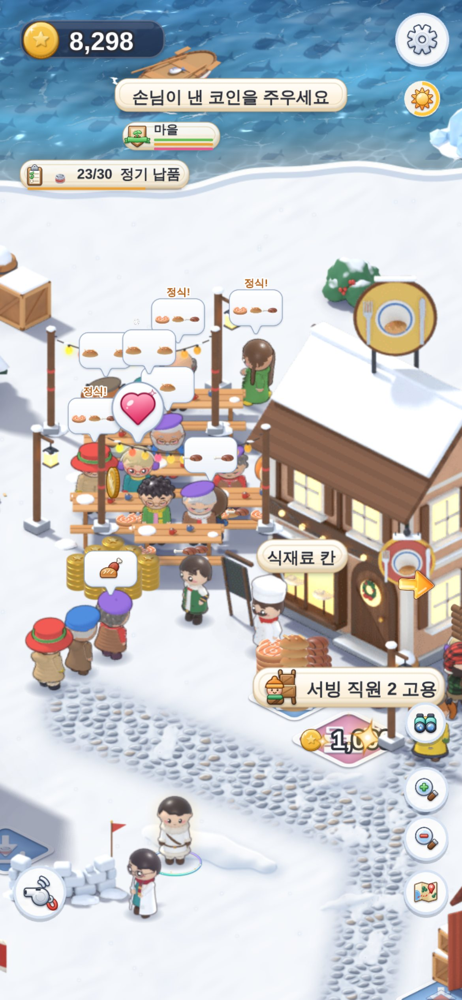 | **1단계 (낮)** — 테라스 뒤에 식탁 2개(자리 12개), 등불 줄 하나 더. 자리 12개 중 10개에 손님이 앉았어요. 이렇게 몰릴 때는 서빙 직원 혼자서는 접시가 밀려서 「서빙 직원 2 고용」(1,000) 발판이 떠요 (보통 때는 안 떠요) |
| 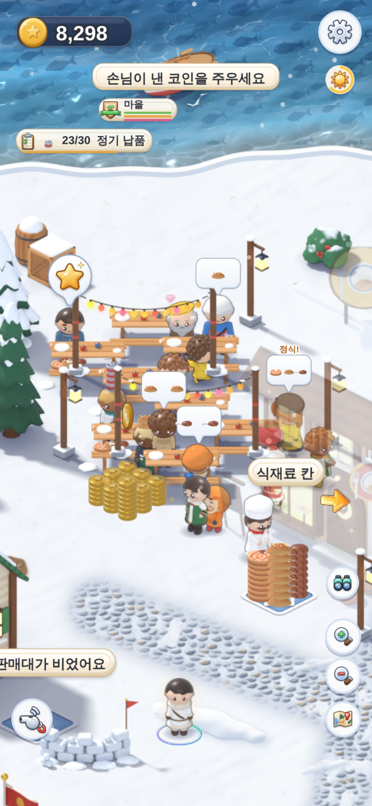 | **2단계 + 서빙 직원 2 (낮)** — 식탁 8개(자리 16개). 음식이 금방 나오고 금방 먹고 가서 자리는 남아요. 손님이 2초마다 올 때는 계산대 앞 줄이 차요 (계산대까지 한 칸씩 걸어 나오는 시간) |
| 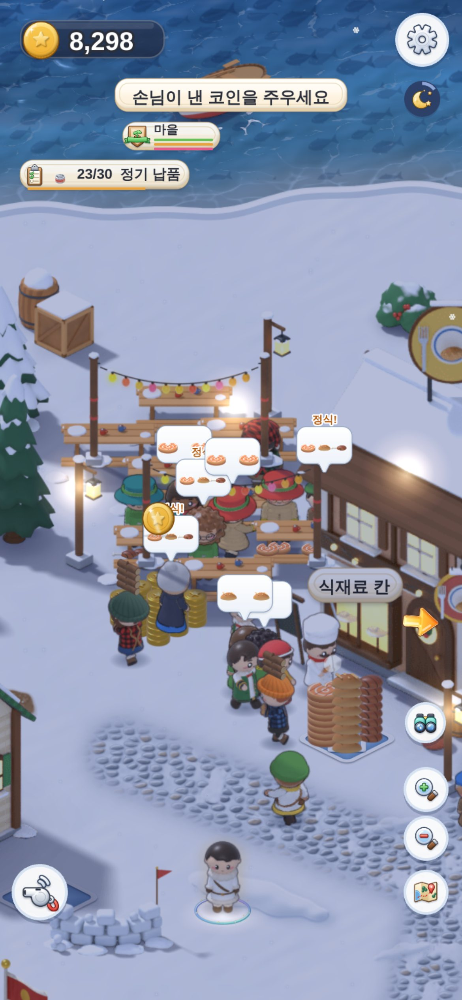 | **밤** — 등불 줄과 가로등 아래 뒤뜰 식탁에서 먹는 손님들 |
|  | **테이블 늘리기 발판** — 테라스 뒤, 새 식탁이 놓일 자리 바로 뒤 (1,200). 배너 "큰 식당에 손님이 많아요! — 식당 뒤뜰에 테이블을 늘릴 수 있어요". 가로등이 가격을 가리지 않아요 |
|  | **통조림 짐꾼 2 발판** — 통조림 공장 문 앞 (700). 배너 "통조림이 쌓여요 — 통조림 짐꾼 2를 부를 수 있어요" |
| 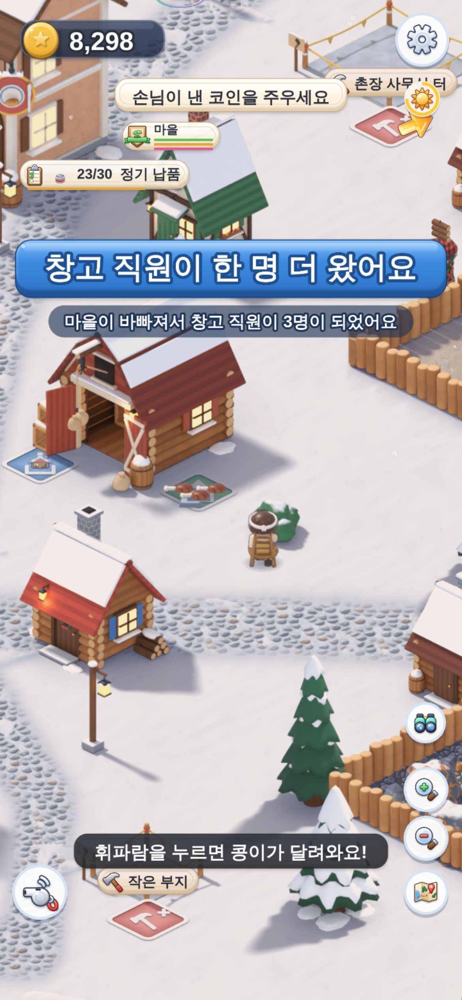 | **창고 직원이 걸어 들어와요** — 서쪽 길에서 창고(빨간 헛간)로. 배너 "창고 직원이 한 명 더 왔어요 — 마을이 바빠져서 창고 직원이 3명이 되었어요" |

### 13.9 숫자 표 (`balance.js`)

| 무엇 | 값 | 키 |
|---|---|---|
| 서빙 직원이 한 번에 나르는 주문 | 2 | `civic.restaurant.serverCarry` |
| 주방이 비었을 때 계산대가 멈추는 주문 수 | 3 | `civic.restaurant.holdTickets` |
| 테이블 늘리기 발판이 생기는 때 / 값 | 줄이 모두 60초 기다림, 또는 손님 모두 150명 · 450명 / 1,200 · 2,000 | `civic.restaurant.tables.offerS`, `meals`, `costs` |
| 자리 수에 따라 손님이 더 오는 정도 | 0.5 (0 이면 자리와 상관없이 같은 간격) | `civic.restaurant.seatsPull` |
| 서빙 직원 2 발판이 생기는 때 / 값 | 음식 2접시 넘게 모두 60초 / 1,000 | `civic.restaurant.server2.offerS`, `cost` |
| 뒤뜰에 앉히는 때 (15.2) | 기다리는 음식이 서빙 직원 한 명당 1접시 이하일 때만 (넘으면 테라스 먼저) | `civic.restaurant.backYardWait` |
| 짐꾼 2 발판이 생기는 때 | 출구 80 % 넘게 모두 45초 (전 90) | `v42.porter2.fullForS` |
| 짐꾼 2 (대장간 · 통조림 · 배 창고) | 700 · 700 · 500 | `v42.porter2.costs` |
| 창고 직원 | 300개부터, 70개마다 1명, 최대 6명, 3분 평균, 1분 간격 | `warehouse.crew.from`, `perMin`, `cap`, `window`, `every` |
| 창고 직원 큰 배너 사이 시간 | 300초 (그 사이엔 작은 알림) | `warehouse.crew.bannerGap` |

### 13.10 아직 남은 것

- **원료가 가득한 것은 그대로예요** (모아두는 곳 중 하나라도 가득한 시간 94~95 %). 가공소가 더 쓰지 못해서예요 — 나를
  사람이 아니라 **쓸 곳**이 모자라요. 공장·가게·공사 현장·자재창고를 늘리는 것은 다음 판(`docs/기획서_물류수요개편.md`)이에요.
- **보이지 않는 벽은 모든 건물에 있었어요** (게임을 다시 불러오면 생기던 것). 큰 식당 말고도 가게 앞 줄 자리 같은 곳이
  조금 좁았을 수 있어요. 이번에 같이 고쳐졌어요. 잡화점 · 선착장 고침과 합친 뒤 다시 잰 숫자는 14장에 있어요.
- **배 창고 짐꾼 2** 는 배 창고의 짐꾼(생선 짐꾼)이 있어야 떠요. 이제 생선 짐꾼은 나룻배와 함께 와요 (14.2) — 해결됐어요.
- **서빙 직원 2 발판은 거의 안 떠요** (보통 때는 필요 없어서). 기차 손님이 한꺼번에 몰릴 때만 떠요.
- 점심이 몰려서(손님이 2초마다) 자리 16개 + 서빙 둘이면, 다음 한계는 **계산대 앞에 줄이 한 칸씩 당겨 서는 시간**이에요
  (1분에 약 31명까지는 받아요). 보통 때(1분에 12~17명)는 상관없어요.
- 수출(기차로 보내는 남는 물건)이 41분 동안 조금 줄었어요(466 → 400개). 큰 식당이 같은 음식을 더 비싸게 쓰기 때문이에요.
- 예전 저장으로 들어가면 창고 직원이 처음 6분 동안 1분에 한 명씩 와서 6명이 돼요 (큰 배너 1번 + 작은 알림).
  많다 싶으면 `warehouse.crew.every`(지금 60초)를 늘리면 돼요.
- 창고가 서쪽 입구 가까이 있어서, 새 창고 직원이 걸어오는 길이 짧을 때가 있어요 (1~2초). 촌장님이 창고 앞에 있으면
  다른 입구에서 와요.
- 화면 오른쪽 끝에 식당이 있으면 「서빙 직원 2 고용」 글씨가 확대 버튼 밑에 걸릴 수 있어요 (화면을 조금 옮기면 보여요).
- 게임 파일(아티팩트)은 아직 다시 만들지 않았어요 (이번엔 만들지 말라는 지시). 새 그림은 없어서 메모리 · 파일 수는 그대로예요.

## 14. 대표님 폰에서 찾은 문제 3개 고침 + 하나로 합쳐서 다시 잰 것 (2026-10-26)

대표님이 폰(APK v4.2)으로 해 보시고 알려 주신 세 가지를 고쳤어요. 지난주에 하나씩 따로 고쳐 둔 것을, 이번에 13장
손질(큰 식당 · 짐꾼)과 **하나로 합쳤어요**. 합친 코드로 시험과 봇을 처음부터 다시 돌렸어요.

| 대표님 말씀 | 진짜 원인 | 고친 것 |
|---|---|---|
| "잡화점 판매원있는데 판매를 안해 사람들도 거기로 못가는건지" | ① **판매대가 비어** 있었어요 (팔 물건이 없어서 점원이 서 있기만 했어요). ② 줄 자리 몇 칸이 **소나무·안개 속**이라 손님이 못 갔어요 | 줄이 소나무를 **돌아서** 서요 · 손님 앞 소나무가 **반투명** · 대장간이 도구를 **한 종류씩 몰아** 만들어요 · '**판매대가 비었어요**' 표시 |
| "위에 어선은 있는 선착장은 짐꾼이 없는건가 여기 생선이 그대로야" | **생선 짐꾼**은 600코인짜리 따로 사는 발판이었는데, 화살표가 한 번도 안 가리켰어요 | **나룻배를 사면 생선 짐꾼이 함께 와요** (예전 저장에도 생기고, 그 발판에 낸 돈은 돌려줘요) |
| "마을회관 오늘의 부탁 … 통조림 내가 가져다 줘도 안 들어가지네" | 부탁(정기 납품)은 **서리역 '짐 싣는 곳'** 에 놓아야 채워져요. 게시판에 그게 **안 쓰여** 있었어요 | 부탁마다 **'→ 가져갈 곳'** 이 쓰이고, **누르면 그곳까지 길 안내** |

### 14.1 잡화점 — "판매원이 있는데 안 팔아요"

**왜 그랬나요** (46분 저장, 8분 동안 잰 것)

- **판매대가 비어 있었어요.** 판매대가 텅 빈 시간이 56 %, 맨 앞 손님이 빈 판매대 앞에서 기다린 시간이 77 %. 점원은 팔
  물건이 없어서 서 있기만 했어요. 판매원이 안 판 게 아니에요.
  - 도구: 대장간이 도구 5가지를 **번갈아** 만들어서, 도구 짐꾼(한 번에 한 종류만 날라요)이 한 번에 **3개**씩만 날랐어요.
    도구 칸은 85 % 의 시간 동안 비어 있었어요.
  - 통조림: 46분 저장에서는 통조림 짐꾼 한 명이 다 못 날랐어요 (1분에 만든 것 21.8개, 나른 것 15.3개). 더 어린 마을에서는
    **생선이 모자라서** 통조림 공장이 놀았어요 (생선을 기다린 시간 79 ~ 87 %).
  - 대표님 폰처럼 **생선 짐꾼이 없으면** (14.2) 부두 생선이 공장까지 하나도 안 와서, 판매대가 89 % 비어 있었어요.
- **줄 자리가 막혀 있었어요.** 줄 자리 6칸 중 몇 칸이 소나무나 안개 속이었어요: w_m2(46분 저장의 잡화점 자리) **3칸**,
  e_m1 **2칸**, e_m2 **1칸**. 그 칸으로 간 손님은 제자리걸음만 해서, 줄이 짧고 막혀 보였어요.
- **손님이 안 보였어요.** 국경 소나무가 줄을 가렸어요 (w_m2 · s_l1 · e_m1 · se_m1 · se_l1). 잡화점 손님은 소나무가
  투명해지는 대상이 아니었어요.

**고친 것**

- 줄이 막힌 칸을 **돌아서** 서요. 6칸 그대로예요 (3칸으로 줄여 보니 오는 손님이 줄어서 6칸으로 뒀어요).
- 잡화점 손님(줄 · 나가는 길) 앞의 소나무가 **반투명**해져요.
- 대장간이 잡화점에 줄 도구를 **한 종류씩 몰아서** 만들어요 (도끼 여러 개 → 곡괭이 여러 개 …). 도구 짐꾼이 **꽉 채워서**
  날라요 (한 번에 3개 → 7 ~ 9개).
- 손님이 빈 판매대 앞에서 **4초** 기다리면 판매대 위에 **'판매대가 비었어요'** 가 떠요. 물건이 오면 사라져요.
  `customers.emptyCueS: 4`
- 통조림 짐꾼을 더 두지는 않았어요. 13.5의 **통조림 짐꾼 2** 가 그 일을 해요.

**고친 뒤** (같은 46분 저장, 8분 동안, 촌장님은 멀리 세워 두고 잰 것)

| | 1분에 산 손님 | 1분에 코인 | 판매대가 텅 빈 시간 | 맨 앞 손님이 빈 판매대 앞에서 기다린 시간 | 도구 짐꾼이 한 번에 나른 도구 |
|---|---|---|---|---|---|
| v4.2 (대표님 폰) | 8.6명 | 402 | 56 % | 77 % | 3.0개 |
| 잡화점 고침만 (합치기 전) | 9.6명 | 557 | 50 % | 71 % | 9.0개 |
| **하나로 합친 지금** | **11.3명** | **619** | **45 %** | **65 %** | **8.3개** |
| 생선 짐꾼이 없던 저장 (대표님 폰과 같은 경우): v4.2 | 4.0명 | 249 | 89 % | 93 % | 3.1개 |
| 생선 짐꾼이 없던 저장: 하나로 합친 지금 (불러오면 생선 짐꾼이 생겨요) | **10.3명** | **525** | 48 % | 69 % | 6.8개 |

- **합칠 때 하나 부딪혔어요.** 13장의 **창고 직원**(마을이 바빠지면 6명까지 늘어요)이 대장간 출구에 도구가 60 % 쯤 쌓이면
  창고로 가져가 버려서, 도구 짐꾼이 한 번에 4.8개밖에 못 날랐어요 (잡화점 1분에 463코인). 그래서 **대장간 출구는 도구 짐꾼
  몫으로 남겨 두고**, 출구가 꽉 차서 대장간이 멈출 때만 창고 직원이 가져가게 했어요 → 다시 한 번에 8.3개, 1분에 619코인.
  다른 가공소 출구는 13장 그대로예요 (60 % 차면 창고 직원이 가져가요).
- 46분 저장에서 통조림 짐꾼 2 · 도구 짐꾼 2 까지 사도 거의 같아요 (1분에 591코인, 8분짜리 한 번이라 ±5 % 는 흔들려요).
  창고 직원이 통조림을 판매대로 바로 날라 주기 때문이에요 (8분에 40개).
- 그래도 판매대가 텅 빈 시간이 아직 45 % 예요. 손님이 1분에 10명쯤 와서, 들어오는 만큼 금방 팔려요. 더 줄이려면 대장간 ·
  통조림 공장이 **더 많이 만들어야** 해요 (생선 · 주괴 · 판자) — 다음 판(물류 · 수요 개편)의 일이에요.

### 14.2 선착장 — "생선이 그대로야"

- **왜**: 생선 짐꾼(배가 잡은 생선을 통조림 공장 · 생선구이로 나르는 사람)은 **600코인짜리 따로 사는 발판**이었어요.
  화살표가 한 번도 이 발판을 안 가리켜서, 사는 줄 모르고 지나가기 쉬웠어요. 그러면 배 창고 앞 생선 칸이 30개로 꽉 차고,
  배는 생선을 못 내려서 부두에서 기다리고, 생선은 그대로 있어요.
- **고친 것**: **나룻배를 사면 생선 짐꾼이 함께 와요.** 발판은 없어요.
  - 배너: "나룻배 출항! — 생선 짐꾼도 함께 와서 잡은 생선을 날라요". 건물 고르기 화면의 배 창고 설명: "배를 사면 생선 짐꾼도 함께 와요".
  - **예전 저장**(배는 있는데 생선 짐꾼이 없는 저장)을 열면 생선 짐꾼이 바로 생겨요. 그 발판에 **조금 낸 돈이 있으면 돌려줘요**
    (한 번만; 다시 열어도 또 주지 않아요).
  - `costs.porter_dock`(600) 은 이제 쓰지 않아요.

**고친 뒤** (46분 저장에서 생선 짐꾼만 뺀 저장, 6분 동안, 30초마다 잰 것; 생선 칸은 30칸)

| | 부두 생선 칸 (평균 / 가장 많을 때) | 90 % 넘게 찬 시간 | 통조림 공장까지 간 생선 | 배가 생선을 못 내리고 기다린 시간 |
|---|---|---|---|---|
| v4.2 (대표님 폰) | 20.5 / 30개 | 32 % | 0개 | 11 % |
| **하나로 합친 지금** | **0.8 / 5개** | **0 %** | **51개** | **4 %** |

- 처음부터 하는 봇도 이제 나룻배를 사는 순간(29분쯤) 생선 짐꾼이 함께 와요 (전에는 600코인을 따로 냈어요).

### 14.3 마을회관 게시판 — "통조림을 가져다 줘도 안 들어가요"

- **왜**: 게시판의 **오늘의 부탁**은 마을이 지금 필요한 것을 **알려 주는 곳**이에요. 마을회관이 물건을 받지는 않아요.
  "정기 납품: 통조림 23/30" 은 **서리역 앞 '짐 싣는 곳'** 에 통조림을 놓아야 채워져요 (솔방울 주문판과 같은 주문). 그런데
  게시판에 **어디로 가져가는지가 안 쓰여** 있었어요. 통조림을 들고 있을 때의 길 안내는 (지금도) 잡화점 판매대를 먼저
  가리켜요 — 잡화점도 통조림을 받는 곳이니까요. 그래서 게시판에서 부탁을 누르면 그 부탁의 곳으로 안내가 바뀌게 했어요.
- **고친 것**:
  - 부탁마다 **가져갈 곳**이 한 줄 더 쓰여요. 예: `정기 납품: 통조림 23/30` 아래에 `→ 서리역 짐 싣는 곳`.
  - 부탁 오른쪽에 **[길 안내]** 표시. 부탁을 **누르면** 게시판이 닫히고 그곳까지 **길 안내**가 시작돼요 (손이 비어 있어도).
    아래 칩: `→ 서리역 짐 싣는 곳 · 87m`.
  - 안내가 끝나는 때: 도착하면 ("서리역 짐 싣는 곳에 왔어요"), 부탁이 다 채워지면 (다른 짐꾼이 채워도), 아래 칩을 **꾹 누르면**,
    **4분**이 지나면 (`v42.nav.pinMaxS: 240`, 도착 거리 `pinArrivePx: 90`).

| 게시판 부탁 | 가져갈 곳 (길 안내가 가는 곳) |
|---|---|
| 솔방울 주문 / 정기 납품 (`{가게}: {물건} 23/30`) | **서리역 짐 싣는 곳** |
| 큰 식당에 ○○이(가) 떨어져 가요 | **큰 식당 식재료 칸** |
| 집을 기다리는 주민 ○명 | **빈 부지 (집 짓기)** — 집을 지을 수 있는 가장 가까운 빈 부지 |
| 광부들이 배가 고파요 | **광부 식량 상자** |

- **마을회관이 직접 받게 하지 않은 이유**: 받는 곳이 두 군데면 헷갈리고, 마을회관에 쌓인 물건을 역까지 옮길 짐꾼이 또
  있어야 해요. 그 짐꾼이 없으면 물건이 마을회관에 그냥 쌓여서 "안 들어가네" 가 다른 모양으로 또 생겨요. 그래서 **받는 곳은
  하나 그대로 두고, 어디인지 알려 주고 데려다 주는** 쪽으로 고쳤어요.
- 자세한 설명: `docs/기획서_v4_2_마을회관.md`.

### 14.4 마을회관은 레벨이 오르나요? — 아니요, 마을이 올라요 (승격식)

- **마을회관 자체는 레벨이 없어요.** 한 번 지으면 그대로예요 (세금 상자, 게시판, 집 자리 +6, 행복 +8).
- 대신 **마을 등급**이 올라요: **서리마을 → 서리읍**. 마을회관 앞 **승격식 발판**에서 올려요. 아래 조건을 다 채우면
  발판에 코인을 내고 승격식을 해요.

| 승격식 조건 (마을 → 읍) | 값 | `balance.js` |
|---|---|---|
| 주민 | 45명 | `v4.rank[2].people` |
| 연 가게 (역 앞) | 5곳 | `v4.rank[2].shops` |
| 행복 | 80 | `v4.rank[2].happy` |
| 승격식 비용 | 11,000 코인 | `v4.rank[2].coins` |

- 왼쪽 위 **등급 칩**(마을 + 막대 3개)을 누르면 지금 몇이 찼는지 보여요. 승격식이 지금 목표일 때는 게시판의 마을 소식에도 "승격식 준비 11,000" 이 보여요 (다른 목표가 먼저일 때는 안 보여요).

### 14.5 하나로 합친 뒤 다시 잰 것

**늦은 마을** (46분 저장에서 같은 봇으로 60분 — 13.6 과 같은 방법. "13장 손질 뒤" 는 13장 마무리 코드, "합친 지금" 은 지금 코드)

| 46분 저장, 60분 | 13장 손질 뒤 | **하나로 합친 지금** |
|---|---|---|
| 1분에 버는 코인 | 2,661 | **2,878** (+8 %) |
| 큰 식당 — 1분에 먹은 손님 · 코인 · 그냥 간 손님 | 15.6명 · 357 · 0 | 16.8명 · 363 · 0 |
| 잡화점 — 1분에 산 손님 · 코인 | (그때는 안 쟀어요) | **10.7명 · 567** |
| 잡화점 판매대가 텅 빈 시간 | (그때는 안 쟀어요) | 49 % |
| 부두 생선 칸 (평균 · 90 % 넘게 찬 시간) | 1.9개 · 0 % | 1.6개 · 0 % |
| 가공소·공방 출구가 80 % 넘게 찬 시간 — 빵집 · 대장간 · 제련소 · 생선구이 | 14 · 19 · 21 · 45 % | 8 · **2** · 15 · 48 % |
| 1분에 만든 것 (원료 + 물건) | 317 + 313 | 327 + 323 |
| 창고 직원 | 2 → 6명 | 2 → 6명 |
| 기차로 수출한 남는 물건 | 659개 | 828개 |
| 오류 | 1번 (13장 마무리에서 막은 것) | **0번** |

- 대장간 출구가 거의 안 차요 (19 → 2 %): 도구를 한 종류씩 몰아서 만들고, 도구 짐꾼이 가득 날라요.
- 이 46분 저장에는 생선 짐꾼이 원래 있어서 부두 숫자는 거의 같아요. (14.2 의 표는 생선 짐꾼을 뺀 저장 — 대표님 폰과 같은 경우 — 로 잰 거예요.)
- **큰 식당 (13장)**: 합친 뒤에도 그대로예요. 식당 시험 51개 모두 통과, 늦은 마을에서 1분에 16.8명, 그냥 간 손님 0.
- **짐꾼 (13장)**: 짐꾼 2 · 창고 직원 시험 21개 모두 통과. **배 창고 짐꾼 2** 는 이제 생선 짐꾼이 늘 있어서 뜰 수 있어요
  (다만 생선이 잘 빠져서 거의 안 떠요).

**처음부터 하는 봇** (새 게임에서 **읍**이 될 때까지 걸린 시간, 분)

| 봇 | v4.2 처음 | 13장 손질 뒤 | **하나로 합친 지금** |
|---|---|---|---|
| 똑똑한 봇 | 47.3 | 45.0 | **44.7** |
| 화살표만 따라가는 봇 | 51.5 | 48.3 | **47.7** |

멈춘 곳 0, 오류 0. 사무실 · 은행 · 물류창고도 조금 빨리 지어요 (똑똑한 봇 50.5 · 52.1 · 56.1분, 전 51.9 · 53.2 · 57.6분).

**저장**: 저장 판은 그대로 **v7** 이고 새 칸은 없어요. v4.1 · v4.2 저장이 그대로 열리고, 잃는 것이 없어요.

**시험**: 새 시험 3개(잡화점 13개 · 생선 짐꾼 11개 · 게시판 21개 검사)와 원래 시험 40여 가지를 합친 코드로 다시
돌렸어요. 모두 통과예요. 다만 둘은 기계가 바쁠 때 흔들려요: ① 비서 총총이가 촌장님을 300 px 안에서 따라오는지 보는 검사가
한 번 321 px 였다가, 다시 돌리니 통과했어요. ② 처음 5분 동안 내려받는 파일을 v4.1 과 견주는 검사는 두 번 다 **순서만**
달랐어요 (빠진 파일은 없고, 새 파일은 v4.2 때부터 있던 하나뿐이에요). 자세한 표는 `docs/build_reports/v42_touch.md` 11장에 있어요.

### 14.6 사진

`docs/previews/screens_v42/` (폰 390×844, 한국어). 합친 코드로 찍었어요.

| 사진 | 보이는 것 |
|---|---|
| 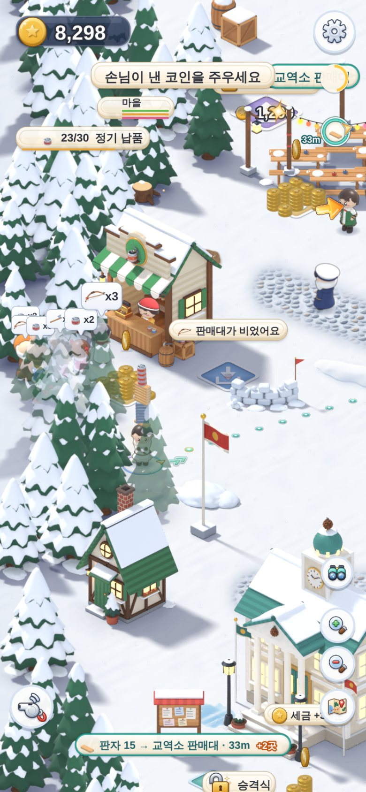 | **잡화점** (46분 저장, w_m2 자리) — 줄이 소나무를 돌아서 서고, 손님 앞 소나무가 반투명해서 손님과 말풍선이 보여요. 판매대가 비어서 위에 '판매대가 비었어요' |
|  | **나룻배를 산 순간** — 배너 "나룻배 출항! — 생선 짐꾼도 함께 와서 잡은 생선을 날라요". 생선 짐꾼은 배 창고 생선 칸 옆(화면 왼쪽)에 생겨요. 600코인 발판은 없어요 |
| 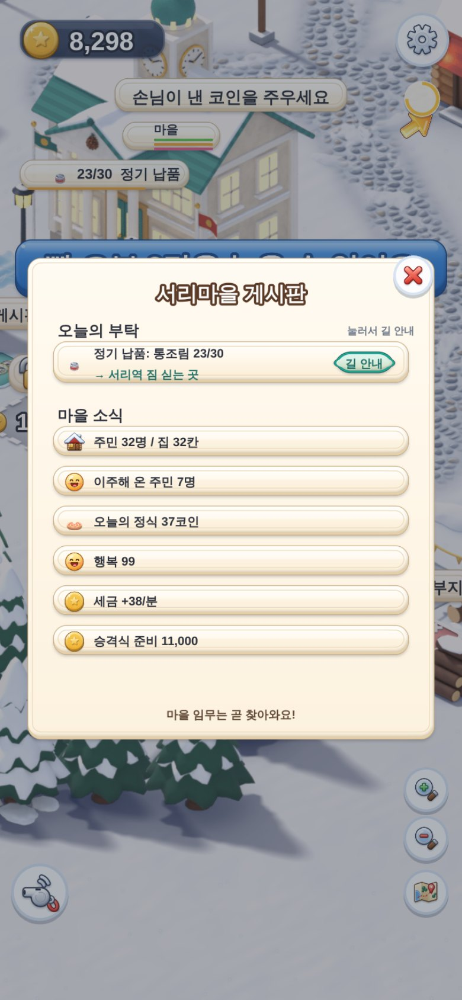 | **마을 게시판** — `정기 납품: 통조림 23/30` 아래 `→ 서리역 짐 싣는 곳`, 오른쪽에 [길 안내], 위에 "눌러서 길 안내" |
| 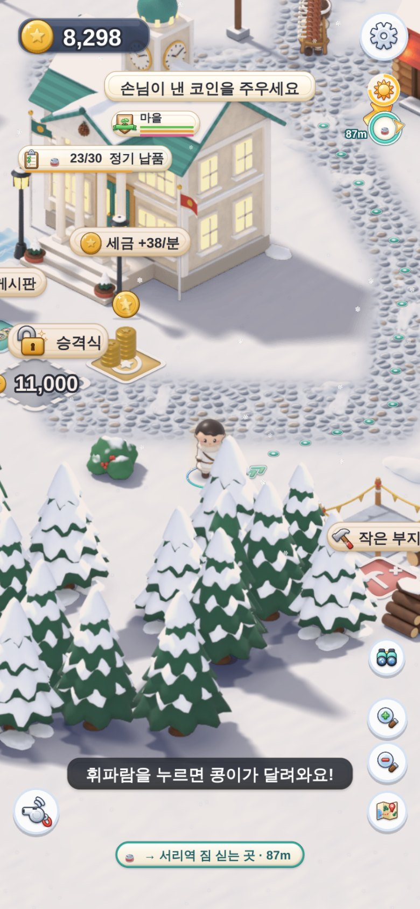 | **부탁을 누른 뒤** — 게시판이 닫히고 길 안내(점선 · 화살표), 아래 칩 `→ 서리역 짐 싣는 곳 · 87m`. 손이 비어 있어도 안내해요 |

(37 ~ 40 은 폰 화면의 2배 크기(780×1688)예요. 31 ~ 36 은 3배예요.)

### 14.7 숫자 표 (`balance.js`)

| 무엇 | 값 | 키 |
|---|---|---|
| '판매대가 비었어요' 가 뜨기까지 손님이 기다린 시간 | 4초 (0 이면 바로) | `customers.emptyCueS` |
| 게시판 길 안내가 저절로 끝나는 시간 / 도착 거리 | 240초 / 90 | `v42.nav.pinMaxS`, `v42.nav.pinArrivePx` |
| 생선 짐꾼 값 | (이제 쓰지 않아요: 나룻배와 함께 와요) | `costs.porter_dock` |
| 창고 직원이 가공소 출구를 창고로 가져가는 때 | 60 % 찼을 때 (대장간은 꽉 차서 멈출 때만 — 14.1) | `warehouse.overflowAt` |
| 승격식 (마을 → 읍) | 주민 45 · 가게 5 · 행복 80 · 11,000 코인 | `v4.rank` |

### 14.8 아직 남은 것

- **잡화점 판매대는 아직 반쯤 비어 있어요** (45 %). 나르는 쪽은 이제 따라가요; 더 팔려면 더 만들어야 해요. 어린 마을(38 ~ 45분)은
  **생선이 모자라서** 통조림 공장이 놀아요 (생선을 기다린 시간 79 ~ 87 %). 고기잡이를 늘릴지는 대표님이 정해 주세요.
- 마을회관은 물건을 **받지 않아요** (14.3). 게시판은 알려 주고 데려다 줘요. 마을회관이 직접 받게 하고 싶으시면 말씀해 주세요
  (그러면 마을회관 → 서리역으로 나르는 짐꾼이 하나 더 있어야 해요).
- 게시판 길 안내는 **배우는 동안(튜토리얼)** 과 **관망 중**에는 안 보여요 (원래 길 안내 규칙과 같아요).
- 생선 짐꾼 값(600)은 이제 받지 않아요 — 나룻배 값(700, `boats.rowboat.coins`)에 들어간 셈이에요. 받고 싶으시면 나룻배 값을 올리면 돼요.
- 13.10 의 나머지는 그대로예요.

## 15. 마지막 검토에서 나온 것 고침 (2026-10-26)

합친 코드를 두 번 꼼꼼히 다시 봤어요(놀이 검토 · 튼튼함 검토). 거기서 나온 것을 모두 고쳤어요. 저장은 그대로 v7,
새 그림은 없어요.

### 15.1 큰 것 — 잡화점을 e_m1 땅에 지으면, 다시 켰을 때 줄 끝 두 자리가 울타리 안에 생겼어요

- **원인**: 게임을 다시 켤 때, 잡화점 줄 자리를 **농장 울타리가 생기기 전에** 정했어요. 그래서 e_m1 땅(농장 옆)에서는
  5번째 · 6번째 자리가 울타리 안이었고, 그 손님 둘이 제자리걸음만 했어요. 처음 지을 때는 괜찮고, **다시 켤 때마다** 그랬어요.
- **고침**: 땅이 열릴 때, 게임을 다 불러온 뒤, 옆에 건물이 다 지어질 때 줄 자리를 **다시 정해요**. 줄에 선 손님은 새 자리로 걸어가요.
- **확인**: e_m1 에 잡화점이 있는 저장을 불러오면 6자리가 모두 설 수 있는 곳이고, 손님 6명이 다 자리에 와요 (사진 44).

### 15.2 보통 것

| 무엇이 이상했나 | 고친 것 |
|---|---|
| **테이블 늘리기로 산 뒤뜰 테이블에 아무도 안 앉았어요** (빈자리 중 맨 앞 테라스부터 앉았는데, 테라스가 꽉 찬 적이 없었어요) | 손님이 **빈자리 아무 데나** 앉아요. 이제 뒤뜰도 써요 (사진 43). 다만 음식이 계산대 옆에 서빙 직원 수보다 많이 기다리면 새 손님은 **테라스 먼저** 앉아요 — 그냥 아무 데나 앉히니 2단계에서 서빙 직원 1명일 때 음식이 6접시나 밀렸어요. 이 규칙으로 2단계가 1분에 16.1 → 17.8명을 받아요 (`backYardWait`) |
| **가방에 통조림을 들면 길 안내가 잡화점으로만** 갔어요. 게시판은 서리역 짐 싣는 곳으로 가져오라는데요. 위쪽 '정기 납품' 칩을 눌러 나오는 주문판에는 길 안내가 없었어요 | 주문이 그 물건을 원하면 길 안내에 **서리역 짐 싣는 곳**도 나와요. 게시판이나 주문판에서 그 주문을 누른 뒤에는 **그곳이 먼저**예요 (아니면 칩의 '+1곳'으로 보여요). 주문판 카드마다 **[길 안내]** 가 생겼어요 (사진 41 · 42) |
| **잡화점 판매대가 아직 자주 비어요** | 새 손님은 **판매대에 있거나 오고 있는 물건**을 사러 와요 (없는 활을 달라고 서 있는 일이 줄어요). 물건 자체가 모자란 건 15.4 를 보세요 |
| 테이블 늘리기를 사면 **가로등이 뒤뜰 의자 위에** 섰어요 (손님 몸을 뚫고). 밤 불빛과 반투명 칸도 옛 자리에 남았어요 | 가로등을 뒤뜰 **구석**(의자에서 77 이상 떨어진 곳)으로 옮기고, 불빛 · 반투명 칸도 같이 옮겨요 |
| **뒤뜰로 가는 손님과 서빙 직원이 식당 건물 뒤에 가려졌어요** | 그 사람들이 건물 뒤에 있으면 **건물이 반투명**해져요 |
| 저장을 불러온 첫 1초에 **알림(배너) 2 ~ 3개가 한꺼번에** 떠서 마지막 것만 보였어요 ('큰 식당에 손님이 많아요!' 는 늘 가려졌어요) | 알림이 **하나씩 차례로** 떠요 |

### 15.3 작은 것

- 관망 중에는 게시판 길 안내 시간이 **멈춰요**. 관망 중에 부탁이 다 채워져서 끝나면, 다시 조종할 때 '부탁을 다 채웠어요' 라고 알려 줘요.
- '판매대가 비었어요' 표시의 그림이 **기다리는 손님이 원하는 물건**이에요 (늘 통조림이던 것).
- 관망 중에는 '지나가다 주웠어요' 같은 **한 번만 나오는 도움말**과 '가득 찼어요!' 를 띄우지 않아요 (대표님이 못 보고 지나가지 않게).
- 테이블 늘리기 발판을 **테이블 한 칸 더 바깥**으로, 서빙 직원 2 발판을 **가로등에서 반 걸음 비켜** 놓았어요 (값이 가려지던 것).
- 창고 직원 둘이 **같은 자리에 겹쳐** 서던 것을 고쳤어요.
- 영어 글자 몇 개를 자연스럽게 고쳤어요 (예: 'Fish piling up', 'Porter 2 · Fish'). 한국어 '도착했어요 · ○○'.
- 고장 난 저장에서 서빙 직원 2가 없어지던 것, 반쯤 낸 짐꾼 2 발판이 안 보이던 것을 고쳤어요.
- 서빙 직원이 접시를 **식탁 너머에서**(약 3 m) 건넸어요. 이제 식탁을 돌아 **손님 옆까지** 걸어가서 건네요 (가운데 거리 180 → 약 95). 식탁 사이에 길이 없는 자리 몇 개만 예전처럼 식탁 앞에서 건네요. 음식이 밀려 있을 때는 빨리 돌아오려고 식탁 앞에서 건네요.
- 14.4 의 문장 하나 ("승격식 준비 11,000" 은 승격식이 지금 목표일 때만 게시판에 보여요) 를 바로잡았어요.

### 15.4 대표님께 — "짐들이 밀려요" 가 또 보이면

**짐꾼은 바빠요.** 창고 직원은 2명에서 5 ~ 6명으로 늘고, 노는 시간이 거의 없어요(2 ~ 21 %). 그래도 생선 · 광석 · 고기 더미가
가득해 보이는 건, **그걸 사 갈 곳이 모자라서**예요 (더미가 90 % 넘게 찬 시간 ≈ 93 %). 나르는 사람을 더 늘려도 쌓여요.
이건 다음 판(v4.4, '물류 · 수요 개편')에서 **팔 곳 · 쓸 곳을 늘려서** 고쳐요. 잡화점 판매대가 비는 것도 같은 까닭이에요:
대장간이 판자 · 주괴를 기다리는 시간이 절반쯤이고, 그걸 늘리면 교역소가 덜 팔아서 마을 전체 수입은 그대로였어요 (15.5).

### 15.5 다시 잰 것

TBD

### 15.6 사진

TBD
