# 「마을 새 단장」 기획서 (v4.3) — 마을이 이야기 순서대로 자라요

> 판매원이 너무 작아 어린아이 같아 · 위에 천막 때문에 안 보여, 천막을 치우고 간판을 만들자 · 첫 가게이다 보니 가게가
> 단계별로 확장이 되었으면 · 교역소가 있을 필요가 있나… 손님들도 두 줄 세 줄 물건 종류에 따라서 · 건물이 들어서는
> 순서가 있어야… 의식주… 촌장실이 처음부터 없는 것도 그렇고 · 건물 위치도 좀 바뀌어야… 그래야 이동거리도 아끼고
>
> 너의 의견 동의하고 대대적인 공사를 하자
>
> 상점을 내가 수동으로 열고 닫고… 짐꾼들은 남은 물건만 옮기고 일손이 부족한 곳으로 잠시 알바를 · 노동자 사무실 ·
> 물자를 한눈에 보는 창 · 첫 물고기 잡는 곳… 좌대 만들어 줘, 낚싯대로 모션 만들고

대표님, 말씀하신 열 가지를 모두 담은 계획이에요. 먼저 꼭 알아 두실 것 네 가지예요.

- **이 문서는 계획이에요.** 게임은 아직 하나도 바뀌지 않았어요. 대표님이 보시고 "좋아요"라고 하시면 이대로 만들기 시작해요.
- **그림은 모두 콘셉트예요.** 지금 게임의 사람·건물·물건 그림 위에 새 모양(좌대, 간판, 가게 단계, 화면)을 얹어 그렸어요.
  실제 게임 그림은 만들 때 새로 뽑아요.
- **시간(○분)은 잘하는 사람이 쉬지 않고 할 때 기준이에요.** 처음 하는 분은 대략 1.3~1.5배 걸려요. 새로 생기는 것의 값은
  첫 짐작이라서, 자동 시험 플레이로 재어 보고 맞춰요.
- **한 번 더 꼼꼼히 따져 봤어요.** 숫자를 다시 재고, 막히는 곳이 없는지 살펴서 고쳤어요. 무엇이 바뀌었는지는 맨 끝
  「16. 검토 후 바뀐 점」에 모아 두었어요.

함께 나가는 것: 「마을 새 단장」은 **고기 통조림(4.2.1)과 함께 v4.3 한 번의 업데이트**로 나가요. 4.2.0.1에서 고친
것(돈 내는 발판을 잘 보이는 빈 땅으로 옮김, 손가락 튜토리얼, 길에 끼던 사람들, 유령 물건, 광산 바위)은 모두 그대로 이어져요.

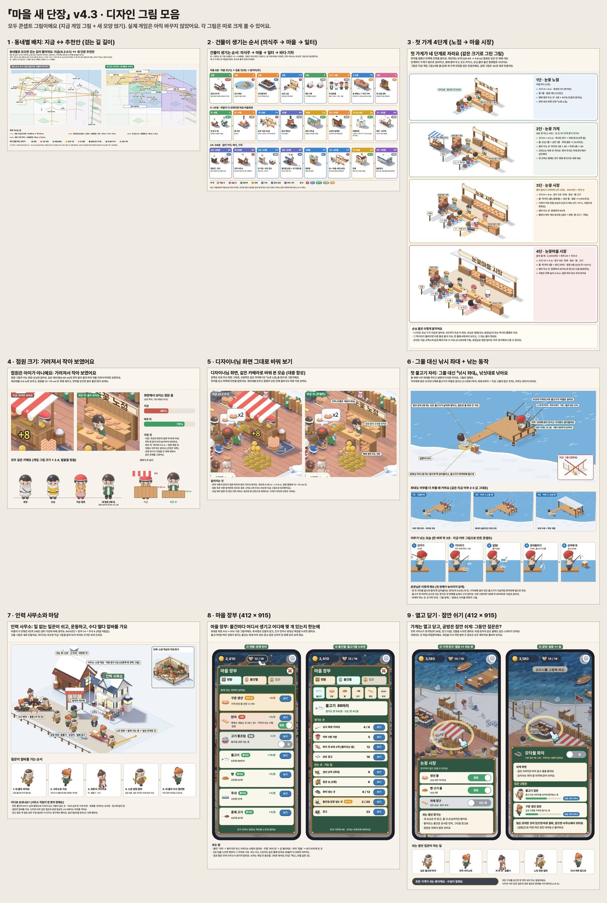
*그림 아홉 장을 한 장에 모았어요. 아래에서 하나씩 크게 보여 드려요.*

---

## 0. 한눈에 보기

- **이야기 순서로 자라는 마을이에요.** 촌장님은 첫날부터 바닷가 오두막에 살아요(책상에서 마을 장부도 볼 수 있어요).
  16분쯤 그 자리를 **촌장 사무실**로 고칠 수 있고, 마을이 다 갖춰지면(20분쯤) 바로 옆에 **마을회관**이 생겨요.
  지금은 사무실이 50분, 회관이 42분이에요.
- **먹을 것 → 입을 것 → 살 집 → 마을 살림 → 일터 → 바다·기차** 순서로 건물이 들어서요 (의식주 순서).
- **동네별로 모아요.** 규칙은 하나예요: **"만드는 곳은 재료 옆, 파는 곳은 사람 옆, 창고는 그 사이."**
- 마을회관에서 서리역까지 **「눈꽃 큰길」 한 줄**로 이어져서 처음 하는 분도 길을 잃지 않아요.
- **첫 가게는 네 단계로 자라요**: 눈꽃 노점(처음) → 눈꽃 가게(숲을 열 때) → 눈꽃 시장(빵이 팔리기 시작하면, 12분쯤) →
  눈꽃마을 시장(읍이 될 때). 3단부터는 가게가 커진 만큼 **손님도 조금 더** 와요.
- **천막 지붕을 없애고 간판을 달아요.** 계산대를 낮추고 점원이 한 칸 올라서서 어른으로 보여요.
- 손님은 **사고 싶은 먹거리 줄**에 서요 (시장부터 두 줄, 마을 시장은 세 줄). 점원이나 촌장님이 있는 줄에만 서요.
- **교역소는 따로 짓지 않아요.** 판자·주괴는 가게의 **자재 창구**에서 상인에게 팔아요. 옛 상인 썰매는 창구 옆에 세워 둬요.
- **그물 대신 낚시 좌대**예요. 낚싯대에 물고기가 저절로 걸리고, 촌장님은 휙 감아올려 지금처럼 빨리 가져가요.
  어부는 의자에 앉아 던지고 기다리다 입질이 오면 감아올려요. 생선 상자는 땅 위에 있어서 짐꾼은 물 위로 다니지 않아요.
- **인력 사무소**(26분쯤, 창고 다음)가 생기면 **가게 열고 닫기 · 공방 잠깐 쉬기**를 할 수 있어요. 쉬는 줄의 짐꾼은 남은
  짐을 다 옮긴 뒤 일손이 모자란 곳으로 **알바**를 가고, 갈 곳이 없으면 사무소 마당에서 쉬어요.
- **마을 장부**: 물건마다 어디서 생기고, 어디에 몇 개 있는지 바로 보여요. **촌장님 책상**(처음부터)이나 왼쪽 위
  **인구 칸**(숲을 연 뒤부터 늘 보여요)을 누르면 열려요. 화면에 새 단추는 만들지 않아요.
- 숲·밭·광산·사냥터 자리는 **그대로**예요. 그래서 광석·고기를 손으로 나르는 길은 조금만(약 10%) 줄어요. 이 둘을 마을
  가까이 당기는 건 다음 업데이트에서 따로 정해요.
- **먼저 보여 드릴 것**: 1단 노점(간판·낮은 계산대·어른 점원)만 먼저 시험 트랙에 올릴 수 있어요. 처음 20분이 다 만들어지면
  **대표님만 보는 미리보기 링크**로 먼저 해 보실 수 있게 할게요(저장 칸이 따로라 지금 마을은 건드리지 않아요).

---

## 1. 대표님 말씀 여섯 가지 — 제 생각과 까닭

### ① "판매원이 너무 작아 어린아이 같아" → 맞아요. 키가 아니라 **가려져서** 작아 보여요

- 점원 그림은 촌장님과 같은 크기예요. 그런데 계산대가 높고(약 0.95 m) 천막 끝이 머리를 덮어서, 화면에서는 **몸의
  48%만** 보여요. 그래서 어린아이처럼 보였어요.
- **이렇게 바꿔요**: 계산대를 0.6 m로 낮추고, 점원은 계산대 뒤 낮은 단(10~15 cm)에 올라서요. 어른 앞치마와 모자를
  씌워요. 그러면 몸이 **약 79%** 보여요(그림에서 잰 값).
- **줄 맨 앞 손님이 서 있을 때도** 몸이 3/4 넘게 보이는지 꼭 확인해요. 손님은 계산대 정면이 아니라 비스듬히 왼쪽 앞에
  서서 점원을 가리지 않게 해요.

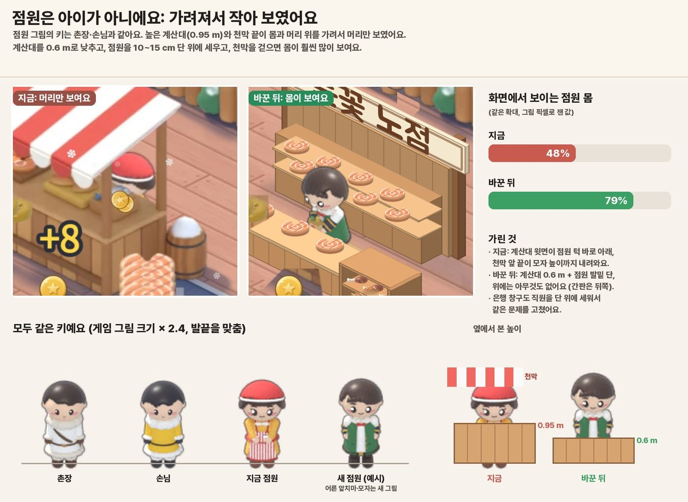
*왼쪽이 지금, 오른쪽이 바꾼 뒤예요. 아래는 같은 키로 세운 줄과, 계산대 높이를 옆에서 본 그림이에요.*

### ② "천막 때문에 안 보여, 천막을 치우고 간판을 만들자" → 네. 모든 단계에서 천막 대신 **간판**

- 줄무늬 천막을 없애고, 기둥 위에 나무 간판(약 2.6 m 높이)을 달아요. 간판 글씨는 게임이 그려서 단계마다 이름이 바뀌어요
  (눈꽃 노점 → 눈꽃 가게 → 눈꽃 시장 → 눈꽃마을 시장).
- 그림은 두 겹으로 만들어요: **뒤(기둥·선반·간판) → 점원 → 앞(계산대)**. 잡화점이 이미 이렇게 그려져 있어서 방법은
  검증되어 있어요.

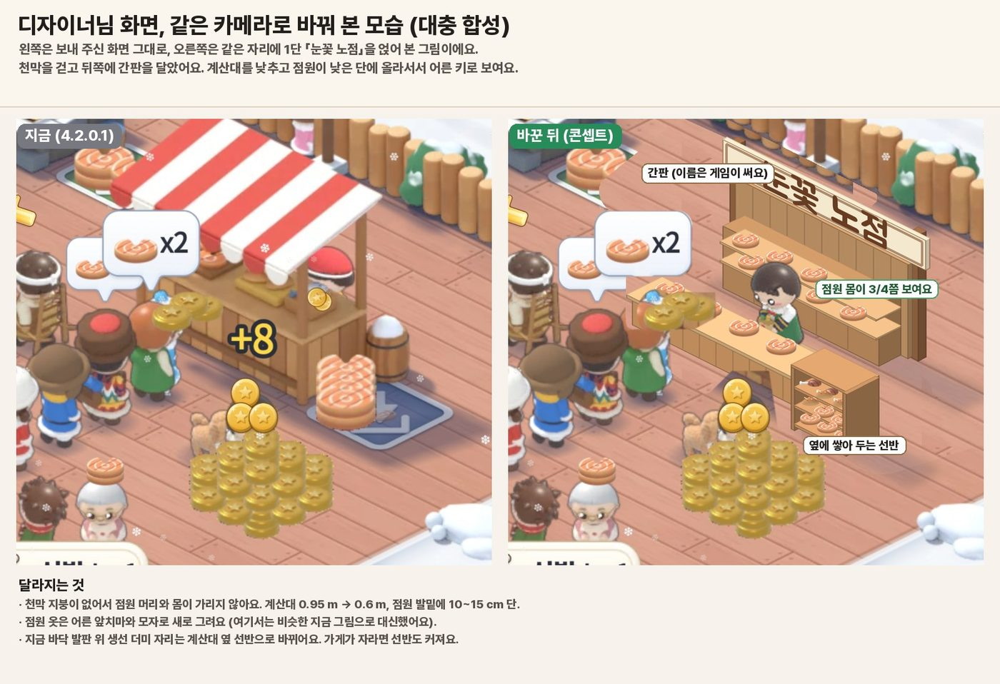
*대표님이 보내 주신 화면(왼쪽)과 같은 카메라로, 천막 노점을 1단 노점으로 바꿔 그린 모습(오른쪽)이에요. 손님·말풍선·동전은 그대로 뒀어요.*

### ③ "첫 가게가 단계별로 확장되었으면… 옆에 쌓아놓는 공간도 커져야" → 네. **네 단계**로 자라요

- 크기, 창구 수, 줄 수, 점원 수, 옆에 쌓아 두는 칸이 단계마다 같이 커져요. 자세한 표는 [4장](#4-첫-가게가-네-단계로-자라요).
- 까닭: 첫 가게는 대표님 마을의 얼굴이라서, "내 가게가 커 간다"는 느낌이 가장 잘 보이는 곳이에요.
- 크기만 커지고 버는 게 같으면 "값만 나가는 심심한 구매"가 돼요. 그래서 **3단부터는 손님이 조금 더 와요**
  (3단 약 +10%, 4단 약 +20%, 시험 플레이로 맞춰요. 선택 15번).

### ④ "교역소가 있을 필요가 있나… 직원을 더 채용해서… 손님도 두세 줄로" → 네 (승인해 주셨어요)

- 교역소를 따로 짓지 않고, 가게에 **자재 창구**를 붙여요. 상인은 그 창구에 줄을 서서 지금과 **같은 빠르기**로 사 가요.
  촌장님이 먹거리 계산대와 자재 계산대 사이를 오가는 길도 14 m → 6 m로 줄어요.
- 먹거리 손님은 **사고 싶은 것에 따라 줄을 나눠** 서요. 단, **점원이나 촌장님이 있는 줄에만** 서요. 점원을 아직 안 뽑은
  줄에 손님이 서서 하염없이 기다리는 일이 없게요. 자세한 건 [4장](#4-첫-가게가-네-단계로-자라요)과
  [5장](#5-교역소는-가게의-자재-창구로-합쳐요).

### ⑤ "건물이 들어서는 순서… 의식주… 촌장실이 처음부터 없는 것도… 마을회관도 먼저" → 네

- 촌장님은 첫날부터 **오두막**(침대·책상·우체통)에 살아요. 책상이 곧 첫 촌장실이에요. 16분쯤 같은 자리를
  **촌장 사무실**로 고칠 수 있고, 20분쯤 바로 옆에 **마을회관**이 서요.
- 먹을 것(0분) → 입을 것(4분) → 살 집(5~6분) → 마을 살림(16~20분) 순서예요. 자세한 표는 [2장](#2-건물이-생기는-순서-의식주-이야기).
- 까닭: 사람이 사는 마을이라면 당연한 순서라서, 처음 하는 분도 "다음엔 뭐가 생길까"를 짐작할 수 있어요.
- 첫 집과 사무실 고치기는 **옆 목표**예요(사고 싶을 때 사요). 모두 꼭 사야 하는 목표로 두면 처음 20분이 1.5~2분
  늘어나서요. 회관은 마을 완성 바로 뒤 첫 목표예요.

### ⑥ "건물 위치도 바뀌어야… 공공시설, 기관시설, 공장, 사무실… 이동거리도 아끼고" → 네

- 동네를 다섯으로 나눠요: **마을 마당 · 집과 들일 · 일터 가운데 띠 · 관청 거리 · 바깥 고리**. 자세한 건 [3장](#3-동네별-배치).
- 촌장님이 동전을 걷으러 도는 길이 **약 290 m → 약 170 m**로 40%쯤 줄어요(두 쪽을 같은 방법으로 어림했어요).
  짐꾼 길은 더 많이 줄어요: 통조림 공장까지 생선 49 → 14 m, 대장간 → 잡화점 69 → 31 m.
- 손님 길은 거의 그대로예요. 손님은 지금처럼 화면 밖 길에서 나타나 걸어오거든요.
- 솔직히 말씀드리면, 숲·밭·광산·사냥터는 이번에 옮기지 않아서 광석·고기를 손으로 나르는 길은 10%쯤만 줄어요.
  이 둘을 옮기면 첫 튜토리얼과 땅 모양을 다 다시 만들어야 해서, 다음 업데이트에서 따로 정하자고 추천드려요.

---

## 2. 건물이 생기는 순서 (의식주 이야기)

**첫날 아침, 촌장님은 바닷가 오두막 마당에서 낚시 좌대로 가요.** 잡은 생선을 모닥불 화덕에 굽고, 눈꽃 노점에서 팔아요.
마을 사람들은 아직 텐트에서 지내요. 숲을 열면 판자가 생겨 노점이 가게가 되고, 작업대는 옷·신발 공방이 되고,
텐트 가족들이 첫 집으로 이사해요. 밭과 광산이 열리고 마을이 커지면 오두막을 촌장 사무실로 고치고, 마을이 다
갖춰지는 날 바로 옆에 마을회관이 문을 열어요. 그다음은 일터(대장간·창고·인력 사무소), 그다음은 바다와 기차예요.

| 시간 | 생기는 것 | 지금과 달라지는 점 |
|---|---|---|
| 0분 | **촌장 오두막**(침대·책상·우체통, 촌장님은 오두막 바닷가 쪽 마당에서 시작), 모닥불 화덕(바닷가 쪽으로 조금), **낚시 좌대**, **눈꽃 노점**(간판, 천막 없음), 텐트 4채 | 오두막은 새것, 그물은 좌대로 |
| 0.5~3분 | 점원 12, 요리사 30, 어부 45(좌대 의자에 앉아요), 짐꾼 70 / 100 | 그대로 |
| 2.4분 | 숲 + 제재소 90 → 노점이 **눈꽃 가게**가 되고 **자재 창구**가 붙어요. 자재 점원 50 | 교역소는 없어져요 |
| 4분 | **옷·신발 공방**: 지금 작업대(가방·신발)가 작은 공방이 돼요. 이게 "입을 것" 단계예요 | 이름과 모양만 바뀌어요 |
| 5~6분 | **첫 집 두 채**(80 + 판자 4, 160 + 판자 6) — **옆 목표**. 텐트 가족이 이사 와요. 마을 인구 한도는 그대로예요 | 지금은 16분 |
| 8.5~11분 | 밭 + 빵 오븐 300, 빵집 아주머니, 농부 | 그대로 |
| 12분쯤 | **눈꽃 시장(3단)**, 400 + 판자 8: 생선 줄 / 빵·고기 줄 / 상인 줄. 손님이 조금 더 와요 | 새것 |
| 14~16분 | 광산 + 제련소 600, 집 터들, **오두막 → 촌장 사무실**(400 + 판자 8, **옆 목표**, 지금 사무실 그림). 사무실 직원·수금원은 읍이 된 뒤에 뽑아요 | 사무실 50분 → 16분쯤 |
| 18.7~20.4분 | 사냥터 + 훈제장 950 → **마을 완성** | 시험 플레이로 지금 ±1분 안에 맞춰요 |
| 20.5분쯤 | **마을회관**(마을 완성 뒤 첫 목표): 1,200 + 판자 16 + 주괴 4, 사무실 옆, 마당을 바라보게. 세금 상자·게시판·집 자리 +6·행복 +8 | 42.5분 → 21분, 값도 반 |
| 21~25분 | 동쪽 망루, 서리역, **대장간**(24분)과 **창고**(25분)가 일터 가운데 띠의 정해진 자리에 | 자리가 정해져요 |
| 26분쯤 | **인력 사무소**(900 + 판자 14 + 주괴 4, 창고 다음). 이때부터 **가게 열고 닫기 · 공방 잠깐 쉬기** 단추가 생기고, 마을 장부의 「일꾼」 칸이 열려요 | 새것 |
| 29~31분 | 큰 식당, 보트 창고, 남쪽 망루 | 그대로 |
| 35~37분 | **통조림 공장**(바닷가 공장 터), **잡화점**(마을 마당 동쪽), **고기 통조림 기계**(4.2.1) | 자리가 정해져요 |
| 41~45분 | **읍 승격식을 마을회관 앞 계단에서**. 그 자리에서 **눈꽃마을 시장(4단)**을 제안해요(2,000 + 판자 20 + 주괴 8). 사무실 직원·수금원 고용, 관청 거리에 은행(사무실을 아직 안 고쳤으면 은행보다 먼저 "사무실 고치기"가 나와요) | 승격식은 회관 앞, 은행 52분 → 45분 |
| 52~56분 | **물류창고** — 이번에는 지금 자리 그대로(★ 다음 물류 업데이트에서 짐 싣는 곳 옆으로 옮기기, 선택 20번) | 그대로 |

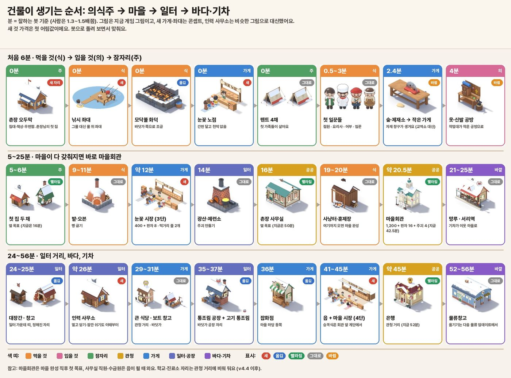
*0분부터 56분까지 24장의 카드예요. 색은 의식주·관청·가게·일터·바깥, 딱지는 새것·옮김·빨라짐·그대로·바뀜이에요.*

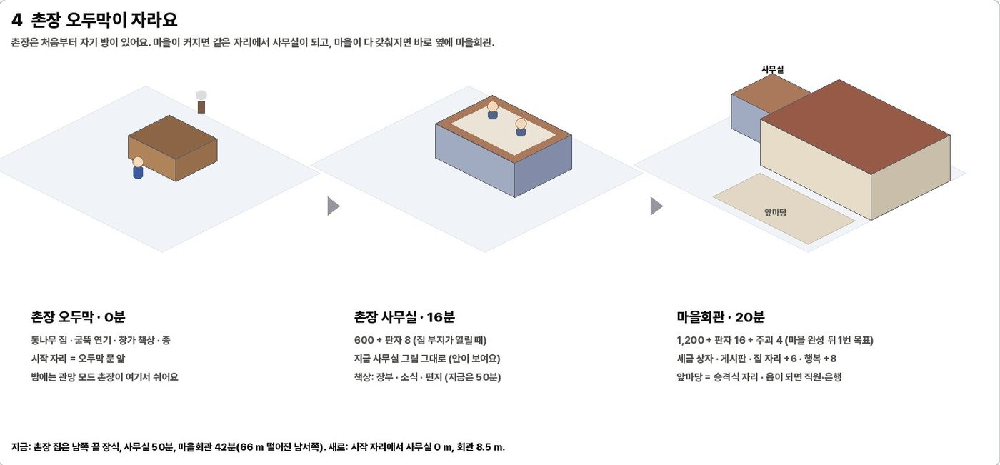
*오두막(0분) → 같은 자리에 사무실(16분쯤) → 바로 옆에 마을회관(20분). 회관 앞마당이 승격식 자리가 돼요.*

**처음 20분이 늘어지지 않게 (검토하며 따져 본 것)**

- 처음 20분에 새로 살 것이 셋 생겨요: 첫 집 두 채(240 + 판자 10), 3단 시장(400 + 판자 8), 사무실 고치기(400 + 판자 8).
  합치면 약 1,040코인 + 판자 26개예요.
- 처음 20분 동안 버는 돈은 모두 9,000코인쯤이라, 셋을 모두 꼭 사야 하는 목표로 두면 마을 완성이 1.5~2분 늦어져요.
- 그래서 **첫 집과 사무실은 옆 목표**(안 사도 다음 목표로 가요), **3단 시장은 손님이 조금 더 와서 값을 되찾게** 했어요.
  시험 플레이로 재서 마을 완성이 지금보다 1분 넘게 늦어지지 않게 값을 맞춰요.
- 빈 시간: 0~26분은 1~4분마다 새것이 생겨요. 37분 뒤 4분, 45분 뒤 7분쯤 비는 곳은 지금과 같아요(그 사이에는 주문·
  손님·기차가 바빠요).

---

## 3. 동네별 배치

**규칙: "만드는 곳은 재료 옆, 파는 곳은 사람 옆, 창고는 그 사이."**

| 동네 | 무엇이 있나요 |
|---|---|
| **마을 마당** (마을의 심장) | 낚시 좌대, 모닥불 화덕, 첫 가게(네 단계), 오두막 → 사무실, 마당 동쪽 끝의 잡화점 |
| **집과 들일** | 숲, 밭, 첫 집들, 옷·신발 공방 |
| **일터 가운데 띠** (공장 거리) | 대장간, 창고, 인력 사무소, 나중에 자재창고 |
| **관청 거리** (서쪽) | 마을회관(사무실 옆), 은행, 큰 식당, 나중에 학교·진료소 자리 |
| **바깥 고리** | 바닷가 동쪽 통조림 공장(보트 창고 옆), 서리역, 짐 싣는 곳, 물류창고 |
| **그대로** | 숲·밭·광산·사냥터와 그 가공소, 서리역, 이웃 마을, 물류창고(이번에는) |

- **눈꽃 큰길**: 마을회관 앞에서 시작해 가게 남쪽, 동쪽 망루, 해안 길을 지나 서리역 금고까지 한 줄로 이어져요.
- **자리**: 공방과 가게는 **정해진 자리 하나씩**이에요(어디 지을지 고민하지 않아도 돼요). 집과 꾸미기는 지금처럼 빈 땅에
  골라 지어요.
- **마당이 붐비지 않게**: 가게 줄은 계산대에서 왼쪽 앞으로, 잡화점 줄은 동쪽으로 서요. 두 줄이 엉키지 않고, 작은
  휴대폰(360×640) 화면에서 줄·이름표·간판이 겹치지 않는지 단계마다 사진으로 확인해요.

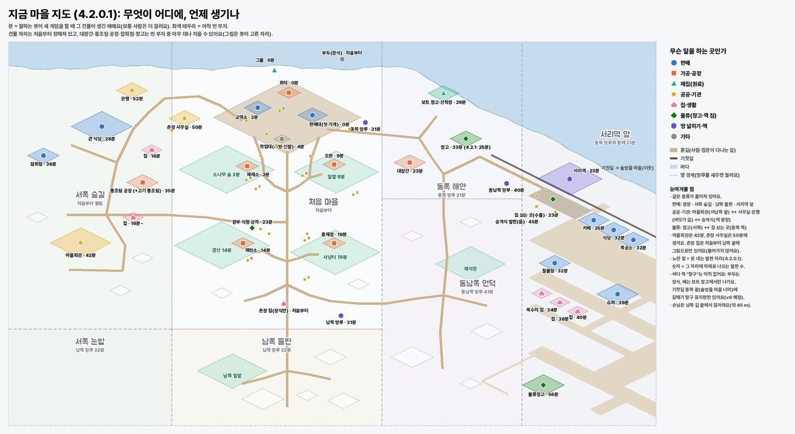
*지금(4.2.0.1) 마을이에요. 같은 일을 하는 건물이 여기저기 흩어져 있어요.*

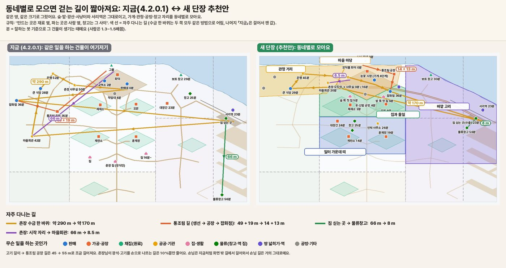
*같은 땅, 같은 크기로 그렸어요. 색 선은 자주 다니는 길이에요. 수금 한 바퀴는 두 쪽을 같은 방법으로 어림했어요.*

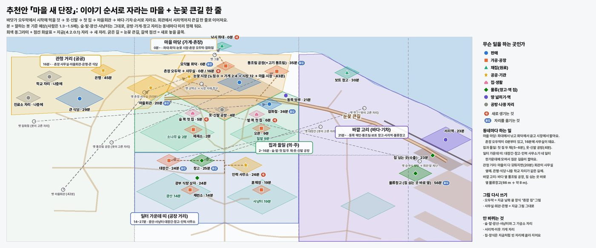
*추천 지도예요. 회색 동그라미와 점선 화살표는 지금 자리 → 새 자리, 굵은 길이 눈꽃 큰길이에요. 물류창고는 옮긴 자리로
그려져 있지만, 검토 뒤에는 이번엔 그대로 두기를 추천해요(선택 20번).*

### 걷는 길이 얼마나 줄어요

| 길 | 지금 | 새 단장 |
|---|---|---|
| 촌장님 첫 생선 한 바퀴 (좌대 → 화덕 → 가게) | 31.6 m | 약 24~27 m |
| 시작 자리 → 촌장실 / 마을회관 | 22.6 m / 66 m | 0 m / 8.5 m |
| 촌장님 동전 걷기 한 바퀴 (같은 방법으로 어림) | 약 290 m | 약 170 m (기차가 역 동전을 실어 오면 87 m) |
| 촌장님: 먹거리 계산대 ↔ 자재(교역소) 계산대 | 13.6 m | 6 m |
| 화덕 → 가게 | 9.7 m | 2.9 m |
| 제재소 / 제련소 → 자재 창구 | 16.7 / 47 m | 16.1 / 41.5 m (제련소 → 창고는 13.4 m) |
| 제재소 / 제련소 → 대장간 | 20.3 / 31 m | 12.3 / 14.8 m |
| 대장간 → 잡화점 | 69 m | 31 m |
| 생선 / 보트 창고 → 통조림 공장 | 48.6 / 76.5 m | 13.6 / 13.8 m |
| 통조림 공장 → 잡화점 / 짐 싣는 곳 | 18.7 / 96 m | 13 / 47 m |
| 인력 사무소 → 일터 (평균) | — | 22.6 m |

**숫자를 읽는 법 (검토하며 바로잡았어요)**

- "지금"은 대부분 실제로 걸어서 잰 값이고, "새 단장"은 지도에서 어림한 값이에요. 걸어서 재면 어림보다 15%쯤 길게
  나와서, 실제로 줄어드는 폭은 표보다 조금 작아요. 동전 걷기는 두 쪽을 같은 방법으로 어림해서 비교했어요(40%쯤).
  만들 때 새 지도에서도 똑같이 걸어서 다시 재요.
- **손님 길은 표에서 뺐어요.** 손님은 지금처럼 화면 밖 길에서 나타나 걸어와요(화면 안에서 갑자기 생기면 어색하니까요).
  그래서 집을 가게 옆에 지어도 손님이 걷는 길은 거의 그대로예요.
- 크게 줄어드는 길은 대부분 **짐꾼 길**이에요. 물건이 더 빨리 돌아서 진열대가 덜 비어요. 촌장님이 직접 걷는 길은
  첫 생선 한 바퀴, 계산대 사이, 동전 걷기, 회관·사무실 가는 길이 줄어요.

**솔직하게, 좋아지지 않는 길도 있어요.**

- 빵 오븐 → 가게: 13.3 → 13.9 m (조금 길어져요).
- **고기 걸이 → 통조림 공장: 45 → 54.5 m (21% 길어져요).** 고기 통조림 짐꾼 가방이 12개라서 감당할 수 있어요.
- 촌장님이 광석·고기를 손으로 나르는 길은 8~10%만 줄어요(101 → 92 m). 광산·사냥터가 그대로라서요.
- 짐 싣는 곳 → 물류창고(66 m)는 이번에 그대로예요(선택 20번).

---

## 4. 첫 가게가 네 단계로 자라요

**모든 단계 공통 (점원 고치기)**: 계산대 0.6 m, 점원은 낮은 단 위, 어른 앞치마·모자, 천막 없음, 간판.

**모양**: 계산대가 **한 줄로 옆으로 길어지고**, 줄은 그 앞에 **나란히** 서요(휴대폰 화면에서 가장 알아보기 쉬워요).
자재 창구는 숲·광산 쪽을 바라보는 **서쪽 끝**에 있어서, 상인이 먹거리 줄을 가로지르지 않아요.

| 단계 | 언제 / 값 | 크기 | 창구 | 줄 | 점원 | 옆에 쌓아 두는 칸 | 손님 |
|---|---|---|---|---|---|---|---|
| 1 노점 | 처음 | 4×3 m | 먹거리 1 | 1 | 1 (12) | 3가지 × **40** (지금과 같음) | 지금과 같음 |
| 2 가게 | 숲을 열 때(2.4분, 숲 값 90 안에) | 6×3.5 m | 먹거리 · 자재 | 손님 1 + 상인 1 | + 자재 점원 50 | 먹거리 3×40 + 자재 2×40 | 지금과 같음 |
| 3 시장 | 12분쯤, 400 + 판자 8 | 8×4 m | 자재 · 생선 · 빵·고기 | 먹거리 2줄 + 상인 | +1 (150) | 종류마다 60 | 약 +10% |
| 4 마을 시장 | 읍, 2,000 + 판자 20 + 주괴 8 | 10×5 m, 트인 지붕 3.6 m | 자재 · 생선 · 빵 · 고기 | 먹거리 3줄 + 상인 자리 2 | 4 | 종류마다 80 | 약 +20% |

간판은 단계마다 「눈꽃 노점」 → 「눈꽃 가게」 + 이름표 → 「눈꽃 시장」 + 줄마다 표지 → 「눈꽃마을 시장」 아치예요.
4단 뒤 창고(200개)와 시장 관리인은 **다음 업데이트(4.3.1)로 미뤘어요**. 종류마다 80개 칸으로 충분하고, 관리인은 할 일이
분명하지 않았거든요.

**줄 서는 법**

- 손님은 지금처럼 같은 간격으로 와요(처음 2초, 마을이 커지면 1.3초). 3단부터는 조금 더 자주 와요.
- 와서 **사고 싶은 먹거리 줄**에 서요. 단, **점원이나 촌장님이 있는 줄에만** 서요. 점원이 없는 창구도 **촌장님이 서면**
  바로 열리고 계산돼요.
- 그 먹거리가 다 떨어지면 손님은 **다른 줄로 옮겨** 서요(마냥 기다리지 않아요).
- 한 줄에 여섯 명까지 똑바로 서고, 그 뒤로는 줄이 꺾여요. 줄 맨 앞은 계산대 비스듬히 앞이라 점원을 가리지 않아요.
- 4단의 둘째 상인 자리는 자재 계산대에 사람이 둘(점원 둘, 또는 점원과 촌장님)일 때 열려요.

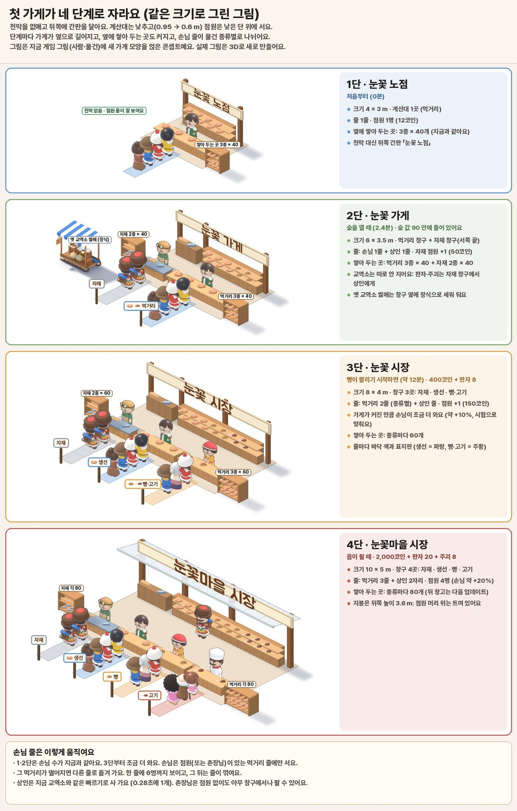
*노점 → 가게 → 시장 → 마을 시장을 같은 크기 비율로 그렸어요. 줄 색깔은 먹거리 종류, 왼쪽 끝이 자재 창구예요.*

---

## 5. 교역소는 가게의 자재 창구로 합쳐요

(대표님이 승인해 주신 내용이에요.)

- **상인**은 자재 창구에 차례로 와서, 누가 계산대에 서 있는 동안 **지금과 같은 빠르기**(한 개에 0.28초)로 판자·주괴를 사 가요.
  상인이 사 가는 양이 줄지 않게 했어요.
- **옛 교역소 썰매**는 자재 창구 옆에 세워 둬요(상인이 타고 온 썰매처럼 보여요).
- 자재 창구를 **닫아도** 공사장에 필요한 판자·주괴는 그대로 가요. 남는 건 창고로 가요.
- **수출**은 지금처럼 서리역 짐 싣는 곳에서 해요. 큰 수출은 나중 항구 업데이트(v6)에서요.
- 교역소에 걸려 있던 목표·도전(교역소 첫 거래, "교역의 날" 등)은 **자재 창구 목표**로 이름이 바뀌어요("상인 장날").
  안내 말풍선도 "자재 창구에 서면 상인이 판자를 사 가요"로 바뀌어요.

---

## 6. 고기 통조림(4.2.1)은 이렇게 들어가요

- **통조림 공장과 고기 통조림 기계**는 바닷가 공장 터(보트 창고 옆)에 서요. 생선과 배의 생선이 14 m 거리예요(지금은 49 m, 77 m).
- 통조림은 **잡화점(13 m)**이나 **짐 싣는 곳(47 m)**으로 가요. 지금은 19 m, 96 m였어요.
- 잡화점의 일곱 번째 선반(고기 통조림)과 "고기 통조림 30개" 늘 주문은 그대로예요.
- 고기 걸이 → 공장 길만 조금 길어져요(45 → 55 m). 고기 짐꾼의 12개 가방으로 충분해요. 다 만든 뒤 길이를 다시 재서
  짐꾼 숫자를 맞춰요.

---

## 7. 가게 열고 닫기 · 공방 잠깐 쉬기 · 짐꾼 알바

**언제부터**: **인력 사무소가 생기면**(26분쯤, 창고 다음)이에요. 그때는 닫은 창구의 물건을 받아 줄 창고와, 쉬는 짐꾼이
쉴 곳이 다 있어서 어디서도 막히지 않아요. 그 전에는 튜토리얼 흐름이 흔들리지 않게 단추가 없어요.

**어떻게**: 건물을 누르거나, 마을 장부의 그 줄에 있는 스위치를 눌러요.

| 단추 | 누르면 |
|---|---|
| 가게 창구: **열림 ⇄ 쉬는 중** | 새 손님이 안 와요. 지금 선 줄은 끝까지 계산해요. 그 창구로 오던 물건은 창고로 가요 |
| 공방·가공소: **일함 ⇄ 쉼** | 재료 입구를 닫아요. 지금 만들던 것만 마저 만들어요. 기술자는 옆 의자에 앉아 쉬어요 |

**쉬는 줄의 짐꾼은 이렇게 해요** (대표님 말씀 그대로예요)

1. 재료 짐꾼은 들고 있던 것만 내려놓고, 물건 짐꾼은 남은 물건을 **끝까지 다 옮겨요**.
2. 일손이 모자란 곳이 있으면 **그리로 바로 알바**를 가요. 없으면 **인력 사무소 마당**에서 쉬다가, 사무소 직원이 일손이
   모자란 곳이 생기면 한 명씩 보내요.
3. "모자란 곳"은 이렇게 정해요: 출구가 80% 넘게 찼는데 가지러 오는 사람이 없는 곳, 10초 넘게 빈 진열대,
   재료를 기다리는 공사장(그 재료가 어딘가 쌓여 있을 때만), 창고에 밀린 짐.
4. 알바 짐꾼은 **노란 조끼**를 입고(도착할 때 "알바" 표가 잠깐 떠요) 적어도 20초는 그곳에서 일해요.
5. 원래 줄이 다시 열리면, 들고 있는 짐만 내려놓고 **집(원래 줄)으로 돌아가요**.

**막히지 않게 지켜 드리는 것**

- 쉬는 공방 때문에 목표·공사장·주문이 기다리면, 그 카드에 **"○○이 쉬는 중이에요 [다시 열기]"**가 떠요. 한 번 눌러
  바로 풀 수 있어요(예: 제련소가 쉬면 주괴가 필요한 마을회관 공사가 기다려요).
- 게임을 다시 켰을 때 쉬는 곳이 있으면 한 번 알려 드려요("쉬는 곳 2곳 · 모두 열기").
- 튜토리얼 다시 보기를 할 때 쉬는 곳이 있으면 먼저 알려 드려요.
- 나무꾼·어부 같은 **채집 일꾼과 기술자는 빌려주지 않아요**(이번에는 짐꾼만).
- 가게를 **모두** 닫으면 "수입이 멈춰요"를 **한 번** 알려 드려요.
- 저장은 "열림/쉼"만 해요. 게임을 다시 켜면 알바 갔던 짐꾼은 원래 줄로 돌아와 있어요.
- 아무도 해고되거나 쫓겨나지 않아요. 물건도 없어지지 않아요.

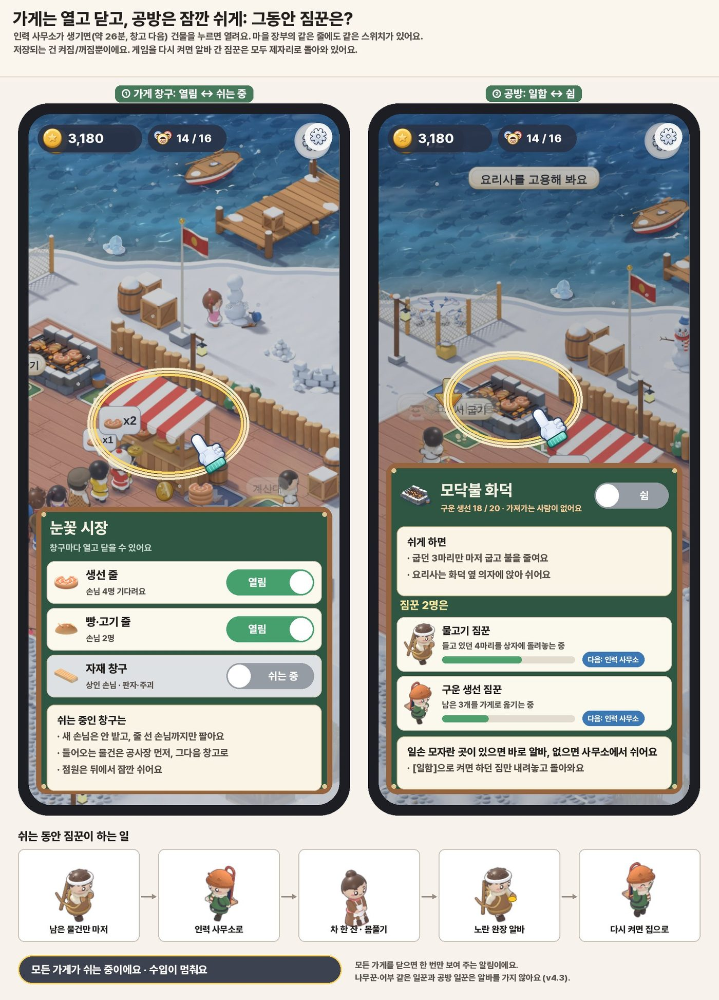
*왼쪽은 시장 창구마다 열고 닫기, 오른쪽은 화덕 잠깐 쉬기예요(배경은 지금 게임 화면이라 천막 노점이 보여요). 짐꾼이 남은
짐을 다 옮기고 알바를 가는 흐름과 "수입이 멈춰요" 알림도 그렸어요. 그림 속 노란 완장은 휴대폰에서는 너무 작아서,
검토 뒤 노란 조끼를 추천해요(선택 18번).*

---

## 8. 인력 사무소 (일 없는 일꾼의 쉼터 + 일자리 찾는 곳)

- **언제**: 26분쯤, 창고 다음. 일터 가운데 띠의 가운데(창고에서 9 m, 네 일터에서 평균 23 m). 값은 900 + 판자 14 + 주괴 4(짐작).
- **큰 건물 + 마당**이에요(대표님 말씀처럼 좀 커요).
  - **사무실**: 소장님 책상, 직원 창구 2개, 일자리 게시판. 소장·직원은 지금 촌장 사무실 사람 그림을 그대로 써요.
  - **쉼터**: 난로, 긴 의자, 차 한 잔.
  - **운동 마당**: 몸 풀기, 눈뭉치 던지기, 썰매 끌기.
  - **수다 자리**: 불통 옆 긴 의자.

**하는 일 (장식이 아니에요)**

1. **일꾼 뽑는 곳**: 창고 일꾼·역 짐꾼처럼 어느 줄에도 속하지 않는 짐꾼은 여기 창구에서 뽑아요.
2. **늘 살아 있는 마당**: 창고 일꾼·역 짐꾼이 할 일이 없을 때는 사무소 마당에서 차를 마시고 몸을 풀며 기다려요. 그래서
   아무것도 쉬게 하지 않아도 마당이 비어 있지 않아요.
3. **열고 닫기·잠깐 쉬기**가 이 건물과 함께 생겨요. 쉬는 줄의 짐꾼이 갈 곳이 없을 때 여기서 쉬다가 알바를 가요.
4. **마을 장부의 「일꾼」 칸**이 열려요: 누가 어디서 일하는지, 누가 알바 중인지, [보기]로 바로 가 볼 수 있어요.

**휴대폰에서**: 사무소는 가게에서 30 m쯤 떨어져 있어서 보통 화면 밖이에요. 그래서 알바 짐꾼은 멀리서도 보이는 노란
조끼로 알아보고, 「일꾼」 칸의 [보기]로 사무소 마당을 바로 볼 수 있게 해요.

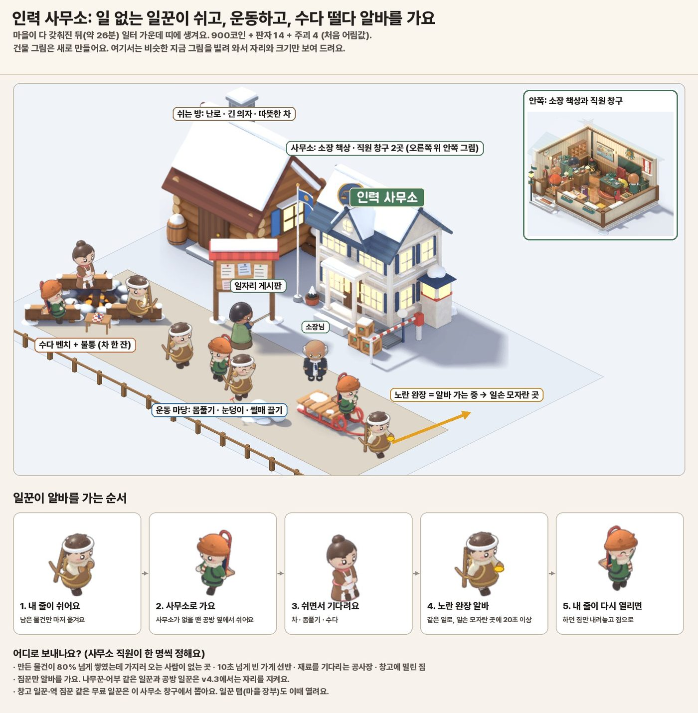
*건물 그림은 콘셉트예요(비슷한 지금 건물을 빌려 그렸어요). 아래 띠는 짐꾼이 알바를 가는 다섯 걸음이에요. 노란 완장 대신
노란 조끼를 추천해요(선택 18번).*

---

## 9. 마을 장부 (물자를 한눈에 보는 창)

- **건물이 아니라 화면**이에요. **촌장님 책상**(오두막·사무실, 처음부터)이나 왼쪽 위 **인구 칸**을 누르면 열려요.
  인구 칸은 지금은 집이 모자랄 때만 보여서, **숲을 연 뒤부터 늘 보이게** 바꾸고 작은 장부 표시를 붙여요. 처음 열릴 수
  있게 될 때 손가락이 한 번 알려 드려요. 화면에 새 단추는 만들지 않아요.
- **한 창으로**: 사무실 창(재고·소식·편지·직원·통장)의 첫 칸이 마을 장부가 돼요. 지금 「재고」 칸을 대신해서 비슷한 창이
  두 개 생기지 않아요. 장부는 직원 없이도 볼 수 있고, 소식·편지·통장은 지금처럼 직원과 함께 열려요.
- **「현황」**: 문제가 있는 곳이 위로 올라와요. 표시는 **가득 / 비어 감 / 멈춤** 세 가지. **[보기]**를 누르면 카메라가 그곳으로
  가요. 열고 닫기 스위치도 같은 줄에 있어요(인력 사무소가 생긴 뒤).
- **「물건별」**: 물건 하나에 카드 한 장. 전체 개수, 1분에 늘고 주는 양, 그리고 **그 물건이 있는 모든 곳**과 지금 개수가
  실시간으로 보여요. 예를 들어 물고기는: 좌대 상자, 어부들 가방, 바다 위 배, 보트 창고, 화덕 입구, 짐꾼 손, 창고,
  통조림 공장 입구… 손에서 진열대로 휙 날아가는 중인 것도 "옮기는 중"으로 세서, 모두 더하면 전체 개수와 꼭 맞아요.
- **「일꾼」** 칸은 인력 사무소가 생기면 열려요.
- **가볍게**: 개수와 1분 흐름은 지금도 1초에 한 번 세고 있는 장부를 그대로 써요. 물건이 있는 모든 곳을 하나하나 세는 일은
  「물건별」 칸을 열어 둔 동안에만 1초에 한 번 해요. 게임이 느려지지 않아요.
- 이 장부는 나중에 나올 「마을 경영」 창의 첫 칸이에요. 따로 만들지 않고 처음부터 한 창으로 자라요.

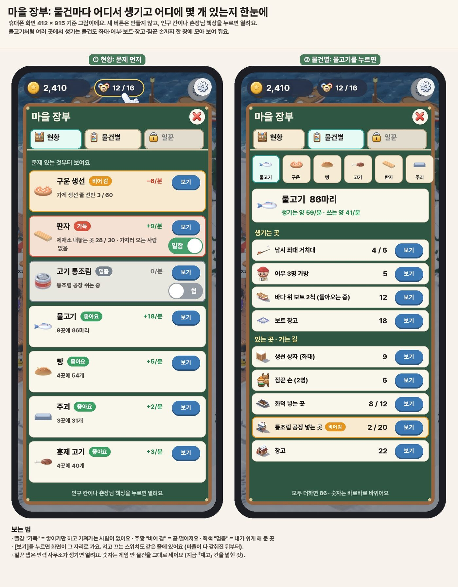
*왼쪽 「현황」은 문제부터, 오른쪽 「물건별」은 물고기 86마리가 아홉 곳에 나뉘어 있는 모습이에요(더하면 86).*

---

## 10. 첫 낚시터: 그물 대신 낚시 좌대 + 낚싯대 동작

- **좌대**: 물 위의 나무 발판과 나무다리예요. 그물은 없어져요.
- **촌장님 자리**는 다리의 뭍 쪽 끝이에요(지금 그물 앞처럼 땅 위).
- **생선 상자도 땅 위**, 다리 앞이에요. 어부가 낚은 물고기가 휙 날아와 쌓여요. 그래서 짐꾼은 물 위로 다니지 않고, 좌대
  위를 걷는 사람은 자기 의자로 가는 어부뿐이에요(길이 막히거나 사람이 물에 빠져 보이는 일을 미리 막아요).
- **낚싯대 거치대 3개**에 물고기가 **저절로** 걸려요. 숫자는 지금 그물과 같아요: 최대 6마리 기다리고, 1.1초마다 한 마리.
- 촌장님이 자리에 서면 **휙 한 번 감아올리고(약 0.6초)**, 물고기가 지금처럼 빠르게 품으로 뛰어들어요.
  그래서 **첫 판매가 늦어지지 않아요.** (촌장님이 한 마리씩 직접 낚으면 처음이 느려져서, 이렇게 추천드려요.)
- **어부**는 지금도 서서 낚싯대를 던지는 모습이 있어요. 새로 만드는 건 **의자에 앉아서**:
  **던지기(0.6초) → 찌가 까딱까딱(1~2초) → 입질! 물보라 → 감아올리기(0.6초) → 상자로 휙**.
  한 사람이 1분에 약 20마리, 세 사람이면 약 59마리로 지금과 같게 맞춰요.
- 어부 2·3을 뽑을 때 좌대가 **2단·3단**(3단은 작은 지붕)으로 넓어져요. 값은 지금과 같아요.
- 같이 바뀌는 것: 손가락 튜토리얼, "그물 앞에…" 안내 문구, 타이틀 화면의 그물도 좌대로 바꿔요.

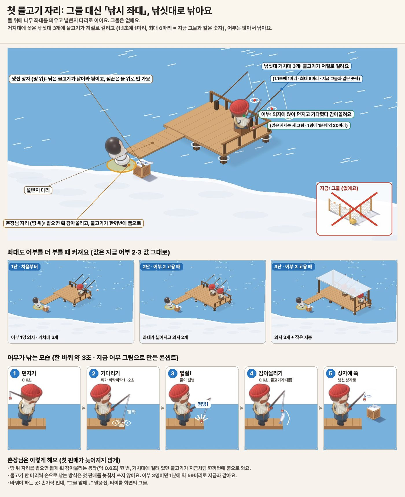
*위는 좌대 전체(그물은 X, 생선 상자는 땅 위), 가운데는 1단·2단·3단, 아래는 어부가 낚는 다섯 장면이에요.*

---

## 11. 남은 선택 (추천은 ★)

추천대로 가도 괜찮으시면 **"추천대로"** 한마디만 주시면 돼요. 바꾸고 싶은 번호만 말씀해 주셔도 돼요.
검토하면서 고를 것이 일곱 개 늘었어요(15~21번). 그래서 꼭 봐 주셨으면 하는 것과, 추천대로 두셔도 되는 것으로 나눴어요.

### 꼭 골라 주셨으면 하는 것 (10가지)

| # | 고를 것 | 선택지 |
|---|---|---|
| 2 | 마을회관 시기 | ★ (A) 마을 완성 때(20분쯤) · (B) 첫 집들과 함께(8~16분, 대신 광산·사냥터가 1분쯤 늦어져요) · (C) 동쪽 망루 뒤(23분쯤) |
| 3 | 촌장님 건물 | ★ (A) 오두막(0) → 같은 자리 사무실(16분쯤) → 옆에 회관(20분), 사무실 직원은 읍 뒤 · (B) 오두막이 그 자리에서 회관으로 자라고, 사무실은 45분쯤 |
| 15 | 가게가 커지면 손님도 더 | ★ (A) 3단 약 +10%, 4단 약 +20% (시험 플레이로 맞춤) · (B) 손님 수는 그대로(가게만 커져요) |
| 16 | 첫 집·사무실 고치기 | ★ (A) 옆 목표(안 사도 다음으로 가요, 사무실 400 + 판자 8) · (B) 꼭 사야 하는 목표(마을 완성이 1.5~2분 늦어져요) |
| 8 | 열고 닫기 시작 | ★ (A) 인력 사무소가 생길 때(26분쯤, 창고 다음) · (B) 마을 완성 때(20분, 사무소 전에는 쉬는 짐꾼이 공방 옆에서 쉬고 닫은 창구 물건은 그 자리에 쌓여요) · (C) 밭을 열 때(9분쯤) |
| 17 | 쉬는 짐꾼이 가는 곳 | ★ (A) 일손이 모자란 곳이 있으면 바로, 없으면 사무소 마당 · (B) 언제나 사무소에 먼저 들렀다가(더 많이 걸어요) |
| 18 | 알바 표시 | ★ (A) 노란 조끼 + 도착할 때 "알바" 표 잠깐 · (B) 노란 완장(휴대폰에서 거의 안 보여요) |
| 19 | 예전 마을의 공방 | ★ (A) 대장간·창고·통조림 공장·잡화점을 동네 자리로 옮기기(단계·물건·일꾼 모두 그대로) · (B) 지금 자리에 두고, 편지로 "새 자리로 옮길까요?" 묻기 |
| 20 | 물류창고 자리 | ★ (A) 이번엔 그대로, 다음 물류 업데이트에서 짐 싣는 곳 옆으로(그때 물류창고를 손보니까요) · (B) 이번에 옮기기(66 → 8 m) |
| 21 | 예전 값으로 다 지은 회관·사무실 | ★ (A) 그대로 두기(잃는 건 없어요, 편지로 고맙다고 알려 드려요) · (B) 새 값과의 차이를 돌려 드리기 |

### 추천대로 두셔도 되는 것 (11가지)

| # | 고를 것 | 선택지 |
|---|---|---|
| 1 | 교역소 | ★ (A) 가게 자재 창구로 완전히 합치기, 수출은 역에서만, 옛 썰매는 장식 · (B) 합치되 숲길에 작은 "상인 썰매 정류장" 두기 · (C) 지금처럼 따로 |
| 4 | 시장(3단) 시기 | ★ (A) 빵이 팔리기 시작하면(12분쯤) · (B) 사냥터와 함께(19분쯤) |
| 5 | 가게 모양 | ★ (A) 계산대 한 줄, 줄은 나란히(휴대폰에서 가장 잘 보여요) · (B) 작은 마당을 둘러싼 말굽 모양 |
| 6 | 공방 자리 | ★ (A) 공방마다 정해진 자리 하나 · (B) 동네 안에서 두 자리 중 고르기 |
| 7 | 숲·광산 자리 | ★ (A) 이번엔 그대로 · (B) 광산·숲도 마을 가운데로 당기기(광석 길은 반으로 줄지만 땅·울타리·튜토리얼을 다시 만들어야 해서 다음 업데이트 후보) |
| 9 | 마을 장부 여는 곳 | ★ (A) 촌장님 책상 + 인구 칸(숲 뒤 늘 보이게), 사무실 창의 첫 칸으로 하나로 · (B) 화면에 새 단추 |
| 10 | 역 동전 | ★ (A) 회관이 서면 기차가 역 동전을 회관 세금 상자로 실어 와요(동전 걷기 170 → 87 m) · (B) 촌장님이 계속 역까지 걸어가요 |
| 11 | 입을 것 | ★ (A) 이번엔 작업대 → 옷·신발 공방, 털옷 공방 빈 자리만 남겨 두기(다음 업데이트) · (B) 털옷 공방을 지금 만들기(사냥터 털 → 털옷을 가게에서) |
| 12 | 촌장님 낚시 | ★ (A) 낚싯대가 저절로 낚고, 촌장님은 휙 한 번 감아올리기 · (B) 촌장님이 한 마리씩 직접(약 1.1초에 한 마리, 처음이 느려져요) |
| 13 | 내보내는 방법 | ★ (A) v4.3 한 번에, 세 걸음으로 만들고 셋째 걸음은 넘칠 경우 v4.3.1로, 첫째 걸음 뒤 대표님 미리보기 링크 · (B) 둘로 나눠 4.3a, 4.3b |
| 14 | 점원·간판 먼저 | ★ (A) 1단 노점(간판·낮은 계산대·어른 점원)만 먼저 시험 트랙에 올리기(저장이 안 바뀌어서 위험이 작아요) · (B) v4.3와 함께 |

---

## 12. 지금 마을은 어떻게 되나요 (대표님 마을 포함)

**약속: 동전 한 닢, 물건 하나 잃지 않아요.** 못 옮기는 게 있으면 값을 돌려 드리고 편지로 알려 드려요.

1. 업데이트 뒤 처음 켤 때, **옮기기 전 마을을 통째로 따로 보관**해 둬요. 설정의 「마을 옮기기」에서 「새 단장 전 마을」
   코드로 꺼낼 수도 있어요.
2. **옮기다가 문제가 생기면 새 마을로 시작하지 않아요.** "마을을 옮기지 못했어요" 카드가 나오고, 원래 마을은 그대로
   남아요. 카드에서 코드를 보내 주시면 고쳐서 다시 옮겨 드려요. (지금 게임은 읽지 못한 저장이 있으면 새 마을로 시작하고
   예전 마을은 보이지 않는 칸에만 남겨요. 이번에 이 부분을 꼭 고쳐요.)
3. **촌장 사무실이 이미 있으면** 오두막 자리로 옮겨 서요. 없으면 오두막이 생겨요.
4. **마을회관을 다 지었으면** 관청 거리 새 자리로 그대로 옮겨 서요. **짓는 중이었으면** 새 자리에서 이어 짓고, 이미 낸
   돈·자재는 그대로 쳐 줘요. 새 값이 더 싸서 넘친 만큼은 돌려 드려요. 마을 완성 뒤인데 아직 시작도 안 했으면, 목표 맨 위에
   회관 카드가 새 값으로 나와요. (촌장 사무실도 똑같이 해요. 이미 다 지은 건 선택 21번대로 해요.)
5. **대장간·창고·통조림 공장·잡화점**은 동네의 정해진 자리로 옮겨 가요(선택 19번 ★). 단계, 쌓인 물건, 일꾼, 이미 낸
   돈·자재 모두 그대로예요. 자리를 비운 땅은 집 터가 돼요.
6. **교역소**는 없어지고: 판자·주괴는 자재 창구 칸으로(넘치면 창고로, 그래도 넘치면 지금 값으로 동전), 교역소 금고 동전은
   가게 금고로, 교역소 점원은 자재 점원이 돼요.
7. **가게 단계**는 진행에 맞춰 정해져요: 숲을 열었으면 2단, 빵을 팔고 있으면 3단(공짜), 읍이면 4단을 반값에 제안해요.
8. **그물의 생선**은 좌대 상자로, 어부 2·3은 좌대 2단·3단으로 바뀌어요.
9. 첫 집 터는 **제안만** 해요. 억지로 짓지 않아요.
10. **물류창고**는 이번에 그대로예요(선택 20번 ★).
11. 촌장님은 오두막 문 앞에서 시작하고(사무실을 짓는 중이면 가게 앞), **「마을 새 단장」 편지**가 와요. 편지의
    「새 지도 보기」를 누르면 세 번 눌러 끝나는 짧은 둘러보기가 나와요.
12. 발판, 길, 장식, 나무, 튜토리얼 손가락 자리는 새 배치에 맞게 다시 놓고, 4.2.0.1 규칙(한 자리에 돈 내는 발판 하나,
    잘 보이는 빈 땅)을 다시 확인해요.

**부탁드려요**: 내보내기 전에 대표님 마을을 꼭 시험해 보고 싶어요. 설정의 **「마을 옮기기」로 만든 글자 코드**를 한 번
보내 주시면, 옮기기 전과 뒤의 동전·물건·건물 수를 하나하나 맞춰 볼게요.

---

## 13. 테스터분들이 알아챌 것

- 새로 시작하면 촌장님이 **오두막** 마당에서 시작하고, 그물 대신 **낚시 좌대**가 있어요.
- 가게에 **천막이 없고 간판**이 있어요. 점원이 어른처럼 보여요.
- **교역소가 없어요.** 판자·주괴는 가게 왼쪽 끝 자재 창구에서 팔아요.
- 가게가 **커져요**(2.4분, 12분쯤, 읍). 손님이 **먹거리별로 줄**을 서요. 3단부터 손님이 조금 더 와요.
- 첫 집을 **훨씬 일찍**(5~6분) 지을 수 있고, 텐트 가족이 이사 와요.
- 촌장 사무실을 **16분쯤**, 마을회관을 **20분쯤** 지을 수 있어요(값도 싸졌어요). 승격식은 회관 앞에서 해요.
- 26분쯤 **인력 사무소**가 생기면 가게·공방에 **열고 닫기 단추**가 생기고, 노란 조끼 알바가 보여요.
- 촌장님 책상이나 인구 칸을 누르면 **마을 장부**가 열려요.
- 이어서 하는 분은 공방 몇 곳이 **동네로 옮겨 가 있고**, 편지와 둘러보기가 와요. 돌려받은 게 있으면 편지에 적혀 있어요.

**업데이트 소개 글 초안** (스토어 "새로운 기능", 500자 안):

> 「마을 새 단장」 — 눈꽃마을이 이야기 순서대로 자라요!
> · 촌장님 오두막이 생겼어요. 마을이 커지면 사무실이 되고, 옆에 마을회관이 들어서요.
> · 첫 가게가 노점 → 가게 → 시장 → 마을 시장으로 자라요. 천막 대신 간판, 손님은 먹거리별로 줄을 서요.
> · 교역소는 가게의 자재 창구가 되었어요.
> · 그물 대신 낚시 좌대! 어부가 의자에 앉아 낚싯대로 낚아요.
> · 인력 사무소가 생기면 가게를 열고 닫고, 공방을 잠깐 쉬게 할 수 있어요. 일이 없는 짐꾼은 알바를 가요.
> · 마을 장부로 물건이 어디에 몇 개 있는지 한눈에 봐요.
> · 고기 통조림이 나와요.
> 이어서 하시는 마을은 그대로 옮겨져요. 편지를 열어 새 지도를 둘러보세요.

---

## 14. 만드는 순서와 약속

- **먼저(선택 14번)**: 1단 노점(간판·낮은 계산대·어른 점원). 저장이 안 바뀌는 작은 업데이트예요. 대표님이 처음 말씀하신
  두 가지(어린아이 같은 점원, 천막)가 바로 풀리는 가장 작은 걸음이에요.
- **첫째 걸음 — 처음 20분**: 오두막, 좌대와 낚싯대, 가게 1~3단과 점원 고치기, 교역소 합치기, 옷·신발 공방, 첫 집,
  튜토리얼·손가락 안내·타이틀 화면. 끝나면 **대표님만 보는 미리보기 링크**를 드려요(새 게임 전용, 저장 칸이 따로라
  지금 마을은 건드리지 않아요).
- **둘째 걸음 — 동네**: 정해진 자리, 사무실 16분쯤, 회관 마을 완성 때, 눈꽃 큰길, 가게 4단, 회관 앞 승격식, 저장 옮기기
  (실패해도 새 마을로 덮지 않게), 고기 통조림 다시 맞추기.
- **셋째 걸음 — 마을 살림**: 마을 장부, 인력 사무소와 알바, 열고 닫기·잠깐 쉬기.
  시간이 모자라면 셋째 걸음만 v4.3.1로 미뤄요(앞 두 걸음과 따로 떨어져 있어서 안전해요. 그때는 장부만 먼저 넣을 수도 있어요).
- **다음 업데이트로 미룬 것**: 물류창고 자리 옮기기, 4단 뒤 창고·시장 관리인, 털옷 공방, 숲·광산 옮기기.
- 만드는 데는 약 **28~34일**, 그림은 따로 **11~12일**쯤 걸려요(검토하며 덜어낸 것과 더한 것 — 실패 안전장치·막힘 알림·미리보기 — 이 비슷해서 거의 같아요).

**다 만든 뒤 꼭 확인하는 것**

- 처음 시작해서 **첫 판매까지 걸리는 시간**이 지금보다 5% 넘게 늘지 않아요.
- **마을 완성**은 지금보다 1분 넘게 늦지 않고, 읍 승격까지 걸리는 시간이 목표의 ±5% 안이에요.
- 상인이 사 가는 빠르기가 지금보다 줄지 않아요. 4.2.1에서 맞춘 물류 숫자도 그대로 지켜요.
- 작은 휴대폰(360×640) 화면에서 가게 앞 줄·이름표·간판이 겹치지 않아요. **줄 맨 앞 손님이 있어도 점원 몸이 3/4 넘게**
  보여요.
- 쉬는 공방이 있어도 막힌 목표가 없어요(모든 카드에 [다시 열기]).
- 옛 마을 저장(여러 시기의 시험 마을 + 대표님 마을)을 옮겼을 때 동전·물건·건물이 똑같거나, 돌려 드린 기록이 남아요.
  일부러 옮기기를 실패시켜도 원래 마을이 그대로 남아요.

---

## 15. 그림 목록 (모두 콘셉트)

| 그림 | 무엇 |
|---|---|
| `img/sheet.jpg` | 아홉 장 한 장 모아보기 (검토 뒤 다시 모음) |
| `img/00_village_map_today.jpg` | 지금(4.2.0.1) 마을 지도 |
| `img/01_zoning_today_vs_plan.jpg` | 지금 ↔ 추천안, 걷는 길 길이 (검토 뒤 숫자 바로잡음, 손님 길 뺌) |
| `img/02_build_order_timeline.jpg` | 건물이 생기는 순서 0~56분 (검토 뒤 옆 목표·인력 사무소·물류창고 고침) |
| `img/03_shop_stages.jpg` | 첫 가게 4단계 (검토 뒤 손님 늘어남, 뒤 창고·관리인 뺌) |
| `img/04_clerk_scale.jpg` | 점원 크기: 가려져서 작아 보였어요 |
| `img/05_before_after_screenshot.jpg` | 대표님 화면 그대로 바꿔 보기 |
| `img/06_fishing_deck.jpg` | 낚시 좌대 + 낚는 동작 (검토 뒤 생선 상자를 땅 위로, 기다리기 1~2초) |
| `img/07_labour_office.jpg` | 인력 사무소와 마당 |
| `img/08_ui_village_ledger.jpg` | 마을 장부 화면 |
| `img/09_ui_open_close_pause.jpg` | 열고 닫기 · 잠깐 쉬기 화면 (검토 뒤 시작 시기·알바 흐름 고침) |
| `img/10_recommended_map.jpg` | 추천 지도 (동네·큰길·새 자리) |
| `img/11_hut_office_hall.jpg` | 오두막 → 사무실 → 마을회관 |

그림 속 새것(가게 단계, 좌대, 앉은 어부, 노란 표시, 두 화면, 인력 사무소 건물)은 아직 게임에 없는 모양이라 콘셉트로
그렸어요. 인력 사무소는 비슷한 지금 건물 그림을 빌려 그렸고, 그림마다 빌린 곳을 적어 두었어요. 검토 전 그림은 따로
보관해 두었어요.

---

## 16. 검토 후 바뀐 점

1. **걷는 길 숫자를 바로잡았어요.** 동전 걷기 "322 → 172 m"는 걸어서 잰 값과 어림값을 섞은 것이라, 같은 방법으로 다시
   비교했어요: 약 290 → 170 m(40%쯤). "손님 길 45 → 7 m"는 뺐어요(손님은 화면 밖에서 와요). 통조림 공장 → 잡화점의
   지금 값은 69 m가 아니라 19 m예요.
2. **처음 20분이 늘어지지 않게**: 새 구매가 약 1,040코인이라, 첫 집·사무실은 옆 목표로 하고 사무실 값을 600 → 400으로
   낮췄어요. 3단부터 손님이 조금 더 와서 가게 구매가 심심하지 않게 했어요(선택 15·16번).
3. **손님은 점원(또는 촌장님)이 있는 줄에만** 서요. 점원 없는 줄에서 하염없이 기다리는 일이 없어요.
4. **열고 닫기는 인력 사무소와 함께**(창고 다음) 생겨요. 닫은 창구 물건이 갈 곳과 쉬는 짐꾼이 갈 곳이 늘 있어요(선택 8번).
5. **막힘 방지**: 쉬는 공방 때문에 기다리는 카드에 [다시 열기], 다시 켤 때 쉬는 곳 알림, 쉬는 짐꾼은 모자란 곳으로 바로
   알바(선택 17번).
6. **인력 사무소가 하는 일**을 분명히 했어요: 일꾼 뽑는 창구, 창고 일꾼·역 짐꾼이 기다리는 마당(늘 살아 있어요), 열고 닫기.
7. **알바 표시**: 노란 완장은 휴대폰에서 너무 작아서 노란 조끼를 추천해요(선택 18번).
8. **마을 장부**: 인구 칸이 지금은 집이 모자랄 때만 보여서 늘 보이게 했고, 사무실 창의 「재고」 칸과 하나로 합쳤어요.
9. **낚시**: 생선 상자를 땅 위로 옮겨 짐꾼이 물 위를 걷지 않아요(길 막힘 위험이 줄어요). 기다리기는 1~2초로 맞췄어요.
   어부는 지금도 낚싯대를 쓰고, 새로 만드는 건 앉은 동작과 촌장님 감아올리기예요.
10. **저장 옮기기 안전**: 옮기다 실패해도 새 마을로 덮어쓰지 않게 했어요(지금 게임은 그렇게 돼요). 옮기기 전 마을은
    코드로 꺼낼 수 있어요.
11. **이번에서 뺀 것**: 물류창고 자리 옮기기, 4단 뒤 창고·시장 관리인은 다음 업데이트로(선택 20번), 짐꾼이 물 위를
    걷는 길은 아예 없앴어요. 대신 실패 안전장치·막힘 알림·미리보기를 더해서, 만드는 기간은 약 28~34일로 거의 같아요.
12. **대표님 미리보기 링크**: 첫째 걸음이 끝나면 지금 마을을 건드리지 않고 새 처음 20분을 먼저 해 보실 수 있어요.
13. 남은 선택이 14가지에서 21가지가 됐어요. 그래서 꼭 봐 주셨으면 하는 10가지를 앞에 따로 모았어요.
