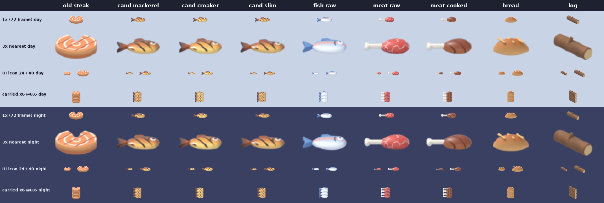

# 기획서: 바다에서 식탁까지 — 갈매기 항구 수산업

2026-11-07 · 대표님 검토용이에요. 아직 아무것도 만들지 않았어요.

- 만드는 사람용 계획은 `roadmap_mayor/fishery_addendum.md`, 로드맵 두 문서를 고칠 곳은 `roadmap_mayor/fishery_roadmap_patch.md`예요. 로드맵 고치기는 대표님 OK 뒤에 해요.
- 초안을 두 번 검토받고 고쳤어요. 한 번은 "재미있나", 한 번은 "정말 만들 수 있나"를 봤어요. 바뀐 것은 맨 끝 「초안에서 바뀐 것」에 있어요.

대표님이 주신 말씀이에요.
> 「처음 생선 잡으면 생선구이 모습이 아닌 일반 고기 모습이야. 생선구이 모습으로...」
> 「추후에 어선에 여러 가지 생선 추가되는 거지? 제일 큰 어선은 원양어선, 참치 잡는 배... 그럼 커다란 참치가 들어오면 냉동차에 실어서 직판장으로 가서 경매, 경매 후 횟집이나 참치캔 공장으로 이동 후 작업. 경매장은 각종 어류, 갑각류, 두족류 등등 판매. 그것을 잡는 각종 어선과 선장, 배의 선원들 등등」

> **숫자 읽는 법** (로드맵과 같아요)
> - "봇 분"은 시험 봇이 새 게임을 처음부터 놀았을 때의 분이에요. 사람은 1.3–1.5배쯤 더 걸려요.
> - "만드는 날"은 만드는 사람 한 명이 일하는 날 수예요. 달력 날짜가 아니에요. v5.1부터는 ±40%쯤 틀릴 수 있어요.
> - 값, 마릿수, 시각은 모두 **예시**예요. 만들 때 봇으로 다시 맞춰요.

## 한눈에

배가 바다에서 여러 가지 생선과 게, 오징어·문어를 잡아 와요. 큰 참치는 냉동차가 경매장으로 날라요. 경매사가 「낙찰!」을 외치면 생선은 횟집, 참치캔 공장, 수출 배, 이웃 도시 도매상으로 가요. 배마다 선장과 선원이 있고, 모두 마을 주민 창에 보이는 주민이에요.

| 언제 | 무엇 | 만드는 날 |
|---|---|---|
| v4.3 미리보기 a3 (지금) | 생선구이 그림을 통째로 구운 생선으로 바꿔요 | 지금 만드는 중 (날 수 밖) |
| v4.6 읍내 장날 | 맛보기 「바다 친구들」: 읍이 된 뒤 좌대와 마을 배에서 고등어·명태·눈꽃무늬 물고기 모습이 올라오고, 도감에 쪽이 생겨요 | +1–2일 (33–38일 → 34–40일) |
| v5.1 주민의 일생 | 선장·선원·어부 일자리가 주민 창에 보여요 | 지금 범위 안 |
| v6 갈매기 항구 | **수산업 핵심:** 연안 어선과 원양어선, 어종별 경매, 냉동차, 하루 한 번 큰 경매 구경, 횟집, 참치캔 공장, 선장·선원 일자리, 「오늘의 바다」 카드 | +18–21일 (v6 25–35일 → 43–56일) |
| v6.1 바다 식구들 (새 작은 버전) | 오징어잡이 배 (밤 집어등), 조선소에서 배 짓기, 바다 장터, 횟집 메뉴 4가지, 항구 쉬는 날, 대게 주간, 배 타고 따라가기, 바다 미션 | 9–10일 |
| v7 햇살 해변 | 조개 캐기 → 해변 조개구이 | +2–3일 |

- 모두 합쳐 31–36일이에요. 공개 출시 (v4.5)까지는 하루도 늘지 않아요.
- 초안에 있던 마을 냉동차 (v5.2)와 v8의 냉동 창고·금방 「오늘의 생선」은 뺐어요.

## 먼저: 생선구이 그림


- 왼쪽부터 날생선, **구운 생선**, 날고기, 구운 고기예요.
- 화덕에서 나오는 '구운 생선' (둘째)이 동그란 연어 스테이크라서, 옆의 고기 그림과 비슷해 보여요. 말씀하신 게 이 그림이라고 봤어요.
- 통째로 구운 생선 그림으로 바꾸고 있어요 (아래는 고르기 전 후보예요). 미리보기 v4.3.0-a3에서 보여 드려요. 그림만 바뀌고 값과 규칙은 그대로예요.



- 혹시 첫째 그림 (바다에서 막 잡은 파란 생선)을 말씀하신 거면 알려 주세요. 그것도 바로 고칠 수 있어요.
- 앞으로 횟집 메뉴판의 생선구이도 이 새 그림을 써요.

## 큰 그림: 바다에서 식탁까지

```
 연안 어선 · 원양어선 ─▶ 부두 ─▶ 냉동차 (큰 참치) ─▶ 수산물 경매장 = 직판장 (경매사, 「낙찰!」)
                                                           │
             ┌───────────────┬──────────────┬──────────────┴─┐
             ▼               ▼              ▼                ▼
           횟집          참치캔 공장       수출 배       이웃 도시 도매상
    (모둠회, 생선구이)   (통조림 → 수출)   (냉동 참치)    (남는 것 전부)
```

- 하나도 버리지 않아요. 상하는 규칙도 없어요. 냉동차는 "싱싱하게 나른다"는 모습이에요.
- 시장님이 아무것도 안 해도 저절로 돌아가요. 시장님은 배와 가게를 열고, 「오늘의 바다」 카드로 항구를 살펴요.

## 어종: 7가지 + 희귀 1

| 무리 (게임 속 이름) | 이름 | 잡는 배 | 경매 값 (1마리, 예시) | 주로 가는 곳 | 처음 보는 때 |
|---|---|---|---|---|---|
| 생선 | 고등어 | 연안 어선, 마을 좌대·배 | 4 | 도매상, 횟집 (생선구이) | v4.6 (모습만) |
| 생선 | 명태 | 연안 어선, 마을 좌대·배 | 5 | 도매상, 횟집 | v4.6 (모습만) |
| 생선 | 참치 | 원양어선 | 45 | 참치캔 공장, 수출, 횟집 | v6 |
| 생선 | 큰 참치 (참치 그림에 리본) | 원양어선 (한 번에 1–2마리) | 참치의 3배 | 큰 경매의 주인공 | v6 |
| 게·새우 | 대게 | 연안 어선 (통발) | 18 | 횟집, 도매상 | v6 |
| 게·새우 | 새우 | 연안 어선 | 2 | 횟집, 도매상 | v6 |
| 오징어·문어 | 오징어 | 연안 어선 (조금), v6.1 오징어잡이 배 | 5 | 횟집, 도매상 | v6 |
| 오징어·문어 | 문어 | 연안 어선 (통발) | 14 | 횟집, 도매상 | v6 |
| 희귀 | 눈꽃무늬 물고기 | 원양어선 (아주 가끔), 마을 좌대 (아주 가끔, 모습만) | 팔지 않아요 | 도감, v7 아쿠아리움 | v4.6 |
| 조개 | 가리비, 바지락 | 해변 조개 캐기 | 2–3 | 해변 조개구이 | v7 |

- 게임 안에서는 '갑각류', '두족류' 대신 **「게·새우」, 「오징어·문어」**라고 불러요.
- 어종은 **항구 경매 안에서만** 나눠요. 마을 물건 (생선, 구운 생선, 참치, 통조림)은 그대로라서 지금 마을이 바뀌지 않아요.
- 지금 '생선' 그림이 이미 고등어처럼 생겼어요. 그래서 고등어는 그 그림을 그대로 써요.
- 대구, 꽃게, 연어는 뺐어요. 작은 그림에서 명태, 대게, 예전 연어 스테이크와 헷갈려요.
- **그림 규칙:**
  - 어종마다 모양 (윤곽)이 달라요. 색만 다르면 흑백이나 색약인 분에게 똑같아 보여서, 흑백으로도 구별되는지 확인해요.
  - 작은 칸 (손가락 한 마디보다 작은 아이콘)에서는 무리 상자 그림 3가지 (생선 / 게·새우 / 오징어·문어)를 써요. 한 마리 그림은 도감, 경매 카드, 메뉴판처럼 큰 칸에서만 보여요.
  - 새 생선구이 그림과 같은 그림체로 그려요.
- **오늘의 생선:** 날마다 한 가지가 인기라서 값이 1.3배예요. 경매장 가격판에 써 붙여요.
- 계절은 없어요. 눈꽃마을은 늘 겨울이에요. 대신 **때**가 있어요: 연안 어선은 점심, 참치는 오후 큰 경매, 오징어 배는 v6.1부터 새벽에 들어와요.

## 배

| 배 | 어디서 | 잡는 것 | 나가고 오는 때 | 선장 + 선원 | 몇 척 | 어떻게 생겨요 (값은 예시) | 그림 |
|---|---|---|---|---|---|---|---|
| 나룻배 → 어선 | 마을 보트 창고 | 생선, 참치 조금 | 마을 바다, 하루 여러 번 | 어부 | 1 | 지금 그대로 | 있어요 |
| 연안 어선 | 항구 (v6) | 고등어, 명태, 새우. 통발로 대게·문어, 오징어 조금 | 05시 → 11시 | 1 + 1 | 2 | 첫 배는 경매장을 살리면 선물로 와요. 둘째 배는 선장 바다의 부탁을 들어주면 이웃 항구에서 들어와요 (2,500) | 있어요 (마을 어선) |
| 원양어선 (참치선) | 항구 (v6) | 참치, 큰 참치 가끔, 희귀 물고기 아주 가끔 | 05시 → 15:50 | 1 + 2 | 3까지 | 큰 조선소 (항구 마지막 단계)에서 만들어요 (15,000 + 판자 60 + 주괴 30) | 있어요 |
| 오징어잡이 배 | 항구 (v6.1) | 오징어 | 19시 → 다음 날 새벽 4:30 | 1 + 2 | 1 | 조선소 미끄럼틀에서 만들어요 | 어선 몸통 + 전구 줄. 불빛은 코드로 그려요 |

- **통발 배는 따로 만들지 않아요.** 연안 어선이 통발도 싣고 나가서 게와 문어를 잡아요. 폰 화면에서 두 배가 거의 똑같아 보이고, 따로 그리면 그림 메모리가 모자라요.
- '새우잡이 배'라는 이름은 쓰지 않아요. 좋지 않은 뜻으로도 쓰이는 말이에요. 새우는 연안 어선이 잡아요.
- 배는 한 척씩 따로 사서 선단을 꾸려요. 항구에 묶어 둔 배는 싼 폰에서도 늘 화면에 보여요. 산 배가 안 보이는 일은 없어요.
- 원양어선도 저녁이면 꼭 돌아와요. 15:50에 선원 가족들이 부두에서 손을 흔들어요.

## 냉동차

- **언제:** 첫 원양어선이 올 때 냉동차 1대가 선물로 따라와요 (v6, 항구 6단계).
- **하루 두 번 달려요:**
  1. 15:50 원양어선이 서쪽 부두에 닿으면 선원들이 참치를 실어요. 냉동차가 바닷가 큰길을 따라 경매장 뒷문으로 가요. 문이 열리면 하얀 김이 나오고, 큰 참치가 수레에 실려 나와요. 대표님 말씀 그대로의 장면이에요.
  2. 17:00 큰 경매가 끝나면 횟집 → 참치캔 공장 → 수출 부두 (크레인) 차례로 들러요.
- 연안 어선 상자는 바로 앞이 경매장이라 선원이 손수레로 날라요.
- **모습:** 하얀 냉동 탑차에 눈꽃 무늬예요. 글자는 없어요.
- **기사님:** 냉동차 기사도 일자리가 있는 주민이에요.
- **함께하기:** 촌장님 트럭으로 마을 생선 30마리를 경매장에 가져가는 미션 「경매장에 싱싱한 생선 배달」이 있어요. [보내기]로 기사님을 보내도 똑같아요.

## 큰 경매 (경매사)

**추천 ★: 저절로 팔고, 하루 한 번 큰 참치 한 마리를 10초 동안 구경해요.**

- 경매는 하루 7번이에요: 작은 경매 6번 (8, 10, 12, 14, 16, 18시)과 큰 경매 1번 (16시 45분).
- 작은 경매는 조용히 저절로 팔려요. 그 자리가 화면에 보일 때만 「낙찰!」이 떠요.
- 경매장 바닥에는 무리 상자 (생선 / 게·새우 / 오징어·문어)와 큰 참치가 얼음 위에 놓여 있어요. 가격판에 그날 값과 「오늘의 생선」이 써 있어요.

**큰 경매 10초 구경** (원양어선이 생긴 뒤 매일)
1. 「땡!」 큰 종이 울려요. 항구를 보고 계시면 「큰 경매가 열려요! [보러 가기]」 칩이 떠요. 다른 동네에 계시면 칩 없이 소식 한 줄만 남아요. 화면이 멀리 뛰지 않아요.
2. 오늘의 주인공 한 마리: 큰 참치가 얼음 위에서 리본을 달고 귀여운 저울에 올라가요. 「182kg · 이번 주 최고!」 「바다 선장이 잡았어요」. 품평회처럼요.
3. 쿡 (횟집), 공장장 (참치캔 공장), 이웃 도시 도매상이 번호판을 들어요.
4. 값은 코인 그림과 숫자로 3–4번 올라가요: 110 → 125 → 140.
5. 「낙찰!」 산 사람이 기뻐해요. 마을이 받은 코인이 뜨고, 그 밑에 작게 「선원 몫 34」가 떠요. 횟집이 사면 횟집 판에 「오늘의 참치회 있어요!」가 뜨고 냉동차가 출발해요.
6. 2초 동안 정리: 「오늘 큰 경매: 참치 130마리, 큰 참치 3마리 · 마을 +2,800」 (공장과 횟집으로 간 것은 빼고, 선원 몫을 나눈 뒤의 코인이에요).

- 10초를 넘지 않아요. 누르면 건너뛰어요. 안 봐도 결과는 같아요.
- 놓치셨으면 소식 한 줄의 [다시 보기]로 다시 봐요.
- 꼬리를 자르거나 칼을 대는 장면은 없어요. 참치는 통째로 얼음 위에 누워 있어요.
- 경매장을 처음 살리는 날 (항구 2단계)에는 「첫 경매」 잔치를 한 번 해요. 매일 하는 구경은 원양어선이 생긴 뒤부터예요. 상자 몇 개로는 구경거리가 안 되거든요.
- **함께하기 (하고 싶을 때만):** 촌장님이 경매사 옆에서 [땡!]을 눌러요. 값은 똑같아요. 경매사의 고맙다는 말과 하트, 추억 한 줄을 받아요.

**왜 이 방식을 추천하나요**
- 매번 손가락으로 경매를 하면 하루 7번이라 금방 귀찮아져요.
- 저절로 팔고 제일 신나는 한 번만 보여 주면, 구경하는 재미와 경영이 다투지 않아요. 안 보는 분도 손해가 없어요.

## 경매가 끝나면: 생선이 가는 곳

| 가는 곳 | 무엇을 | 마을에 생기는 것 | 그다음 |
|---|---|---|---|
| 횟집 (항구 해산물 식당) | 하루치 생선·게·오징어 조금, 큰 참치 1마리 | 관광객이 횟집에서 더 써요 (예시 1.25배, 참치회 날 1.4배). 항구 주민의 먹거리가 채워져요 | 모둠회와 생선구이를 접시에 담아 내요 |
| 참치캔 공장 (항구 창고 안) | 참치. 수출 주문에 필요한 만큼, 하루 40마리까지 | 통조림이 수출되면 참치를 그냥 팔 때보다 더 벌어요 | 참치 1마리 → 통조림 3개. 주괴는 안 들어요 |
| 수출 배 | 냉동 참치 (화물선 주문) | 수출 값 2배 (지금 계획 그대로) | 크레인이 실어요 |
| 이웃 도시 도매상 | 남은 것 전부 | 그날 경매 값 | 언제나 다 사 가요 |

- 횟집과 참치캔 공장은 **우리 마을 가게**예요. 그래서 코인을 내지 않고 가져가요. 대신 그날 잡은 값의 절반까지만 가져가요. 그래서 경매에서 들어오는 코인은 늘 선원 몫보다 많아요.
- 참치캔은 지금의 '통조림'과 같은 물건이에요. 그래서 수출 주문에 바로 들어가요. 마을의 통조림 공장은 지금 그대로예요.
- 회는 접시 위에 예쁘게 담긴 모습만 보여요. 자르는 장면은 없어요. 횟집 수족관 창의 게는 그림으로만 있고, 글이나 말로 가리키지 않아요.

## 항구의 하루 (v6 예시)

연안 어선 2척, 원양어선 2척, 횟집과 공장이 있을 때예요. 게임 속 하루는 진짜 시간 10분이에요.

| 시각 | 무슨 일 | 보이는 것 |
|---|---|---|
| 05:00 | 연안 어선 2척과 원양어선 2척이 나가요 | 갈매기가 따라가요 |
| 08:00, 10:00 | 작은 경매 (조용히) | 촌장님이 가져온 생선, 전날 남은 상자 |
| 11:00 | 연안 어선이 돌아와요 | 고등어·명태·새우 상자, 대게·오징어·문어 조금 |
| 12:00 | 작은 경매 | 횟집이 하루치를 먼저 가져가고, 나머지는 도매상이 사 가요 |
| 14:30 | 원양어선이 먼 바다에서 그물을 올려요 | 소식 한 줄 |
| 15:50 | 원양어선이 돌아와요 | 선원 가족이 손을 흔들어요. 냉동차가 참치를 싣고 경매장 뒷문으로 가요 |
| 16:30 | 경매장 뒷문 | 문이 열리고 하얀 김, 큰 참치가 수레에 실려 나와요 |
| **16:45** | **큰 경매 (큰 종)** | **10초 구경: 오늘의 큰 참치** |
| 17:00 | 냉동차가 횟집 → 참치캔 공장 → 수출 부두 | 횟집 판에 「오늘의 참치회 있어요!」, 공장 굴뚝에 김이 퐁퐁 |
| 18:00 | 마지막 작은 경매, 횟집 저녁 장사 | 관광객과 주민이 모둠회, 생선구이를 먹어요 |

- 하루의 큰 장면은 **오후 큰 경매** 하나예요. 작은 일들은 조용히 지나가요.
- v6.1에는 큰 장면이 둘 더 생겨요: **새벽 오징어 배 귀항** (04:30, 집어등이 하나씩 꺼져요)과 **밤 집어등 출항** (19:00, 등대 불빛과 함께).

## 시장님이 하는 일

| 시장님이 정해요 | 저절로 돼요 |
|---|---|
| 배를 언제, 몇 척 들일지 | 배가 시간표대로 나가고 돌아와요 |
| 횟집을 열지 | 선원이 상자를 내리고, 냉동차가 날라요 |
| (v6.1) 일주일에 하루 「항구 쉬는 날」 | 종이 울리면 경매가 열리고, 사는 곳이 가져가요 |
| 수출 주문 받기 (지금 계획 그대로) | 횟집이 장사하고, 공장이 통조림을 만들어요 |
| | 일자리가 주민으로 채워지고 선원 몫이 나가요 |

- **「오늘의 바다」 카드:** 경매장이나 항구 알림을 누르면 떠요. 폰 한 화면에 다 들어가요.
  - 나간 배와 쉬는 배
  - 오늘 잡은 것: 무리 상자 3개와 숫자
  - 오늘 최고 낙찰
  - 큰 경매까지 남은 시간
  - 항구 주민 수, 채워진 일자리, 먹거리가 넉넉한 주민
- **주민 부탁으로 열어요** (v4.5 부탁 그대로):
  - 선장 바다: 「배가 한 척 더 있으면 대게도 잡아 올게요」 → 연안 어선 둘째 배
  - 쿡: 「항구에 횟집을 열고 싶어요. 메뉴는 제가 짤게요」 → 횟집
  - 선장 바다: 「큰 배가 있으면 참치를 잡아 올게요」 → 원양어선
  - 부탁을 들어주면 바로 짓기 카드가 떠요. 부탁을 안 보셔도 지도에서 똑같이 지을 수 있어요.
- **시장님의 성적표**는 코인만이 아니에요. 항구 주민 수, 채워진 일자리, 먹거리가 넉넉한 주민 비율로 보여 줘요.
- 초안의 경매 방침 버튼 (「우리 공장 먼저 / 바로 팔기」)은 뺐어요. 늘 한쪽이 나아서 고르는 재미가 없었어요. 대신 v6.1에 진짜 고를 만한 것 하나를 둬요: **「항구 쉬는 날」**. 그날은 배가 쉬고, 선원들이 저녁 잔치에 와서 주민이 더 행복해져요. 그날 잡은 생선은 없지만 잃는 것도 없어요.
- 모두 지도에서 누르기와 [여기서 짓기]로 돼요. 걸어갈 필요가 없어요.

## 사람들: 일자리와 몫

| 일 | 일터 | 몇 명 | 받는 것 | 하는 모습 |
|---|---|---|---|---|
| 선장 | 배마다 | 1 | 선원 몫 | 조타실에서 손 흔들기, 돌아오면 부두에서 인사 |
| 선원 | 배마다 | 연안 어선 1, 원양어선 2 | 선원 몫 | 그물 올리기, 상자 내리기 |
| 경매사 | 경매장 | 1 | 품삯 | 종 치기, 값 부르기, 「낙찰!」 |
| 냉동차 기사 | 경매장 | 1 | 품삯 | 운전, 문 열고 내리기 |
| 공장 직원 | 참치캔 공장 | 2 (공장장 포함) | 품삯 | 통조림 상자 쌓기 |
| 횟집 요리사 | 횟집 | 2 | 품삯 | 접시 내기 |
| 부두 일꾼 | 부두 (지금 계획 그대로) | 4 | 품삯 | 크레인, 상자 나르기 |

- 항구가 다 살아나면 일자리가 23개예요. v6.1에서 27개가 돼요.
- **선원 몫:** 배가 잡아 온 값의 4분의 1이 그 배의 선장·선원 몫이에요. 공장으로 간 참치도 몫이 있어요. 자리가 비어 있거나 배가 쉬면 몫도 없어서, 그만큼 마을 코인도 덜 나가요. 주민 창에는 「오늘 몫 34」처럼 보여요.
- **품삯:** 경매사, 기사, 공장 직원, 요리사, 부두 일꾼은 「돈과 복지」 계획의 동네 가게 판매원과 똑같이 받아요. 주민 이야기 속 돈이라 마을 코인에서 따로 빠지지 않아요. (그 계획이 다르게 정하면 그대로 따라요.)
- **누가 일하나요:** 항구로 이사 온 주민 (지금 계획처럼 최대 20명)과 해안 기차로 출근하는 마을·솔방울 주민이에요. 지금 계획의 항구 어부 6자리는 배가 생기면 선원 자리로 바뀌어요.
- **마을 주민 창 (v4.3 a3):** 일터 「원양어선 1호」, 「오늘 몫」, 지금 하는 일 「그물 올리는 중」이 보여요. [따라가기]를 누르면 항구 입구까지 따라가고, 「바다로 나갔어요. 15:50에 돌아와요」 카드가 떠요. 배를 타고 바다까지 따라가는 건 v6.1이에요.
- **선장 바다** (지금 있는 주민, 큰 물고기와 뱃노래를 좋아해요)가 원양어선 1호 선장이 돼요. 쿡과는 원래 「생선 거래처」 사이예요. 그래서 「바다 선장이 잡은 큰 참치를 쿡이 낙찰받는 날」 같은 이야기 장면이 생겨요.
- 배 위의 선장과 선원은 배 그림 안에 그려져 있어요. 주민이 부두에서 배에 오르면 그 그림이 그 주민이에요.
- 새 옷 조각: 선원 모자, 줄무늬 셔츠, 구명조끼, 선장 모자, 고무 앞치마.

## 돈의 흐름 · 주간 보고서에 보태는 줄

돈의 흐름 창과 주간 보고서는 따로 쓰고 있는 「돈과 복지」 계획이 정해요. 같은 걸 두 군데서 정하지 않으려고, 수산업은 거기에 줄만 보태요.

| 어디에 | 보태는 줄 |
|---|---|
| 돈의 흐름: 들어온 돈 | 경매 (마을 몫), 통조림 수출, 관광객 (지금 계획 그대로. 횟집이 있으면 늘어요) |
| 돈의 흐름: 나간 돈 | 선원 몫 (주민에게 나눈 돈), 배 들이기와 횟집 열기 (한 번씩) |
| 주간 보고서 (게임 속 7일) | 이번 주 잡은 것 (생선 / 게·새우 / 오징어·문어 상자 수), 최고 낙찰 (예: 「큰 참치 140, 횟집」), 새 일자리, 이번 주 바다 친구 (희귀 물고기), 수출한 통조림 |

- 횟집과 공장은 마을 가게라서 월세는 없어요.
- 마을과 읍내의 생선 가게는 그 계획의 「동네 장터」가 맡아요. 항구의 가판대는 v6.1의 「바다 장터」예요. 「시장」이라는 말은 시장님 호칭과 헷갈려서 가게 이름에 쓰지 않아요.

## 꼭 지키는 약속

- 생선은 버려지거나 상하지 않아요. 안 팔리는 생선은 없어요.
- 벌칙이 없어요. 배가 쉬어도 아무것도 잃지 않아요.
- 무섭거나 아픈 장면이 없어요. 회는 접시 위 모습만, 참치는 통째로 얼음 위에 누워 있어요. 꼬리 자르기나 칼은 없어요.
- 배는 저녁마다 집에 돌아와요.
- 촌장님 없이도 다 돌아가요. 함께하기는 마음 보상 (하트, 편지, 추억)만 줘요.
- 싼 폰에서도 부드럽게: 큰 배 6척, 움직이는 작은 배 2척, 사람 24명까지만 그려요. 따라가는 주민은 늘 그려요.

## 언제 무엇이 오나요

| 버전 | 무엇 | 만드는 날 |
|---|---|---|
| v4.3 a3 (지금) | 생선구이 그림 | 만드는 중 (날 수 밖) |
| v4.6 읍내 장날 | 「바다 친구들」: 읍이 된 뒤 좌대와 마을 배에서 고등어·명태·눈꽃무늬 물고기 모습이 올라와요. 물건과 값은 지금처럼 '생선' 하나예요. 처음 잡으면 도감 카드가 생기고, 고용한 어부가 잡아도 채워져요 | +1–2일 (33–38 → 34–40) |
| v5.1 주민의 일생 | 선장 바다와 어부들이 '선장', '선원', '어부' 일자리로 주민 창에 보여요 (일터: 보트 창고, 낚시 좌대) | 범위 안 |
| v6 갈매기 항구 | 핵심 흐름: 연안 어선 2척 (항구에 이미 있는 마을 배 두 척), 원양어선, 어종별 경매, 냉동차, 큰 경매 구경, 횟집, 참치캔 공장, 선장·선원·경매사·기사 일자리와 선원 몫, 「오늘의 바다」 카드, 주민 부탁으로 열기 | +18–21일 (25–35 → 43–56) |
| v6.1 바다 식구들 | 오징어잡이 배 (밤 집어등), 조선소 미끄럼틀에서 배 짓기, 바다 장터 (가판대 하나), 횟집 메뉴 4가지 (모둠회, 생선구이, 대게찜, 해물탕), 「항구 쉬는 날」, 「대게 주간」, 배 타고 바다까지 따라가기, 바다 미션 4–6개 | 9–10일 |
| v7 햇살 해변 | 조개 캐기 (가리비, 바지락) → 해변 조개구이가 사 가요 | +2–3일 (20–28 → 22–31) |

- **v6가 v4.4만큼 커져요.** 그래서 중간 미리보기를 두 번 드려요: 배·경매·구경이 되면 (≈20일째), 냉동차·횟집·공장·선원이 되면 (≈38일째).
- 늦어지면 부탁으로 열기, 이번 주 최고 기록, 다시 보기, 가족 마중을 v6.1로 넘겨요 (2일쯤 줄어요). 부탁이 없어도 지도에서 똑같이 지을 수 있어요.
- "만드는 날"은 일의 양이에요. 여럿이 동시에 만들어서 달력으로는 훨씬 짧아요 (첫째 걸음은 11일치 일이 2–3일). v6.1을 따로 테스터 판으로 내면 테스트 기간 1–2주가 더해져요.

**모두 합치면 (두 계획을 함께 본 표)**

| | 지금 로드맵 | + 돈과 복지 | + 수산업 | 둘 다 |
|---|---|---|---|---|
| 공개 출시판 (v4.5)까지 | 95–111 | 103–120 | 95–111 | 103–120 |
| 읍장 단계 (v4.4–v4.6) | 109–127 | 117–137 | 110–129 | 119–139 |
| 시장 취임 (v5.0)까지 | 172–202 | 187–220 | 173–204 | 189–222 |
| 안심 마을까지 | 224–272 | 270–326 | 225–274 | 272–328 |
| 항구·해변·도시 (v6–v8) | 75–103 | 75–103 | 104–137 | 104–137 |
| v8까지 | 299–375 | 345–429 | 329–411 | 376–465 |

- 수산업만 따로 더하면 31–36일이에요. 표의 v8까지 칸은 버전마다 반올림해서 30–36일만큼 늘어요.
- 버전은 이름으로 불러 주세요. 「돈과 복지」 계획대로 「돌봄 마을」이 v5.2에 들어가면 탈것의 시대와 안심 마을의 번호가 하나씩 밀려요. 수산업은 그 두 버전을 건드리지 않아서 어느 쪽이든 그대로예요.

**항구에서 열리는 순서**

| 항구 단계 | 수산업에서 열리는 것 |
|---|---|
| 2 수산물 경매장 | 연안 어선 1척 (선물), 어종별 경매, 「첫 경매」 잔치. 그 뒤 선장 바다의 부탁으로 연안 어선 둘째 배 |
| 4 여객선 터미널 | 쿡의 부탁으로 횟집 (관광객이 오니까요) |
| 5 크레인 + 세관 | 냉동 참치 수출 주문 (지금 계획의 주문 그대로) |
| 6 큰 조선소 | 선장 바다의 부탁으로 원양어선, 냉동차, 참치캔 공장, 매일 큰 경매 구경 |

## 그림 메모리와 싼 폰

- **마을 쪽:** 어종 그림은 아주 작아요 (모두 합쳐 0.1 MiB쯤).
- **항구 쪽** (항구 동네만 쓰는 칸 120 MiB):
  - 계획된 배 그림 나누기를 하면 약 100 MiB예요. 이걸 꼭 먼저 해요.
  - 마을 어선 그림 7.8 MiB: 항구에 이미 그려지는데 아직 안 세었어요. 둘째 자리에 있던 나룻배는 빼고 어선 그림 하나로 두 척을 그려요.
  - 냉동차 5–6.5 MiB, 소품과 옷 조각 1–2.5 MiB.
  - 합쳐 114–117 MiB라서 120 안에 들어가요. 남는 건 3–6 MiB쯤이에요.
- 냉동차는 항구 안에서만 달려요. 그래서 그림 메모리가 꽉 찬 역 동네 (455 중 453쯤)에는 들어가지 않아요.
- **덤으로 아끼기:** 지금 마을은 배를 안 사도 두 배 그림 (11.7 MiB)을 늘 들고 있어요. 안 산 배의 그림은 내려서 최소 3.9 MiB, 동쪽 바닷가에서 멀리 있을 때는 11.7 MiB까지 아껴요. v4.4 그림 정리 때 같이 하기를 추천해요.
- **싼 폰:** 배를 새로 들일 때 항구 하루 시간표를 한꺼번에 다시 짜지 않고 조금씩 나눠서 해요. 순간 버벅임을 막아요.

## 초안에서 바뀐 것

- 어종: 10가지 → **7가지 + 희귀 1**. 대구·꽃게·연어는 빼고, 희귀 물고기는 「눈꽃무늬 물고기」로 바꿨어요.
- **마을 냉동차 (v5.2)를 뺐어요 (−3일).** 마을에는 경매장이 없고 짐꾼이 이미 생선을 날라서, 냉동차가 할 일이 없었어요.
- v8의 냉동 창고와 금방 「오늘의 생선」을 뺐어요. 대표님이 부탁하신 게 아니었어요.
- 통발 배는 연안 어선에 합쳤어요. 작은 배는 새 부두 없이 항구에 이미 있는 두 자리를 써요.
- 큰 경매 구경: 세 마리 → 한 마리, 값은 숫자로, 다시 보기, 칩은 항구에 있을 때만. 매일 구경은 원양어선이 생긴 뒤부터예요.
- 경매 방침 버튼을 빼고, 「오늘의 바다」 카드와 주민 부탁으로 열기를 넣었어요.
- 돈: 선원 몫은 공장으로 간 참치에도 있어요. 공장에 주괴가 안 들어요. 횟집과 공장은 그날 값의 절반까지만 가져가요. 「낙찰!」에 뜨는 숫자는 마을이 실제로 받은 코인이에요.
- v4.6 「바다 친구들」은 생선만 보여요. 오징어가 화덕에서 생선구이가 되는 이상한 그림을 막으려고요.
- v6 날 수: 할 일은 줄였지만, 하나하나 다시 재 보니 +18–21일이에요 (초안 +16–19일).
- 「수산 시장 가판대」 → 「바다 장터」 (v6.1).
- 말투: 「사슬」 → 「흐름」, 「하이라이트」 → 「큰 경매 구경」, 「하루 월급」 → 「오늘 몫」, 「품삯」.

## 대표님이 정해 주실 것 (수산 1–6)

각 질문 아래 줄이 제 추천과 까닭이에요 (★가 추천). "추천대로"라고 하시면 그대로 만들어요. 로드맵 질문 1–24, 「돈과 복지」 질문 25–41과 헷갈리지 않게 '수산'을 붙였어요.

1. **어종은 어떻게 넣을까요?**
   - (A) ★ 항구 경매 안에서만 7가지 + 희귀 1을 나눠요. 마을 물건은 그대로예요. 마을이 바뀌지 않고 저장도 거의 안 커져요.
   - (B) 마을 물건 목록에도 어종을 하나하나 넣어요. 어종마다 20곳 넘게 고쳐야 하고, 저장이 커지고, 마을 값도 다시 맞춰야 해요.
2. **경매는 어떻게 보여 줄까요?**
   - (A) ★ 저절로 팔고, 하루 한 번 큰 참치 한 마리를 10초 구경해요. 함께하기는 [땡!].
   - (B) 경매마다 손가락으로 값을 불러요. 하루 7번이라 금방 귀찮아져요.
   - (C) 그림 없이 소식 한 줄만 남겨요.
3. **시장님은 무엇으로 항구를 경영할까요?**
   - (A) ★ 주민 부탁으로 배와 가게를 열고, 「오늘의 바다」 카드로 살펴요. 고를 거리는 v6.1의 「항구 쉬는 날」 하나예요.
   - (B) 초안의 경매 방침 버튼 (우리 공장 먼저 / 바로 팔기). 늘 한쪽이 나아서 추천하지 않아요.
4. **선장과 선원은 무엇을 받을까요?**
   - (A) ★ 배가 잡은 값의 4분의 1을 선원 몫으로 나눠요. 마을 코인에서 나가고 돈의 흐름에 보여요. 다른 항구 일자리는 주민 이야기 속 품삯이에요.
   - (B) 모두 주민 이야기 속 돈이에요. 쉽지만 돈의 흐름에 안 보여요.
   - (C) 마을이 모든 항구 일꾼에게 날마다 품삯을 줘요. 새 지출이라 돈이 모자라는 날이 생길 수 있어요.
5. **버전은 어떻게 나눌까요?**
   - (A) ★ v6에 핵심 흐름을 넣고 (43–56일, 중간 미리보기 두 번), 더 많은 배와 놀거리는 v6.1 「바다 식구들」 (9–10일)로 해요.
   - (B) v6는 원래 계획에 어종별 경매만 더해요 (+4–5일, v6 29–40일). 냉동차·횟집·공장·선원은 v6.1로 가요. v6가 빨리 나오지만, "냉동차로 경매장" 장면은 v6.1에 와요.
6. **v4.6 맛보기 「바다 친구들」을 넣을까요?**
   - (A) ★ 네. 생선만 3가지 모습과 도감 쪽이에요 (+1–2일). "여러 생선이 생기나요?"에 일찍 답해 드려요. v4.6이 늦어지면 가장 먼저 빼요.
   - (B) 빼고 v6에서 한꺼번에 보여 드려요.

**나머지는 추천대로 할게요.** 바꾸고 싶으시면 번호만 말씀해 주세요.
- 수산 7. 생선구이 그림을 통째로 구운 생선으로 바꿔요 (a3).
- 수산 8. 냉동차 길: 서쪽 부두 → 경매장 뒷문, 경매 뒤 횟집 → 참치캔 공장 → 수출 부두. 마을 냉동차 (v5.2)는 빼요.
- 수산 9. 참치캔 공장은 항구 창고 안에 참치캔 줄과 「참치캔」 간판을 달아요 (새 건물 없음). 물건은 지금의 '통조림'이에요.
- 수산 10. 횟집은 항구 해산물 식당이에요. v6는 모둠회와 생선구이, 메뉴 4가지는 v6.1이에요.
- 수산 11. 배는 한 척씩 따로 사서 선단을 꾸려요. 연안 어선 2척, 원양어선 3척까지예요.
- 수산 12. 통발 배는 연안 어선에 합치고, 오징어잡이 배는 v6.1이에요.
- 수산 13. 조개는 v7 조개 캐기로, 희귀 물고기 「눈꽃무늬 물고기」는 팔지 않고 도감과 아쿠아리움으로 가요.
- 수산 14. 이름: 「바다 장터」, 「대게 주간」, 게임 안에서는 「게·새우」, 「오징어·문어」.

## 부록

- 만드는 사람용 계획: `roadmap_mayor/fishery_addendum.md`
- 로드맵 고칠 곳: `roadmap_mayor/fishery_roadmap_patch.md` (대표님 OK 뒤에 적용)
- 그림: `previews/fishery/grilledfish_before.png` (지금), `previews/fishery/grilledfish_candidates.png` (후보, 고르기 전)
- 이 기획서를 받아 주시면 `docs/기획서_수산업.md`로 옮기고, 그림은 `docs/previews/fishery/`로 옮겨요.
- 함께 보는 문서: `docs/기획서_v6_항구도시.md`, `docs/기획서_시장취임_로드맵.md`, 「돈과 복지」 계획 (`../econ_welfare/`)
